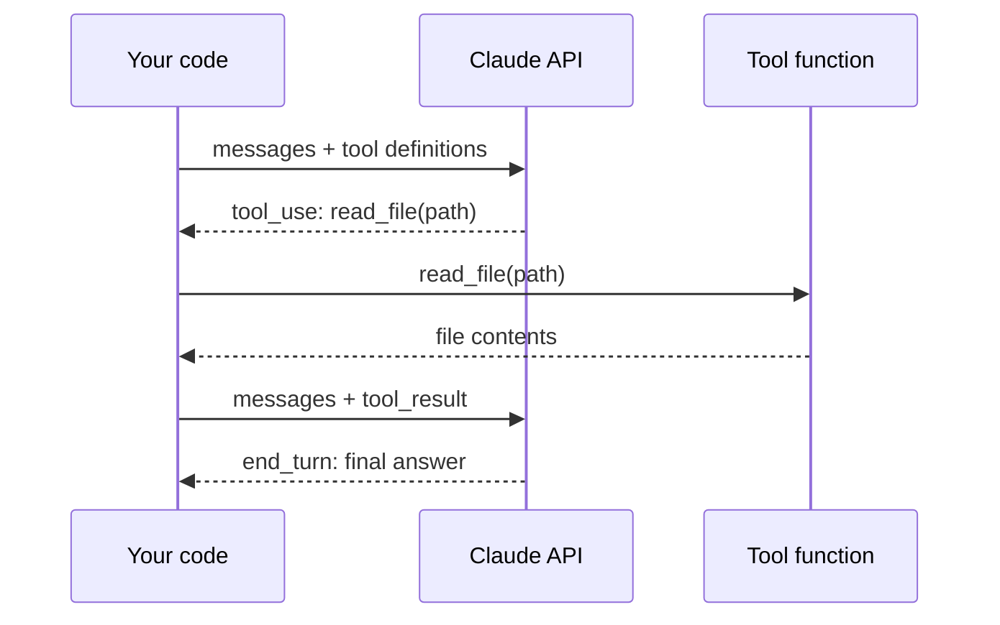

# Lab 1: Your First Agent Loop

## What You'll Learn

- How a model asks for a tool, and how your code runs it and sends the result back
- Why the loop, not the model, decides when an agent stops
- How to read `stop_reason` and why it matters for every call
- What the SDK's tool runner does for you, and what it hides

You need the lab set up and `./incident` generated. See [Set Up the Lab](index.md#set-up-the-lab).

## Mental Model

A model can't run code. It can only produce text, and one kind of text is a **tool call**: a structured request such as "call `read_file` with `path=logs/checkout.log`". Your program runs the tool, sends back the output as a **tool result**, and asks the model again. An agent is this exchange in a loop.



Three facts drive everything else in these labs:

1. **The API is stateless.** Each call sends the whole conversation so far, including every earlier tool call and result.
2. **The model chooses the tool and its arguments.** Your code chooses whether to run it.
3. **`stop_reason` tells you what happened.** `tool_use` means "run my tool calls and call me again". Anything else means the turn is over.

## Step 1: Write the Agent

Save this as `first_agent.py`:

```python title="first_agent.py"
"""Lab 1: the smallest useful agent loop."""

from pathlib import Path

import anthropic

client = anthropic.Anthropic()
MODEL = "claude-opus-5-5"
WORKSPACE = Path("incident").resolve()


def list_files() -> str:
    return "\n".join(str(p.relative_to(WORKSPACE)) for p in sorted(WORKSPACE.rglob("*")) if p.is_file())


def read_file(path: str) -> str:
    target = (WORKSPACE / path).resolve()
    if not target.is_relative_to(WORKSPACE):
        return "error: that path is outside the incident workspace"
    return target.read_text()


TOOLS = [
    {
        "name": "list_files",
        "description": "List every file in the incident workspace.",
        "input_schema": {"type": "object", "properties": {}},
    },
    {
        "name": "read_file",
        "description": "Read one file from the incident workspace.",
        "input_schema": {
            "type": "object",
            "properties": {"path": {"type": "string", "description": "Path relative to the workspace"}},
            "required": ["path"],
        },
    },
]


def execute(name: str, args: dict) -> str:
    if name == "list_files":
        return list_files()
    if name == "read_file":
        return read_file(args["path"])
    return f"error: unknown tool {name}"


messages = [{"role": "user", "content": "Look through the incident workspace and tell me why the checkout alert fired."}]

for step in range(1, 11):  # never loop forever
    response = client.messages.create(model=MODEL, max_tokens=16000, tools=TOOLS, messages=messages)
    messages.append({"role": "assistant", "content": response.content})

    if response.stop_reason != "tool_use":
        break

    results = []
    for block in response.content:
        if block.type == "tool_use":
            print(f"[step {step}] {block.name}({block.input})")
            output = execute(block.name, block.input)
            results.append({"type": "tool_result", "tool_use_id": block.id, "content": output})
    messages.append({"role": "user", "content": results})

print(f"\nstop_reason={response.stop_reason}\n")
print("".join(block.text for block in response.content if block.type == "text"))
```

The parts that matter:

| Part | What it does |
|---|---|
| `TOOLS` | Name, description, and JSON Schema for each tool. The model only sees these, never your Python code. |
| `messages.append({"role": "assistant", ...})` | Adds the model's turn, including its tool calls, to the history. Append the full `response.content`, not just the text. |
| `tool_use_id` | Links each result to the call that asked for it. A result with an unknown ID is rejected. |
| `for step in range(1, 11)` | A hard limit. Without it, a confused model can call tools until your budget runs out. |
| `response.stop_reason` | `tool_use` continues the loop. `end_turn` means the answer is ready. |

## Step 2: Run It

```bash
python first_agent.py
```

Your run will differ, because the model picks its own path. A typical run looks like this:

```text
[step 1] list_files({})
[step 2] read_file({'path': 'ALERT.txt'})
[step 2] read_file({'path': 'logs/checkout.log'})
[step 3] read_file({'path': 'deploys.json'})
[step 3] read_file({'path': 'config/checkout.env'})

stop_reason=end_turn

The alert fired because checkout requests started failing with 503s at 14:04,
right after version 2.14.0 was deployed at 14:02. That deploy reduced
DB_POOL_SIZE from 20 to 5 (deploys.json, config/checkout.env). The log shows
every connection in use (in_use=5 size=5) and requests timing out after 5000 ms
waiting for one...
```

Two things to notice:

- **Several calls in one step.** In step 2 the model asked for two files at once. Your loop ran both and returned both results in **one** user message. Splitting them into separate messages works, but teaches the model to stop making parallel calls.
- **The model planned its own path.** Nobody told it to check `deploys.json`. It read the alert, saw a time, and went looking for what changed at that time. That judgment is what you're paying for, and it's also why runs differ.

## Step 3: Look at What Was Sent

Add this line after the loop and run again:

```python
print(sum(len(str(m["content"])) for m in messages), "characters of history")
```

Every step resends all of it. A 5-step investigation that reads a 1 MB log file pays for that megabyte on every later step. Lab 2 caps tool output for this reason.

## Step 4: Break It on Purpose

Each change below takes one line. Run each one and watch what happens.

1. **Ask for a file that doesn't exist.** Change the task to `"Call read_file on logs/payments.log and summarize it."` When the model makes that call, `read_text()` raises `FileNotFoundError` and the whole program crashes. The model never gets the chance to recover.
2. **Drop the step limit.** Change `range(1, 11)` to `range(1, 2)`. The agent stops after one tool call with `stop_reason=tool_use` and no answer. Your code must handle "ran out of steps" as a separate outcome, not as an empty answer.
3. **Remove the path check.** Delete the `is_relative_to` check and ask: `"Read ../first_agent.py."` The model reads your source code. With a real tool, that would be any file your process can read.

All three show the same lesson: the model is fine, but the code around it isn't ready. Lab 2 fixes each one.

## The Same Agent With the Tool Runner

The Anthropic SDK includes a **tool runner** that writes this loop for you. Tools are typed Python functions. The SDK builds the JSON Schema from the signature and docstring:

```python title="runner_agent.py"
"""Lab 1, part 2: the same agent with the SDK's tool runner."""

from pathlib import Path

import anthropic
from anthropic import beta_tool

client = anthropic.Anthropic()
WORKSPACE = Path("incident").resolve()


@beta_tool
def list_files() -> str:
    """List every file in the incident workspace."""
    return "\n".join(str(p.relative_to(WORKSPACE)) for p in sorted(WORKSPACE.rglob("*")) if p.is_file())


@beta_tool
def read_file(path: str) -> str:
    """Read one file from the incident workspace.

    Args:
        path: Path relative to the workspace.
    """
    target = (WORKSPACE / path).resolve()
    if not target.is_relative_to(WORKSPACE):
        return "error: that path is outside the incident workspace"
    return target.read_text()


runner = client.beta.messages.tool_runner(
    model="claude-opus-5-5",
    max_tokens=16000,
    max_iterations=10,
    tools=[list_files, read_file],
    messages=[{"role": "user", "content": "Look through the incident workspace and tell me why the checkout alert fired."}],
)
for message in runner:  # one message per model turn; the runner calls the tools in between
    for block in message.content:
        if block.type == "tool_use":
            print(f"{block.name}({block.input})")

final = runner.until_done()
print("".join(block.text for block in final.content if block.type == "text"))
```

The runner is shorter and is the right default for production code. Build the manual loop at least once anyway, for three reasons:

- When an agent misbehaves, you debug the loop: what was sent, what came back, in which order.
- Approval gates, budgets, memory, and tracing (Labs 2 to 7) are easier to see in a loop you wrote.
- Every agent framework is this loop with extras. Once you've written it, you can read any of them. [Lab 11](11-langchain-agent.md) rebuilds this agent in LangChain to prove it.

!!! tip "What the runner sends"
    In SDK 2.x the tool runner keeps the conversation as a server-side thread (the `message-threads` beta) and sends only the new tool results each turn. If you log requests, you won't see the full history in each one.

## What Most Engineers Miss

- **The tool description is a prompt.** The model decides when to call a tool from its name and description alone. "Read one file" and "Read one file. Prefer search_files for logs over 1,000 lines" produce different agents.
- **`end_turn` doesn't mean success.** It means the model stopped talking. An agent can end its turn with "I couldn't find the cause" or with a confident wrong answer. Lab 7 measures which.
- **The history is the agent's only memory.** If you trim or rewrite earlier messages to save tokens, the model loses what it learned in those steps.

!!! quiz "Parallel tool calls"
    The model returns one response with three `tool_use` blocks. What should your code send back?

    - [ ] Three user messages, one `tool_result` each, in the order the calls finished
    - [x] One user message with three `tool_result` blocks, each with the matching `tool_use_id`
    - [ ] Only the result of the first call, then let the model ask again

    All results for one assistant turn go in a single user message. Order doesn't matter because `tool_use_id` links each result to its call.

!!! quiz "Reading stop_reason"
    Your loop ends and `stop_reason` is `max_tokens`. What happened?

    - [ ] The model finished its answer
    - [x] The response was cut off at the `max_tokens` limit, so the answer may be incomplete
    - [ ] The agent hit your step limit

    `max_tokens` is the per-response output cap. Your step limit is your own code and never shows up in `stop_reason`.

## Common Mistakes

- Appending only the text of the model's response to `messages`, which drops the `tool_use` blocks and makes the next request fail.
- Sending tool results with a `tool_use_id` that doesn't match, or skipping a result for a call that failed. Every call needs a result, even if it's an error.
- Treating the loop's exit as success without checking `stop_reason`.
- Letting a tool raise an exception that kills the whole agent instead of returning the error to the model.
- Writing one-word tool descriptions and then blaming the model for picking the wrong tool.

## Interview Questions

- Walk through one iteration of an agent loop. What does your code send, and what comes back?
- Why must each tool result carry a `tool_use_id`?
- The API is stateless. What does that cost an agent that takes 20 steps, and how would you reduce it?
- When would you write the loop yourself instead of using a framework or the SDK's tool runner?

## Next

Continue to [Lab 2: Tools and Guardrails](02-tools-and-guardrails.md).
