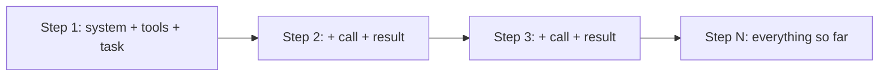

# Lab 3: Tokens, Context, Temperature, and Memory

## What You'll Learn

- How to count tokens before you send a request, and what uses them up
- What temperature does to sampling, and why `temperature=0` now returns an error on Claude
- How the context window fills up in an agent loop, and the safe ways to shrink it
- The difference between short-term memory (the conversation) and long-term memory (what survives the run)

[LLM Fundamentals](../llm-fundamentals.md) covers the theory. This lab measures it on the agent from Lab 2.

## Part 1: Count Tokens

A **token** is the unit a model reads and writes: a common word, part of a rarer word, or a few symbols. You pay per token, rate limits count tokens, and the context window is measured in tokens. Count them; don't estimate them from characters.

Save this as `count_tokens.py`:

```python title="count_tokens.py"
"""Lab 3: measure what the agent sends before you send it."""

import anthropic

from agent import MODEL, SYSTEM
from tools import TOOLS, WORKSPACE

client = anthropic.Anthropic()


def count(messages, tools=None, system=None):
    kwargs = {"model": MODEL, "messages": messages}
    if tools:
        kwargs["tools"] = tools
    if system:
        kwargs["system"] = system
    return client.messages.count_tokens(**kwargs).input_tokens


hello = [{"role": "user", "content": "hi"}]
print(f"{'the word hi':<36}{count(hello):>8,}")
print(f"{'hi + system prompt':<36}{count(hello, system=SYSTEM):>8,}")
print(f"{'hi + system prompt + tool schemas':<36}{count(hello, TOOLS, SYSTEM):>8,}")
print()

for path in sorted(p for p in WORKSPACE.rglob("*") if p.is_file()):
    text = path.read_text()
    tokens = count([{"role": "user", "content": text}])
    print(f"{str(path.relative_to(WORKSPACE)):<36}{tokens:>8,}   {len(text) / tokens:.1f} characters per token")

model = client.models.retrieve(MODEL)
print(f"\n{MODEL}: {model.max_input_tokens:,} input tokens, {model.max_tokens:,} output tokens")
```

```bash
python count_tokens.py
```

`count_tokens` is a free API call that returns the exact input token count for a request, including the system prompt and tool definitions. Read three things in the output:

- **Tool schemas cost tokens on every request.** Four tools add several hundred tokens to each call, before any work. An agent with 40 tools pays for all 40 schemas on every step.
- **Characters per token varies by content.** Plain English packs more characters into each token than JSON, timestamps, or config files. That's why "divide by 4" estimates are wrong for logs.
- **The model reports its own limits.** `models.retrieve()` returns the context window (`max_input_tokens`) and output cap (`max_tokens`), so your code doesn't have to hard-code them.

!!! warning "Don't count Claude tokens with tiktoken"
    `tiktoken` is OpenAI's tokenizer. Claude uses a different one, and `tiktoken` undercounts Claude tokens, by a wide margin on code and non-English text. Use `count_tokens`, or read `response.usage` after the call.

After a real call, `response.usage` tells you what you were billed for. The agent in Lab 2 adds up `input_tokens`, `cache_creation_input_tokens`, `cache_read_input_tokens`, and `output_tokens`. Cached reads are much cheaper, so watch that number grow as the loop runs.

## Part 2: Temperature

A model doesn't output a word. It outputs a score for every possible next token, turns the scores into probabilities, and **samples** one. **Temperature** reshapes those probabilities before sampling:

- Low temperature makes the top token more likely. Output gets repetitive and predictable.
- High temperature flattens the probabilities. Unlikely tokens get picked more often.

This script shows it without calling any API. Save it as `temperature_demo.py`:

```python title="temperature_demo.py"
"""Lab 3: what temperature does to next-token sampling. Runs offline."""

import math
import random

# Made-up scores (logits) for the next word after "The root cause is the database ..."
LOGITS = {"pool": 4.0, "connection": 3.2, "disk": 1.5, "network": 1.0, "moon": -2.0}


def probabilities(temperature):
    scaled = {word: score / temperature for word, score in LOGITS.items()}
    top = max(scaled.values())
    weights = {word: math.exp(s - top) for word, s in scaled.items()}
    total = sum(weights.values())
    return {word: w / total for word, w in weights.items()}


random.seed(7)
for temperature in (0.2, 1.0, 2.0):
    p = probabilities(temperature)
    print(f"temperature {temperature}: " + "  ".join(f"{w} {p[w]:.0%}" for w in LOGITS))
    picks = random.choices(list(p), weights=list(p.values()), k=8)
    print(f"  8 samples: {' '.join(picks)}\n")
```

```text
$ python temperature_demo.py
temperature 0.2: pool 98%  connection 2%  disk 0%  network 0%  moon 0%
  8 samples: pool pool pool pool pool pool pool pool

temperature 1.0: pool 63%  connection 28%  disk 5%  network 3%  moon 0%
  8 samples: pool pool pool pool pool connection pool pool

temperature 2.0: pool 45%  connection 30%  disk 13%  network 10%  moon 2%
  8 samples: connection network connection pool network pool disk pool
```

At 2.0, "moon" gets a 2% chance. Over a 500-token answer, a few low-probability picks like that are enough to send a response off course.

### Why `temperature=0` Fails on Claude Now

Older tutorials set `temperature=0` for "deterministic" output. On current Claude models that doesn't work:

| Where | What happens |
|---|---|
| Claude Opus 4.7 and later models | Accept only the default sampling settings. |
| API version `2026-10-21` | Any `temperature`, `top_p`, or `top_k` on a Messages request returns a 400 error, on every model, even at the default value. |
| `anthropic` Python SDK 2.x | Sends `2026-10-21` and no longer has a `temperature` argument. |
| LangChain `ChatAnthropic(temperature=0)` | Passes the value through, and the API rejects the request. |
| LiteLLM `completion(temperature=0)` | Raises `UnsupportedParamsError` before sending, unless you set `drop_params=True`, which removes the parameter without telling you. |

Search your configs for `temperature` before you upgrade. It's often set in a shared wrapper or a YAML file that nobody reads any more.

Even where it's accepted, `temperature=0` was never a guarantee of identical output. What you actually want is a system that gives *acceptable* answers every time. You get that from:

- **Structured outputs and strict tool schemas** (Labs 2 and 6), so the *shape* of every answer is fixed
- **`effort`**, which trades thinking depth against cost and speed
- **Evals over repeated runs** (Lab 7), so you measure how often the answer is right instead of hoping it doesn't vary

## Part 3: The Context Window

The **context window** is everything the model can see in one request: system prompt, tool definitions, and every message so far. In an agent loop it only grows. Each step adds a tool call and its result, and each later request sends all of it again.



That growth creates three problems: cost (each step pays for the whole history), latency, and, in very long runs, quality, because the evidence that matters gets buried in old tool output.

!!! danger "Don't trim the history yourself on current models"
    The common advice is to delete old tool results from `messages`. On Claude Opus 5.5, Sonnet 5.5, and Fable 5.1, the model's thinking blocks are bound to the exact conversation that produced them. If you edit, reorder, or remove an earlier turn, later thinking blocks become invalid, and on newer accounts the API rejects the request with a 400. Keep `messages` **append-only**.

Shrink the context the supported ways, in this order:

1. **Send less in the first place.** Output caps, `search_files` instead of whole-file reads, and paging (Lab 2) do more than any other fix.
2. **Prompt caching.** It doesn't shrink the context, but it makes resending it cheap. Lab 2's loop already sets `cache_control`.
3. **Server-side context editing.** The API clears old tool results from what the model sees, and your history stays unchanged:

    ```python
    response = client.beta.messages.create(
        model=MODEL,
        max_tokens=16000,
        system=SYSTEM,
        tools=TOOLS,
        messages=messages,
        betas=["context-management-2025-06-27"],
        context_management={"edits": [{"type": "clear_tool_uses_20250919"}]},
    )
    ```

4. **Server-side compaction** (beta) summarizes the early conversation when it nears a threshold. Use it for agents that run for hours, not for a 10-step triage.

## Part 4: Memory

"Memory" means two different things in agent systems:

| | Short-term memory | Long-term memory |
|---|---|---|
| What it is | The `messages` list for this run | Anything saved outside the run |
| Lifetime | One conversation | Across runs, users, or days |
| Where it lives | Your process, and the API request | A file, database, or vector store |
| Who controls it | The loop appends every turn | Your code decides what's saved and loaded |

The agent in Lab 2 only has short-term memory. Every run starts from nothing, so it rediscovers that `deploys.json` exists every time.

Save this as `memory.py`. It gives the agent a `remember` tool that writes lessons to `memory.md`, and loads those notes into the task at the start of each run.

```python title="memory.py"
"""Lab 3: long-term memory. Notes the agent keeps between runs, in a file you can read."""

from pathlib import Path

from agent import run_agent
from tools import TOOLS

MEMORY_FILE = Path("memory.md")
MAX_NOTES = 30
MAX_NOTE_CHARS = 300

REMEMBER_TOOL = {
    "name": "remember",
    "description": "Save one short, reusable lesson for future investigations, such as where useful "
    "evidence lives. Never save secrets, customer data, or facts about this one incident.",
    "strict": True,
    "input_schema": {
        "type": "object",
        "properties": {"note": {"type": "string", "description": "One sentence, under 300 characters"}},
        "required": ["note"],
        "additionalProperties": False,
    },
}


def load_notes() -> str:
    return MEMORY_FILE.read_text() if MEMORY_FILE.exists() else "(no notes yet)\n"


def remember(note: str) -> str:
    note = " ".join(note.split())[:MAX_NOTE_CHARS]
    notes = MEMORY_FILE.read_text().splitlines() if MEMORY_FILE.exists() else []
    notes = [n for n in notes if n != f"- {note}"] + [f"- {note}"]
    MEMORY_FILE.write_text("\n".join(notes[-MAX_NOTES:]) + "\n")
    return "saved"


if __name__ == "__main__":
    task = (
        "Notes from earlier investigations. They may be wrong or out of date:\n"
        f"{load_notes()}\n"
        "Investigate the checkout alert and find the root cause. "
        "At the end, save at most two lessons that would make the next investigation faster."
    )
    result = run_agent(task, tools=TOOLS + [REMEMBER_TOOL], handlers={"remember": remember})
    print(f"\n--- {result['status']} after {result['steps']} steps, {result['tokens']:,} tokens ---")
    print(result["answer"])
    print(f"\n{MEMORY_FILE}:\n{load_notes()}")
```

Run it twice:

```bash
python memory.py
cat memory.md
python memory.py
```

A typical `memory.md` after the first run:

```text
- deploys.json lists recent releases with the config changes they made; check it first when errors start suddenly.
- Search logs for "timed out|503" to find the first failing request quickly.
```

On the second run, the agent usually goes straight to `deploys.json` and finishes in fewer steps. Compare the step and token counts of the two runs.

Design choices in `memory.py` that matter more than the code:

- **Notes go into the task, not the system prompt.** The system prompt stays identical across runs, which keeps the prompt cache warm and keeps history append-only.
- **The tool description says what *not* to save**: secrets, customer data, facts about one incident. A note that says "the root cause is always the DB pool" would mislead the next investigation.
- **Notes are capped** in count and length, and duplicates are removed. Memory that only grows turns into noise.
- **The file is plain text that a human can read and edit.** Review it like code. Anything in it is fed to the model on every run, so it's a prompt that the agent writes itself.

!!! warning "Memory is a persistence layer for prompt injection"
    If an attacker can get text into a log the agent reads, and the agent saves it as a "lesson", that text is now in every future run. Lab 8 covers this attack. Keep humans in the loop for what goes into long-term memory, or at least review it regularly.

## What Most Engineers Miss

- **Output tokens cost more than input tokens**, often 5 times more. Verbose answers and long thinking show up on the bill faster than big prompts.
- **The context window is a ceiling, not a target.** A 1M-token window doesn't mean you should send 1M tokens. Smaller, focused context is cheaper, faster, and usually more accurate.
- **"Determinism" is the wrong goal.** Even with sampling fixed, a model can answer differently after a model update or a prompt change. Pin the model version, then measure with evals.
- **Vector databases are one kind of long-term memory, not the definition of it.** A small, curated text file often works better than retrieving from thousands of auto-saved snippets.

!!! quiz "Temperature"
    Your config sends `temperature: 0` to `claude-opus-5-5` through the Python SDK 2.x. What happens?

    - [ ] The model answers more deterministically
    - [ ] The value is silently ignored
    - [x] The request fails, because sampling parameters are rejected on API version `2026-10-21`

    Remove sampling parameters from Claude requests, and control consistency with schemas, effort, and evals.

!!! quiz "Shrinking the context"
    A 40-step agent run is getting slow and expensive. Which change is safe on Claude Opus 5.5?

    - [ ] Delete tool results older than 10 steps from `messages` before each request
    - [x] Enable server-side context editing to clear old tool results
    - [ ] Rewrite the system prompt each step with a summary of progress so far

    Editing earlier turns or rebuilding the system prompt invalidates later thinking blocks. Server-side context editing changes only what the model sees, not the history you send.

## Common Mistakes

- Estimating tokens from characters, or with another provider's tokenizer.
- Copying `temperature=0` from an old tutorial into a framework config and losing a day to the resulting 400s.
- Trimming or rewriting `messages` to save tokens on a model that binds thinking to the conversation.
- Treating every past conversation as memory. Save lessons, not transcripts.
- Letting the agent write long-term memory with no review, cap, or expiry.

## Interview Questions

- What is a token, and why do token counts differ between model providers?
- What does temperature do? Why might an API stop accepting it?
- An agent's cost per run doubled after you added five tools. Why?
- What's the difference between short-term and long-term memory in an agent? Where would you store each?
- How do you keep a long-running agent within its context window without losing important evidence?

## Next

Continue to [Lab 4: Build an MCP Server](04-build-an-mcp-server.md).
