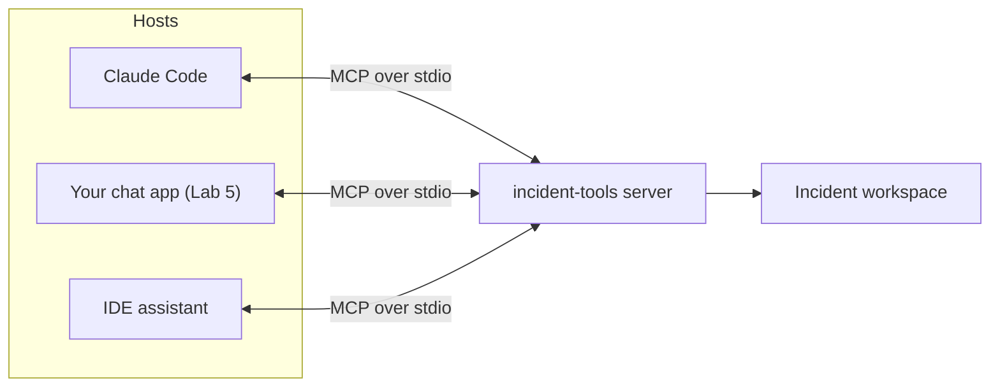

# Lab 4: Build an MCP Server

## What You'll Learn

- What the Model Context Protocol (MCP) standardizes, and what it doesn't
- How to expose Python functions as MCP tools with the 2.x SDK's `MCPServer`
- How MCP reports tool errors, and why the exception type decides what the model sees
- How to test a server with MCP Inspector and use it from Claude Code

## Why MCP Exists

The tools from Lab 2 work in one program: yours. To use them from Claude Code, an IDE, a chat app, or a teammate's agent, each of those would need its own copy of the tool code and the glue to call it.

MCP is a standard interface between **hosts** (apps that run a model) and **servers** (programs that provide tools, data, and prompts). Write the server once and any MCP host can use it.



A server can offer three kinds of things:

| Primitive | Controlled by | Example |
|---|---|---|
| **Tools** | The model decides when to call them | `search_files`, `restart_service` |
| **Resources** | The host app decides what to load | A runbook, a file, a dashboard snapshot |
| **Prompts** | The user picks them | "Triage the current alert" template |

This lab builds tools, which is what most servers provide.

## Step 1: Write the Server

Save this as `incident_mcp.py` in the same folder as `tools.py` from Lab 2:

```python title="incident_mcp.py"
"""An MCP server that exposes the incident workspace as read-only tools."""

from mcp.server.mcpserver import MCPServer
from mcp.server.mcpserver.exceptions import ToolError
from mcp.types import ToolAnnotations

import tools

server = MCPServer("incident-tools", instructions="Read-only access to one incident workspace.")
READ_ONLY = ToolAnnotations(read_only_hint=True, open_world_hint=False)


def call(fn, *args):
    # MCP only shows the model the message of a ToolError. Any other exception
    # is treated as a crash, and the model sees a generic "Error executing tool".
    try:
        return fn(*args)
    except tools.ToolError as exc:
        raise ToolError(str(exc)) from None


@server.tool(annotations=READ_ONLY)
def list_files(path: str = ".") -> str:
    """List every file under a directory of the incident workspace, with sizes."""
    return call(tools.list_files, path)


@server.tool(annotations=READ_ONLY)
def read_file(path: str, start_line: int = 1, max_lines: int = 200) -> str:
    """Read a text file from the incident workspace with numbered lines. At most 500 lines per call."""
    return call(tools.read_file, path, start_line, max_lines)


@server.tool(annotations=READ_ONLY)
def search_files(pattern: str, path: str = ".") -> str:
    """Search files for a case-insensitive regular expression. Returns file:line: text, at most 50 matches."""
    return call(tools.search_files, pattern, path)


if __name__ == "__main__":
    server.run()  # stdio: the client starts this process and talks to it over stdin and stdout
```

How it works:

- **`MCPServer`** builds each tool's JSON Schema from the function's type hints, and the description from its docstring. Defaults such as `start_line: int = 1` become optional parameters.
- **`ToolAnnotations(read_only_hint=True)`** tells hosts the tool doesn't change anything. Hosts can use it to skip approval prompts. It's a hint from the server, not a security control, so a host should only trust it from servers it trusts.
- **`restart_service` isn't exposed.** This server is for investigation. Leaving out the action tool is stronger than any approval prompt.
- **`server.run()`** uses the stdio transport: the host starts this script as a child process and talks to it over stdin and stdout. Nothing listens on a network port.

!!! warning "MCP SDK 2.x renamed FastMCP"
    Most MCP tutorials use `from mcp.server.fastmcp import FastMCP`. In `mcp` 2.x that import fails, because the class is now `MCPServer` in `mcp.server.mcpserver`. Field names also moved to snake_case: `tool.input_schema`, `result.is_error`, `read_only_hint`. If you must run 1.x code, pin `mcp<2`.

## Step 2: Get Errors Right

The `call()` wrapper is the part people skip. MCP's Python SDK treats exceptions in two ways:

| The tool raises | The model sees | The server logs |
|---|---|---|
| `ToolError("...")` | `Error executing tool read_file: '../tools.py' is outside the incident workspace` | One info line |
| Any other exception | `Error executing tool read_file` and nothing else | A full traceback |

Hiding unexpected exceptions is the right default, because tracebacks can leak paths, hostnames, and secrets. But it means an error you *expected*, such as a missing file, reaches the model with no explanation, and the model can't recover. Convert your own expected errors to `ToolError`. Let real bugs stay generic.

## Step 3: Test With MCP Inspector

MCP Inspector is a web UI that connects to a server and lets you call its tools by hand. It needs Node.js:

```bash
npx @modelcontextprotocol/inspector python incident_mcp.py
```

It prints a local URL with an access token. Open it, click **Connect**, then **Tools**, **List Tools**. Try these calls:

1. `search_files` with `pattern` = `pool`. You should see matches from `config/checkout.env`, `deploys.json`, and `logs/checkout.log`.
2. `read_file` with `path` = `../tools.py`. You should get an error result that says the path is outside the workspace.
3. `read_file` with `path` = `logs/checkout.log` and `start_line` = `9`. The line numbers should start at 9.

Test every server this way before giving it to a model. If a tool is confusing to call by hand, it's confusing for the model too.

## Step 4: Use It From Claude Code

Register the server with Claude Code. Use absolute paths, because Claude Code may start it from another directory:

```bash
claude mcp add incident-tools \
  --env INCIDENT_DIR="$PWD/incident" \
  -- "$PWD/.venv/bin/python" "$PWD/incident_mcp.py"
```

Start `claude`, run `/mcp` to check the server shows as connected, then ask:

```text
Use the incident-tools server to find out why the checkout alert fired.
```

Claude Code asks permission before the first call to each tool, then investigates with your three tools. The agent loop is Claude Code's, and the tools are yours. Remove the server when you're done:

```bash
claude mcp remove incident-tools
```

The same server works in any MCP host. Most use a JSON config in this shape, which Lab 5 reads too:

```json title="mcp_servers.json"
{
  "mcpServers": {
    "incident": {
      "command": "python",
      "args": ["incident_mcp.py"],
      "env": {"INCIDENT_DIR": "incident"}
    }
  }
}
```

## Use It From Your Own Agent

The Anthropic Python SDK can convert MCP tools for its tool runner. Install `anthropic[mcp]` to get the helpers:

```python
from anthropic.lib.tools.mcp import async_mcp_tool

tools_result = await mcp_session.list_tools()
runner = client.beta.messages.tool_runner(
    model="claude-opus-5-5",
    max_tokens=16000,
    tools=[async_mcp_tool(t, mcp_session) for t in tools_result.tools],
    messages=[{"role": "user", "content": "Why did the checkout alert fire?"}],
)
```

Lab 5 does the same thing by hand, so you can see every step.

## What Most Engineers Miss

- **MCP standardizes the interface, not the safety.** A server with a `run_shell` tool is as dangerous over MCP as it is in your own code. Review third-party servers like any dependency that runs with your credentials.
- **Tool descriptions from a server go straight into the model's context.** A malicious or compromised server can put instructions in a description. Only connect servers you trust, and pin their versions.
- **stdio servers run with your user's permissions.** The server process can read anything you can, whatever its tools claim. Run untrusted servers in a container.
- **Remote servers** (the streamable HTTP transport) need authentication, TLS, and rate limits, like any API. The stdio transport in this lab has none of those because nothing is exposed.

!!! quiz "Tool errors in MCP"
    Your MCP tool raises `FileNotFoundError` for a missing file. What does the model see?

    - [ ] The full Python traceback
    - [ ] `FileNotFoundError: [Errno 2] No such file or directory: ...`
    - [x] A generic `Error executing tool <name>` with no details

    Only `ToolError` messages reach the model. Convert errors you expect into `ToolError` with a message the model can act on.

!!! quiz "Annotations"
    A server marks its `delete_bucket` tool with `read_only_hint=True`. What does that change?

    - [ ] The tool can no longer delete buckets
    - [x] Nothing is enforced. A host might skip its approval prompt because of the hint.
    - [ ] The MCP SDK rejects the call

    Annotations are claims made by the server. Enforce safety with credentials and with which tools you expose.

## Common Mistakes

- Copying `FastMCP` examples into a project that installed `mcp` 2.x.
- Raising plain exceptions for expected failures, so the model only ever sees "Error executing tool".
- Printing to stdout in a stdio server. stdout carries the protocol, so a stray `print()` corrupts it. Log to stderr.
- Exposing every function you have, instead of the few the host's job needs.
- Registering a server with relative paths, then wondering why the host can't start it.

## Interview Questions

- What problem does MCP solve? What doesn't it solve?
- What's the difference between MCP tools, resources, and prompts?
- How would you decide whether a third-party MCP server is safe to install?
- Why does an MCP server's error handling affect how well the agent recovers?
- When would you run an MCP server over HTTP instead of stdio, and what would you add?

## Next

Continue to [Lab 5: Build a Chat Client With MCP](05-build-a-chat-client-with-mcp.md).
