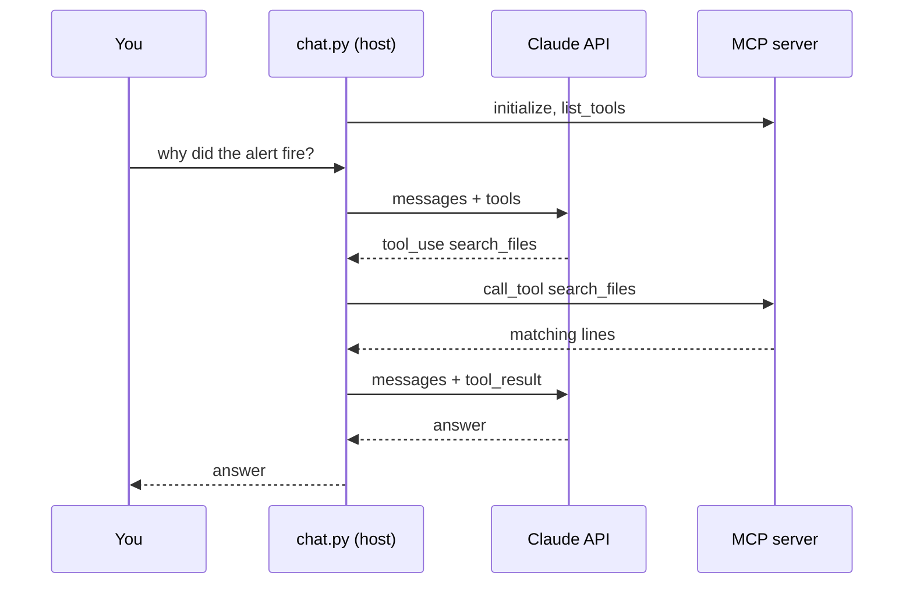

# Lab 5: Build a Chat Client With MCP

## What You'll Learn

- What an MCP **host** does: start servers, list tools, route calls, run the model
- How to convert MCP tool definitions into Claude tool definitions
- How a multi-turn chat keeps its memory, and how to measure it
- Why one chat app can mix tools from several servers, and the naming problem that creates

## Mental Model

In Lab 4, Claude Code was the host. Here you write the host. A host has four jobs:

1. **Start each server** and open an MCP session to it.
2. **Collect the tools** from every server and hand them to the model as one list.
3. **Route each tool call** back to the server that owns that tool.
4. **Keep the conversation** so the next question has the context of the last answer.



## Step 1: Write the Client

You need `incident_mcp.py` and `tools.py` from Lab 4, and `mcp_servers.json`:

```json title="mcp_servers.json"
{
  "mcpServers": {
    "incident": {
      "command": "python",
      "args": ["incident_mcp.py"],
      "env": {"INCIDENT_DIR": "incident"}
    }
  }
}
```

Save this as `chat.py`:

```python title="chat.py"
"""Lab 5: a terminal chat client that uses tools from any MCP server.

    python chat.py                  # servers from mcp_servers.json
Commands: /tools  /tokens  /clear  /quit
"""

import asyncio
import json
import os
from contextlib import AsyncExitStack

import anthropic
from mcp import ClientSession
from mcp.client.stdio import StdioServerParameters, stdio_client

MODEL = os.environ.get("AGENT_MODEL", "claude-opus-5-5")
MAX_STEPS = 10
SYSTEM = "You are a helpful on-call assistant. Use the tools when a question needs evidence. Be brief."

client = anthropic.AsyncAnthropic()


async def connect(stack, config_path="mcp_servers.json"):
    """Start every configured server and return {tool_name: session} and Claude tool definitions."""
    config = json.loads(open(config_path).read())["mcpServers"]
    routes, tools = {}, []
    for name, server in config.items():
        params = StdioServerParameters(command=server["command"], args=server.get("args", []),
                                       env={**os.environ, **server.get("env", {})})
        read, write = await stack.enter_async_context(stdio_client(params))
        session = await stack.enter_async_context(ClientSession(read, write))
        await session.initialize()
        for tool in (await session.list_tools()).tools:
            if tool.name in routes:
                print(f"skipping {tool.name} from {name}: another server already defines it")
                continue
            routes[tool.name] = session
            tools.append({"name": tool.name, "description": tool.description or "",
                          "input_schema": tool.input_schema})
        print(f"connected to {name}: {', '.join(t['name'] for t in tools if routes[t['name']] is session)}")
    return routes, tools


async def call_mcp_tool(session, name, args):
    result = await session.call_tool(name, args)
    text = "\n".join(part.text for part in result.content if part.type == "text")
    return text or "(no text output)", bool(result.is_error)


async def answer(messages, routes, tools):
    """Run the tool loop for one user message. Appends every turn to `messages`."""
    for _ in range(MAX_STEPS):
        response = await client.messages.create(
            model=MODEL, max_tokens=16000, system=SYSTEM, tools=tools, messages=messages,
            cache_control={"type": "ephemeral"},
        )
        messages.append({"role": "assistant", "content": response.content})
        if response.stop_reason != "tool_use":
            return "".join(b.text for b in response.content if b.type == "text")
        results = []
        for block in response.content:
            if block.type == "tool_use":
                print(f"  [{block.name} {json.dumps(block.input)}]")
                content, is_error = await call_mcp_tool(routes[block.name], block.name, block.input)
                results.append({"type": "tool_result", "tool_use_id": block.id,
                                "content": content, "is_error": is_error})
        messages.append({"role": "user", "content": results})
    return f"(stopped after {MAX_STEPS} tool steps)"


async def main():
    async with AsyncExitStack() as stack:
        routes, tools = await connect(stack)
        messages = []  # the conversation: this is the chat's whole short-term memory
        while True:
            try:
                text = (await asyncio.to_thread(input, "\nyou> ")).strip()
            except EOFError:
                break
            if text in ("/quit", "/exit"):
                break
            if text == "/tools":
                print("\n".join(f"  {t['name']}: {t['description']}" for t in tools))
                continue
            if text == "/clear":
                messages = []
                print("  conversation cleared")
                continue
            if text == "/tokens":
                # A request must end with a user turn, so count with a placeholder next message.
                count = await client.messages.count_tokens(
                    model=MODEL, system=SYSTEM, tools=tools,
                    messages=messages + [{"role": "user", "content": "(next message)"}])
                print(f"  {count.input_tokens:,} tokens of context go out with your next message")
                continue
            if not text:
                continue
            messages.append({"role": "user", "content": text})
            print(f"\nclaude> {await answer(messages, routes, tools)}")


if __name__ == "__main__":
    asyncio.run(main())
```

The parts that matter:

| Code | Host job |
|---|---|
| `connect()` with `AsyncExitStack` | Starts every server and keeps its session open for the whole chat, then shuts all of them down on exit |
| `{"name", "description", "input_schema"}` from `list_tools()` | Converts MCP tools to Claude tools. The schemas are both JSON Schema, so they carry over unchanged. |
| `routes[block.name]` | Sends each call to the server that defined the tool |
| `result.is_error` passed through | The model learns that a call failed, with the server's `ToolError` message |
| `messages` kept across questions | Short-term memory. `/clear` forgets it. |
| `/tokens` | Calls `count_tokens` so you can watch memory grow |

## Step 2: Chat

```bash
python chat.py
```

```text
connected to incident: list_files, read_file, search_files

you> why did the checkout alert fire?
  [search_files {"pattern": "error|timed out", "path": "logs"}]
  [read_file {"path": "deploys.json", "start_line": 1, "max_lines": 50}]

claude> Checkout requests started timing out at 14:04 waiting for a database
connection (logs/checkout.log:9). Release 2.14.0, deployed at 14:02, reduced
DB_POOL_SIZE from 20 to 5 (deploys.json:10)...

you> what would you change first?

claude> Roll back 2.14.0, or set DB_POOL_SIZE back to 20...

you> /tokens
  3,412 tokens of context go out with your next message
```

Your output will differ. Notice that "what would you change first?" only makes sense because of the earlier turns. That's the `messages` list at work. Run `/clear` and ask the same follow-up: the model no longer knows what "change" refers to.

## Step 3: Add a Second Server

Hosts get useful when they combine servers. Add a second copy of the incident server pointed at a different workspace:

```bash
python make_workspace.py --scenario disk-full --out incident-disk
```

```json
{
  "mcpServers": {
    "incident": {"command": "python", "args": ["incident_mcp.py"], "env": {"INCIDENT_DIR": "incident"}},
    "incident-disk": {"command": "python", "args": ["incident_mcp.py"], "env": {"INCIDENT_DIR": "incident-disk"}}
  }
}
```

Run `chat.py` again:

```text
connected to incident: list_files, read_file, search_files
skipping list_files from incident-disk: another server already defines it
skipping read_file from incident-disk: another server already defines it
skipping search_files from incident-disk: another server already defines it
connected to incident-disk:
```

The second server connected, but none of its tools are usable. That's deliberate: with two `list_files` tools, the model can't tell which workspace it's reading, and your router can't either. Real hosts solve this by prefixing tool names with the server name, such as `incident__list_files`. Add that to `connect()` as an exercise: prefix the name when you build the tool list, and strip the prefix before `call_tool`.

## What Most Engineers Miss

- **The host owns the security decisions.** Servers only offer tools. The host decides which servers to start, which tools to show the model, and which calls need your approval. `chat.py` runs every call without asking, which is fine for three read-only tools and wrong for anything else.
- **Every tool from every server costs tokens on every turn.** Connecting ten servers with 15 tools each means 150 schemas in each request. Load only the servers a task needs.
- **Long chats cost more per message.** Each question resends the whole conversation, so the 20th question costs far more than the first. `/tokens` makes that visible.
- **Server processes are children of the host.** If the host crashes without cleanup, servers can be left running. `AsyncExitStack` closes them even when an exception escapes.

!!! quiz "Routing"
    Two MCP servers both define a tool named `query`. What's the safest way for a host to handle that?

    - [ ] Offer both, and let the model pick
    - [ ] Keep whichever server connected last
    - [x] Rename them with a server prefix, such as `postgres__query` and `prometheus__query`

    Tool names must be unique in one request, and the host must know where to route each call.

!!! quiz "Chat memory"
    A user asks "and what about yesterday?" and the model has no idea what they mean. What's the likely bug?

    - [x] The host isn't sending earlier turns in `messages`
    - [ ] The model's context window is too small
    - [ ] The MCP server lost its state

    The API is stateless. The host has to send the conversation every time.

## Common Mistakes

- Opening a new MCP session for every tool call, which restarts the server process each time.
- Merging tools from several servers without checking for name clashes.
- Dropping `is_error` when relaying results, so the model treats an error message as real data.
- Keeping the whole chat history forever. Offer `/clear`, and start a new conversation per task.
- Auto-approving every tool call because the first servers you connected happened to be read-only.

## Interview Questions

- What does an MCP host do that an MCP server doesn't?
- How would you design approval prompts in a chat app that connects to third-party MCP servers?
- A chat session gets slower and more expensive with every message. Why, and what would you do?
- How would you let users connect their own MCP servers safely?

## Next

Continue to [Lab 6: Incident Triage Agent](06-incident-triage-agent.md).
