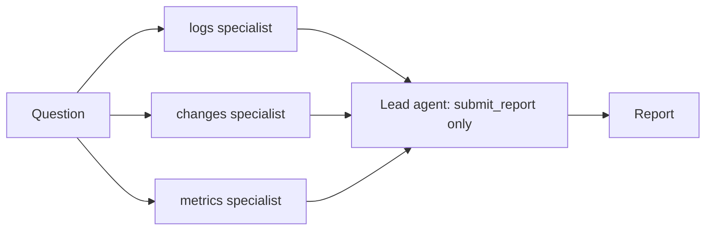

# Lab 9: Multi-Agent Systems

## What You'll Learn

- When several agents beat one, and when they just cost more
- Two patterns: parallel fan-out controlled by code, and a coordinator agent that delegates
- How sub-agents keep each other's context clean
- What goes wrong between agents, and how to see it

## Mental Model

A **multi-agent system** is several agent loops, each with its own system prompt, tools, and context, passing results to each other. In this lab, each specialist is just `run_agent()` from Lab 2 with a different system prompt. There's no special framework.

Use multiple agents when at least one of these is true:

| Reason | Example in this lab |
|---|---|
| **Independent work can run in parallel** | Logs, changes, and metrics can be read at the same time |
| **Context isolation** | The log specialist reads 10,000 log lines; the lead only sees its 10-line summary |
| **Different instructions or permissions** | A specialist that only reads `logs/`, a lead that can't read files at all |

If none of those applies, one agent is cheaper, faster, and easier to debug.

## Step 1: Write the Specialists

Save this as `multi_agent.py`, next to `agent.py`, `tools.py`, and `triage.py`:

```python title="multi_agent.py"
"""Lab 9: several specialist agents instead of one generalist.

    python multi_agent.py fanout        # code runs every specialist in parallel, then one agent decides
    python multi_agent.py coordinator   # a coordinator agent decides whom to ask, and what
"""

import json
import sys
from concurrent.futures import ThreadPoolExecutor

from agent import run_agent
from tools import TOOLS
from triage import REPORT_TOOL

READ_ONLY_TOOLS = [t for t in TOOLS if t["name"] != "restart_service"]

SPECIALISTS = {
    "logs": "You analyse application logs. Find when errors started, what they say, and how often. "
    "Ignore everything outside logs/.",
    "changes": "You analyse change history. Report every deploy and config change in the two hours "
    "before the alert, with what it changed. Look at deploys.json and config/.",
    "metrics": "You analyse metrics. Describe what changed in metrics.json around the alert time, "
    "and which metrics stayed flat.",
}
RULES = "\nCite file and line for every finding. Report facts only; another agent draws conclusions."
usage = []  # (agent, steps, tokens) for every agent that ran


def ask(specialist: str, question: str) -> str:
    result = run_agent(
        question,
        tools=READ_ONLY_TOOLS,
        system=SPECIALISTS[specialist] + RULES,
        log=lambda msg: print(f"  [{specialist}] {msg.strip()}"),
    )
    usage.append((specialist, result["steps"], result["tokens"]))
    return result["answer"] or f"(no answer: {result['status']})"


def fanout():
    """Orchestrator-workers in code: every specialist runs at once, then one agent decides."""
    question = "What does your evidence show about the checkout alert that fired at 14:05?"
    with ThreadPoolExecutor(max_workers=len(SPECIALISTS)) as pool:
        answers = dict(zip(SPECIALISTS, pool.map(lambda s: ask(s, question), SPECIALISTS)))
    findings = "\n\n".join(f"## {name} specialist\n{text}" for name, text in answers.items())
    return run_agent(
        f"Three specialists investigated the checkout alert.\n\n{findings}\n\n"
        "Decide the root cause from their findings, and call submit_report.",
        tools=[REPORT_TOOL],
        system="You are the incident lead. You can't read files; you weigh the specialists' evidence.",
        stop_on="submit_report",
    )


ASK_TOOL = {
    "name": "ask_specialist",
    "description": "Send one focused question to a specialist agent and get its findings with file:line "
    "evidence. Specialists can't see each other's answers, so include any context they need.",
    "strict": True,
    "input_schema": {
        "type": "object",
        "properties": {
            "specialist": {"type": "string", "enum": list(SPECIALISTS)},
            "question": {"type": "string"},
        },
        "required": ["specialist", "question"],
        "additionalProperties": False,
    },
}


def coordinator():
    """A coordinator agent with no file access. Its only tools are other agents and the report."""
    return run_agent(
        "The checkout alert fired at 14:05. Find the root cause by asking specialists, "
        "then call submit_report. Ask follow-up questions when findings conflict.",
        tools=[ASK_TOOL, REPORT_TOOL],
        system="You are the incident lead. Delegate investigation to specialists and weigh their evidence.",
        handlers={"ask_specialist": ask},
        stop_on="submit_report",
    )


if __name__ == "__main__":
    mode = sys.argv[1] if len(sys.argv) > 1 else "fanout"
    result = fanout() if mode == "fanout" else coordinator()
    usage.append(("lead", result["steps"], result["tokens"]))
    print(json.dumps(result["report"], indent=2))
    for name, steps, tokens in usage:
        print(f"{name:<10}{steps:>3} steps {tokens:>9,} tokens")
    print(f"{'total':<10}{sum(u[1] for u in usage):>3} steps {sum(u[2] for u in usage):>9,} tokens")
```

Each specialist is a narrow system prompt plus the read-only tools. `RULES` makes all of them report facts with file and line, and leave conclusions to the lead. That split matters: if every specialist guesses a root cause, the lead has to weigh three guesses instead of three sets of evidence.

## Step 2: Pattern A, Fan-Out in Code

```bash
python multi_agent.py fanout
```



Your code decides the plan: every specialist runs at once in a thread pool, then the lead gets all three answers in one prompt. The lead has only the `submit_report` tool, so it can't go and read files itself. It has to judge the evidence it was given.

At the end, the script prints the steps and tokens for every agent. A typical run:

```text
changes     3 steps    18,204 tokens
metrics     2 steps    11,377 tokens
logs        3 steps    19,952 tokens
lead        1 steps     6,140 tokens
total       9 steps    55,673 tokens
```

## Step 3: Pattern B, a Coordinator Agent

```bash
python multi_agent.py coordinator
```

Now the lead is an agent whose tools are other agents. `ask_specialist` is a normal tool, implemented by a handler that runs a whole specialist loop. The lead decides whom to ask, what to ask, and whether to follow up. A typical run:

```text
[step 1] ask_specialist {'specialist': 'logs', 'question': 'When did errors start and what do they say?'}
  [logs] [step 1] search_files {'pattern': 'error|warn', 'path': 'logs'}
  ...
[step 2] ask_specialist {'specialist': 'changes', 'question': 'What changed between 13:00 and 14:05?'}
  [changes] [step 1] read_file {'path': 'deploys.json', 'start_line': 1, 'max_lines': 50}
  ...
[step 3] submit_report {...}
```

The lead's questions get more specific as it learns. Here it asked about changes *after* the log specialist reported connection-pool timeouts.

## Step 4: Compare

Run each pattern three times and fill in this table from your output:

| | Fan-out in code | Coordinator agent | Single agent (Lab 6) |
|---|---|---|---|
| Who plans | Your code | The lead model | The model |
| Parallel | Yes | No, one question at a time | Can make parallel tool calls |
| Total tokens | | | |
| Wall-clock time | | | |
| Follow-up questions | Not possible | Yes | Not needed |
| Easy to debug | Yes, fixed path | Harder, varies per run | Medium |

Expect the multi-agent versions to use more tokens than the single agent. Every specialist pays for its own system prompt, tools, and reading. On a five-file incident, the single agent from Lab 6 is probably the best choice. Multi-agent designs start to pay off when the evidence is too big for one context window, or when the specialists need different permissions.

## What Most Engineers Miss

- **Agents lose information at every handoff.** A specialist summarizes; the lead only sees the summary. Ask specialists for evidence with file and line, so the lead can tell a fact from a guess.
- **Specialists can't see each other.** The `ask_specialist` description says so, which pushes the lead to include context in its questions. Without it, the lead asks "is it the database?" and the change specialist has no idea why.
- **Fan-out in code is a workflow, not an agent.** It's predictable, parallel, and cheap to debug. Start there, and use a coordinator only when the plan really depends on what's found.
- **Every sub-agent needs the same guardrails.** Step limits, token budgets, and read-only tools apply per agent. A coordinator that can start specialists in a loop needs a limit on how many it starts.
- **Specialist output is untrusted input for the lead.** If a specialist read an injected log line (Lab 8), its summary can carry the injection to the lead. Keep the lead's tools as narrow as the specialists'.

!!! quiz "When to split"
    Which situation most justifies splitting one agent into specialists?

    - [ ] The agent's answers are sometimes wrong
    - [x] The evidence for one investigation doesn't fit in a single context window
    - [ ] You want the system to look more advanced

    Context isolation and parallel reading are concrete benefits. Wrong answers usually need better tools, prompts, or evals.

!!! quiz "Cost"
    A single agent uses 30,000 tokens per investigation. You split it into three specialists and a lead. What's the most likely result?

    - [ ] About 10,000 tokens, since each specialist does a third of the work
    - [ ] About 30,000 tokens, the same work split up
    - [x] More than 30,000 tokens, because every agent pays for its own prompt, tools, and reading

    Multi-agent systems trade tokens for parallelism and isolation.

## Common Mistakes

- Reaching for multiple agents before one agent with good tools has been tried.
- Letting specialists draw conclusions, so the lead weighs opinions instead of evidence.
- Giving the lead file access as well, so it repeats the specialists' work.
- Not counting tokens across all agents, and being surprised by the bill.
- No limit on how many sub-agents a coordinator can start.

## Interview Questions

- When would you use multiple agents instead of one? When wouldn't you?
- Compare orchestration in code with a coordinator agent that delegates.
- How do you stop information from getting lost between agents?
- How would you debug a multi-agent system that gave a wrong answer?

## Next

Continue to [Lab 10: A2A Protocol](10-a2a-protocol.md).
