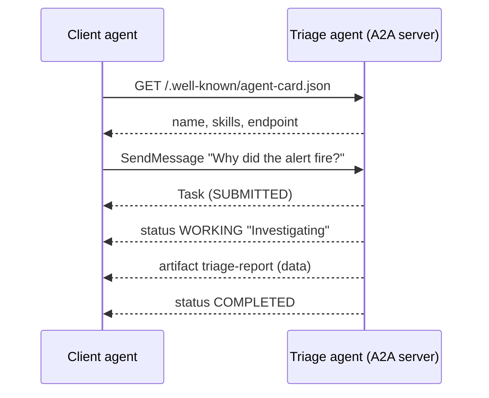

# Lab 10: A2A Protocol

## What You'll Learn

- What the Agent2Agent (A2A) protocol is for, and how it differs from MCP
- How agent cards, tasks, status updates, and artifacts fit together
- How to serve the triage agent over A2A with `a2a-sdk` 1.x
- How to call a remote agent from your own agent, and what to trust in its answers

## A2A vs MCP

In Lab 9 the specialists ran in your process. Now imagine the checkout team owns the triage agent, runs it in their cluster, and other teams' agents need to ask it questions. They can't import its Python code. They need a network protocol.

| | MCP (Labs 4 and 5) | A2A (this lab) |
|---|---|---|
| Connects | An agent to **tools and data** | An agent to **another agent** |
| The other side is | A function: input in, result out | An opaque agent with its own model, tools, and reasoning |
| Typical call | Milliseconds to seconds | Seconds to hours, with status updates |
| You see | Tool schemas | An agent card with skills, and task results |
| Example | `search_files(pattern)` | "Why did the checkout alert fire?" |

They work together. The triage agent uses MCP-style tools internally and exposes itself to other agents over A2A.

## A2A in Five Terms

- **Agent card**: a JSON document at `/.well-known/agent-card.json` that says who the agent is, what skills it has, and where to send requests.
- **Message**: one turn from the client or the agent, made of parts (text, data, or files).
- **Task**: a unit of work with an ID and a state: `SUBMITTED`, `WORKING`, `INPUT_REQUIRED`, `COMPLETED`, `FAILED`, and others.
- **Artifact**: the output of a task, such as our triage report, as text or structured data.
- **Transport**: JSON-RPC, REST, or gRPC over HTTP. Streaming uses server-sent events.



## Step 1: Serve the Triage Agent

You need `triage.py` and its dependencies from Lab 6. Save this as `a2a_server.py`:

```python title="a2a_server.py"
"""Lab 10: serve the triage agent over the A2A protocol."""

import asyncio

import uvicorn
from a2a.helpers import (
    get_message_text,
    new_data_artifact_update_event,
    new_task_from_user_message,
    new_text_status_update_event,
)
from a2a.server.agent_execution import AgentExecutor
from a2a.server.request_handlers import DefaultRequestHandler
from a2a.server.routes import create_agent_card_routes, create_jsonrpc_routes
from a2a.server.tasks import InMemoryTaskStore
from a2a.types import AgentCapabilities, AgentCard, AgentInterface, AgentSkill, TaskState
from starlette.applications import Starlette

from triage import TASK, triage

HOST, PORT = "127.0.0.1", 9999

AGENT_CARD = AgentCard(
    name="Checkout triage agent",
    description="Investigates checkout incidents from logs, config, deploys, and metrics. Read-only.",
    version="1.0.0",
    supported_interfaces=[
        AgentInterface(protocol_binding="JSONRPC", protocol_version="1.0", url=f"http://{HOST}:{PORT}/a2a/jsonrpc/")
    ],
    capabilities=AgentCapabilities(streaming=True),
    default_input_modes=["text/plain"],
    default_output_modes=["application/json"],
    skills=[
        AgentSkill(
            id="triage",
            name="Incident triage",
            description="Finds the root cause of the current checkout alert and returns a triage report.",
            tags=["incident", "sre", "checkout"],
            examples=["Why did the checkout alert fire?"],
        )
    ],
)


class TriageExecutor(AgentExecutor):
    async def execute(self, context, event_queue):
        task = context.current_task or new_task_from_user_message(context.message)
        await event_queue.enqueue_event(task)  # a Task must be the first event

        def status(state, text):
            return new_text_status_update_event(
                task_id=task.id, context_id=task.context_id, state=state, text=text)

        await event_queue.enqueue_event(status(TaskState.TASK_STATE_WORKING, "Investigating"))
        # The caller's text is extra context, never a replacement for our own task and rules.
        request = get_message_text(context.message)
        result = await asyncio.to_thread(
            triage, task=f"{TASK}\n\nRequest from the calling agent:\n{request}", log=lambda *_: None)

        if result["report"] is None:
            await event_queue.enqueue_event(status(TaskState.TASK_STATE_FAILED, f"No report: {result['status']}"))
            return
        await event_queue.enqueue_event(new_data_artifact_update_event(
            task_id=task.id, context_id=task.context_id, name="triage-report", data=result["report"]))
        await event_queue.enqueue_event(
            status(TaskState.TASK_STATE_COMPLETED, f"Done in {result['steps']} steps"))

    async def cancel(self, context, event_queue):
        raise NotImplementedError("this agent does not support cancellation")


handler = DefaultRequestHandler(
    agent_executor=TriageExecutor(), task_store=InMemoryTaskStore(), agent_card=AGENT_CARD)
routes = create_agent_card_routes(AGENT_CARD) + create_jsonrpc_routes(handler, rpc_url="/a2a/jsonrpc/")
app = Starlette(routes=routes)

if __name__ == "__main__":
    uvicorn.run(app, host=HOST, port=PORT)
```

How it works:

- **`AGENT_CARD`** advertises one skill and one JSON-RPC endpoint. `protocol_version="1.0"` is required by the spec. Without it, the SDK logs a warning that other SDKs may not accept the card.
- **`TriageExecutor.execute()`** follows the task pattern: publish a `Task` first, then a `WORKING` status, then the work, then an artifact and a final status.
- **`asyncio.to_thread`** runs the synchronous agent loop without blocking the server's event loop, so it can serve other requests and stream status updates meanwhile.
- **The caller's text is appended to our task, not used as the task.** The remote caller can add context, but it can't replace the triage instructions or the read-only rules. Treat it like any other untrusted input.
- **The report is a data artifact**, so clients get structured JSON instead of text to parse.

!!! warning "a2a-sdk 1.x is not 0.3"
    `a2a-sdk` 1.0 implements A2A protocol 1.0 and changed the Python API: types are protobuf messages (`TaskState.TASK_STATE_COMPLETED`, `event.HasField("task")`), and servers are built from route factories such as `create_jsonrpc_routes` instead of `A2AStarletteApplication`. Examples written for 0.3 won't run. The server can accept 0.3 clients with `enable_v0_3_compat=True`.

Start it:

```bash
python a2a_server.py
```

In another terminal, read its card:

```bash
curl -s http://127.0.0.1:9999/.well-known/agent-card.json | python -m json.tool
```

```json
{
    "name": "Checkout triage agent",
    "description": "Investigates checkout incidents from logs, config, deploys, and metrics. Read-only.",
    "supportedInterfaces": [
        {
            "url": "http://127.0.0.1:9999/a2a/jsonrpc/",
            "protocolBinding": "JSONRPC",
            "protocolVersion": "1.0"
        }
    ],
    "version": "1.0.0",
    "capabilities": {
        "streaming": true
    },
    ...
}
```

## Step 2: Call It

Save this as `a2a_client.py`:

```python title="a2a_client.py"
"""Lab 10: call a remote agent over A2A, and wrap it as a tool for your own agent."""

import asyncio
import json
import sys

from a2a.client import create_client
from a2a.helpers import get_data_parts, get_message_text, new_text_message
from a2a.types import Role, SendMessageRequest, TaskState

AGENT_URL = "http://127.0.0.1:9999/"


async def ask_remote_agent(question: str, url: str = AGENT_URL, verbose: bool = True) -> dict:
    client = await create_client(url)  # fetches /.well-known/agent-card.json first
    request = SendMessageRequest(message=new_text_message(question, role=Role.ROLE_USER))
    report, state = None, None
    async for event in client.send_message(request):
        if event.HasField("task"):
            if verbose:
                print(f"task {event.task.id}")
        elif event.HasField("status_update"):
            status = event.status_update.status
            state = TaskState.Name(status.state)
            if verbose:
                print(f"status {state}: {get_message_text(status.message)}")
        elif event.HasField("artifact_update"):
            report = get_data_parts(event.artifact_update.artifact.parts)[0]
        elif event.HasField("message"):
            print(get_message_text(event.message))
    return {"state": state, "report": report}


# The same call as a tool for the agent loop from Lab 2: run_agent(..., handlers={"ask_triage_agent": ...})
ASK_TRIAGE_TOOL = {
    "name": "ask_triage_agent",
    "description": "Ask the checkout team's triage agent to investigate the checkout service. "
    "Returns its report as JSON. Takes a minute or two.",
    "strict": True,
    "input_schema": {
        "type": "object",
        "properties": {"question": {"type": "string"}},
        "required": ["question"],
        "additionalProperties": False,
    },
}


def ask_triage_agent(question: str) -> str:
    return json.dumps(asyncio.run(ask_remote_agent(question, verbose=False)))


if __name__ == "__main__":
    question = " ".join(sys.argv[1:]) or "Why did the checkout alert fire?"
    result = asyncio.run(ask_remote_agent(question))
    print(json.dumps(result["report"], indent=2))
```

```bash
python a2a_client.py "Why did the checkout alert fire?"
```

A typical run:

```text
task 082b9c58-3367-4403-b482-827a3dedc72c
status TASK_STATE_WORKING: Investigating
status TASK_STATE_COMPLETED: Done in 5 steps
{
  "root_cause": "Release 2.14.0 reduced DB_POOL_SIZE from 20 to 5, exhausting the pool.",
  "next_steps": [
    "Roll back 2.14.0 or set DB_POOL_SIZE=20"
  ],
  "evidence": [
    {
      "line": 10.0,
      "file": "deploys.json",
      "observation": "2.14.0 changed DB_POOL_SIZE 20 -> 5"
    }
  ],
  "confidence": "high",
  "summary": "..."
}
```

Look at `"line": 10.0`. A2A data parts are stored as protobuf `Value`s, which hold every number as a double, so whole numbers come back as floats and key order isn't kept. Convert the fields you expect to be integers on the client side, and don't rely on key order.

The client never imported `triage.py`. All it knew was a URL. It read the card, found the endpoint, and got back a task with a status stream and a structured result.

## Step 3: A Remote Agent as a Tool

`a2a_client.py` also defines `ASK_TRIAGE_TOOL` and `ask_triage_agent()`. With the `handlers` parameter from Lab 2, any agent can delegate to the remote triage agent:

```python
from a2a_client import ASK_TRIAGE_TOOL, ask_triage_agent
from agent import run_agent

result = run_agent(
    "Customers report failed payments. Is checkout involved? Ask the checkout team's agent.",
    tools=[ASK_TRIAGE_TOOL],
    handlers={"ask_triage_agent": ask_triage_agent},
)
print(result["answer"])
```

This is Lab 9's coordinator pattern across a network boundary. The specialist now belongs to another team, runs on their infrastructure, and uses their credentials. You only see its card and its answers.

## Make It Production-Ready

The lab server has no authentication and listens on `127.0.0.1` only. Before exposing an A2A agent:

| Concern | What to do |
|---|---|
| **Authentication** | Declare a security scheme in the agent card and enforce it in front of the server, for example OAuth 2.0 client credentials or mTLS inside a mesh. |
| **Authorization** | Decide which calling agents may use which skills. The caller is another team's software, not a person. |
| **Timeouts** | Triage takes minutes. Set client timeouts, and use streaming or task polling instead of one long blocking call. |
| **Untrusted answers** | A remote agent's artifact is input to your agent, like a log line in Lab 8. Validate structured data against a schema, and never let it trigger actions without your own approval step. |
| **Cost** | Every call runs a full agent on someone's API budget. Rate-limit callers. |
| **Persistence** | `InMemoryTaskStore` loses tasks on restart. The SDK has database-backed stores for production. |

## What Most Engineers Miss

- **A2A agents are opaque on purpose.** You don't see the remote agent's prompts, tools, or reasoning, only its results. Treat its answers the way you'd treat a reply from another team: useful, but checked.
- **The agent card is a contract.** Version it, keep skill descriptions accurate, and treat a change to it like an API change. Calling agents choose skills from the description, just as models choose tools.
- **Long-running work is the normal case.** Design for `WORKING` and `INPUT_REQUIRED` states, cancellation, and reconnecting to a task, not just request and response.
- **Don't use A2A inside one codebase.** If you own both agents and they run in one process, a function call (Lab 9) is simpler, faster, and easier to debug.

!!! quiz "MCP or A2A"
    Your agent needs to query Prometheus. Which protocol fits?

    - [x] MCP: Prometheus queries are a tool with defined inputs and outputs
    - [ ] A2A: Prometheus is a separate system
    - [ ] Both, one for reads and one for writes

    A2A is for delegating a goal to another agent that reasons on its own. A query with a known shape is a tool.

!!! quiz "Trust"
    A remote A2A agent returns a report that recommends `kubectl delete deployment checkout`. What should your agent do?

    - [ ] Run it, since the remote agent is the expert on checkout
    - [x] Treat it as a suggestion that goes through your own approval and permissions
    - [ ] Refuse to use the remote agent again

    Output from another agent is untrusted input. Your guardrails apply no matter where a suggestion came from.

## Common Mistakes

- Following A2A examples written for `a2a-sdk` 0.3 with the 1.x package.
- Exposing an A2A server with no authentication because "it's internal".
- Passing the caller's message straight in as the agent's task, so any caller can rewrite its instructions.
- Blocking a client for minutes on a single request instead of streaming status.
- Assuming numbers in data artifacts keep their type.

## Interview Questions

- What's the difference between MCP and A2A? When would you use each?
- What's in an A2A agent card, and why does it matter?
- How would you secure an A2A agent that other teams' agents call?
- A remote agent you depend on starts returning wrong answers. How would you detect and contain that?

## Next

Continue to [Lab 11: LangChain](11-langchain-agent.md).
