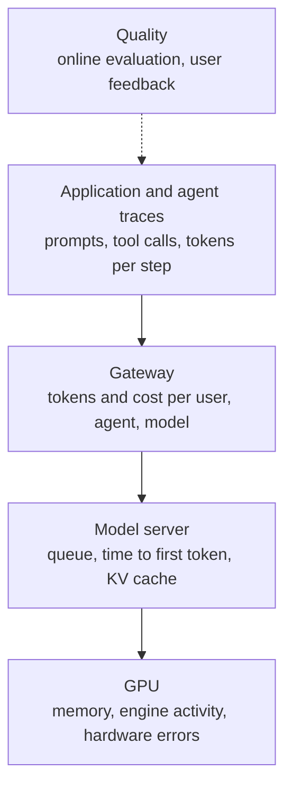

# AI Observability

## What You'll Learn

- Why LLM systems need more than the usual request rate, errors, and duration
- The four layers to instrument: GPU, model server, gateway, and application or agent
- How to trace model calls, tool calls, and agents with the OpenTelemetry GenAI conventions
- Which metrics, queries, and alerts matter for self-hosted inference
- How to keep prompts out of places they shouldn't be, and where quality checks fit

## Why This Matters

Classic monitoring answers "is it up, and is it fast?". An LLM system can be up, fast, and wrong: a made-up answer comes back as `200 OK` in 800 ms. Cost grows with tokens, not requests, so one agent stuck in a tool loop can spend more than all your users combined. Latency also has two parts: the wait for the first token, and the speed of the stream after it.

AI observability adds three questions to the usual ones: what did it cost, what did it do (which prompts, tools, and models), and was the answer any good.

## Mental Model

> Instrument four layers and join them with one trace ID. GPUs tell you about capacity, the model server about saturation and latency, the gateway about who spent which tokens, and application traces about what the agent actually did. Quality is a fifth signal, which you sample and score rather than scrape.



## How It Works

### The signals that matter

| Signal | Why it matters | Where it comes from |
|---|---|---|
| Time to first token (TTFT) | What users feel as "slow"; queue time plus prompt processing | vLLM `vllm:time_to_first_token_seconds`; client-side spans |
| Inter-token latency | How smoothly the answer streams | `vllm:inter_token_latency_seconds` |
| End-to-end latency | Budgets for agent steps and SLOs | `vllm:e2e_request_latency_seconds`; client spans |
| Queue depth | The earliest sign of saturation; the input for autoscaling | `vllm:num_requests_waiting` |
| KV cache usage and preemptions | Memory pressure that turns into tail latency | `vllm:kv_cache_usage_perc`, `vllm:num_preemptions_total` |
| Tokens in and out | Cost and capacity | `vllm:prompt_tokens_total`, `vllm:generation_tokens_total`; `gen_ai.usage.*` on spans; gateway metrics |
| Prefix cache hit rate | Whether prompt layout and routing reuse work | `vllm:prefix_cache_hits_total` ÷ `vllm:prefix_cache_queries_total` |
| Errors, refusals, truncation | `429`s from budgets or load shedding, `5xx`, answers cut off by `max_tokens` | Gateway metrics; finish or stop reasons on spans |
| GPU memory and activity | Capacity planning and failing hardware | DCGM exporter |
| Quality | Correctness, groundedness, safety | Online evaluation and user feedback |

### Model server metrics (vLLM)

vLLM serves Prometheus metrics on `/metrics`, on the same port as its API (see [Serving LLMs with vLLM](../kubernetes/ai-workloads/02-serving-llms-with-vllm.md#autoscale-on-the-queue-not-on-cpu) for scraping it on Kubernetes). Every metric carries a `model_name` label.

```promql
# p95 time to first token, per model
histogram_quantile(0.95,
  sum by (le, model_name) (rate(vllm:time_to_first_token_seconds_bucket[5m])))

# Output tokens per second across the fleet
sum(rate(vllm:generation_tokens_total[5m]))

# Requests waiting, and KV cache pressure, per pod
sum by (pod) (vllm:num_requests_waiting)
max by (pod) (vllm:kv_cache_usage_perc)

# Prefix cache hit rate
sum(rate(vllm:prefix_cache_hits_total[5m])) / sum(rate(vllm:prefix_cache_queries_total[5m]))
```

vLLM's docs list counters without a suffix, such as `vllm:generation_tokens`. The Prometheus client adds `_total` when it exposes a counter, so queries use `vllm:generation_tokens_total`. Older dashboards may use `vllm:gpu_cache_usage_perc`: the current name is `vllm:kv_cache_usage_perc`.

### GPU metrics (DCGM exporter)

NVIDIA's [DCGM exporter](https://github.com/NVIDIA/dcgm-exporter) runs as a DaemonSet on GPU nodes (the GPU Operator installs it), serves metrics on port 9400, and labels them with the pod, namespace, and container using the GPU.

!!! warning "DCGM exporter 4.9.0 renamed its metrics"
    Version 4.9.0 (6 November 2026) renamed 23 default fields to the names DCGM 4.7 introduced. Several also changed unit: utilization went from a percentage to a 0–1 ratio, and memory from MiB to bytes. Dashboards and alerts built on the old names go quiet after the upgrade, and thresholds written for percentages stop firing.

| Up to 4.8.4 | From 4.9.0 | What it measures |
|---|---|---|
| `DCGM_FI_DEV_GPU_UTIL` (%) | `DCGM_FI_DEV_GPU_UTIL_RATIO` (0–1) | Coarse "was the GPU busy" |
| `DCGM_FI_DEV_FB_USED` (MiB) | `DCGM_FI_DEV_FB_USED_BYTES` | GPU memory in use |
| `DCGM_FI_PROF_GR_ENGINE_ACTIVE` | `DCGM_FI_PROF_GR_ENGINE_UTIL_RATIO` | Share of time the graphics/compute engine was active |
| `DCGM_FI_PROF_PIPE_TENSOR_ACTIVE` | `DCGM_FI_PROF_TENSOR_UTIL_RATIO` | Share of cycles the tensor cores were active |
| `DCGM_FI_PROF_DRAM_ACTIVE` | `DCGM_FI_PROF_DRAM_UTIL_RATIO` | Share of cycles moving data to or from GPU memory |
| `DCGM_FI_DEV_POWER_USAGE` | `DCGM_FI_DEV_BOARD_POWER_WATTS` | Power draw in watts |
| `DCGM_FI_DEV_XID_ERRORS` | `DCGM_FI_DEV_XID_ERROR` | The last XID error: driver and hardware faults |

"GPU utilization" is the most misread number in AI infrastructure. nvidia-smi documents it as the share of the sample period in which one or more kernels was running. A server that keeps one small kernel running all the time reads close to 100% while most of the chip sits idle. Use it to spot GPUs doing nothing at all. For "is this GPU full?", use the model server's queue and KV cache, and the tensor activity ratio.

### Tracing model calls and agents with OpenTelemetry

The OpenTelemetry [GenAI semantic conventions](https://github.com/open-telemetry/semantic-conventions-genai) define standard span and attribute names for model calls, tool calls, and agents, so any backend can show them. They are still in Development status. In 2026 they moved out of the core semantic conventions into their own repository, whose first release, v0.1.0, came out on 21 November 2026.

| Span | Name the conventions recommend | Kind | Key attributes |
|---|---|---|---|
| Model call | `{gen_ai.operation.name} {gen_ai.request.model}`, such as `chat claude-opus-5-5` | `CLIENT` | `gen_ai.operation.name`, `gen_ai.provider.name`, `gen_ai.request.model`, `gen_ai.response.model`, `gen_ai.usage.input_tokens`, `gen_ai.usage.output_tokens`, `gen_ai.response.finish_reasons` |
| Tool call | `execute_tool {gen_ai.tool.name}` | `INTERNAL` | `gen_ai.tool.name`, `gen_ai.tool.call.id` |
| Agent run in the same process | `invoke_agent {gen_ai.agent.name}` | `INTERNAL` | `gen_ai.agent.name`, `gen_ai.conversation.id` |

Some SDKs now emit these spans themselves. Since version 1.14 (October 2026), the Anthropic Python SDK creates a span for every API call once your app registers an OpenTelemetry tracer provider, and it propagates trace context to the API. Combine that with your own spans for the agent and its tools:

```python
import anthropic
from opentelemetry import trace
from opentelemetry.exporter.otlp.proto.http.trace_exporter import OTLPSpanExporter
from opentelemetry.sdk.resources import Resource
from opentelemetry.sdk.trace import TracerProvider
from opentelemetry.sdk.trace.export import BatchSpanProcessor

# Register the tracer provider before creating the client.
provider = TracerProvider(resource=Resource.create({"service.name": "support-agent"}))
provider.add_span_processor(BatchSpanProcessor(OTLPSpanExporter()))  # reads OTEL_EXPORTER_OTLP_ENDPOINT
trace.set_tracer_provider(provider)

tracer = trace.get_tracer("support-agent")
client = anthropic.Anthropic()


def lookup_order(order_id: str) -> str:
    with tracer.start_as_current_span("execute_tool lookup_order") as span:
        span.set_attribute("gen_ai.operation.name", "execute_tool")
        span.set_attribute("gen_ai.tool.name", "lookup_order")
        return f"Order {order_id} shipped on 2026-11-20"


with tracer.start_as_current_span("invoke_agent support-agent") as span:
    span.set_attribute("gen_ai.operation.name", "invoke_agent")
    span.set_attribute("gen_ai.agent.name", "support-agent")
    status = lookup_order("A-1042")
    reply = client.messages.create(  # the SDK adds a child span with model and token usage
        model="claude-opus-5-5",
        max_tokens=300,
        messages=[{"role": "user", "content": f"Write a one-line update for the customer: {status}"}],
    )
    print(reply.content[0].text)

provider.shutdown()  # flush spans before the process exits
```

Install `anthropic`, `opentelemetry-sdk`, and `opentelemetry-exporter-otlp-proto-http`, and set `OTEL_EXPORTER_OTLP_ENDPOINT` to your collector or tracing backend. This is the trace from a test run against a stub of the Messages API, so the token counts are the stub's:

```text
invoke_agent support-agent          INTERNAL  gen_ai.agent.name=support-agent
├── execute_tool lookup_order       INTERNAL  gen_ai.tool.name=lookup_order
└── anthropic.messages.create       CLIENT    gen_ai.provider.name=anthropic
                                              gen_ai.operation.name=chat
                                              gen_ai.request.model=claude-opus-5-5
                                              gen_ai.usage.input_tokens=31
                                              gen_ai.usage.output_tokens=14
```

The SDK names its span after the method (`anthropic.messages.create`), not with the conventions' `chat <model>` pattern, but its attributes follow the conventions. Group and filter on attributes, not span names. For other providers and frameworks, the [OpenTelemetry Python GenAI instrumentations](https://github.com/open-telemetry/opentelemetry-python-genai) cover OpenAI, Bedrock, LangChain, and others. If you install the Anthropic instrumentation as well, you get duplicate spans, so use one or the other. To turn off the SDK's own tracing, set `ANTHROPIC_OPEN_TELEMETRY=false`.

On self-hosted models, vLLM can emit server-side spans too: start it with `--otlp-traces-endpoint`. `--collect-detailed-traces` adds per-step timing but costs performance.

!!! note "Metric names are changing"
    Instrumentation built on the core semantic conventions (up to v1.41) emits `gen_ai.client.token.usage`, a histogram split by `gen_ai.token.type`, and `gen_ai.client.operation.duration`. The GenAI conventions v0.1.0 replace these for model calls with `gen_ai.client.inference.usage.input_tokens` and `.output_tokens` (counters), `gen_ai.client.inference.operation.input_tokens` and `.output_tokens` (histograms), and `gen_ai.client.inference.duration`. Check which names your libraries actually send before you build dashboards.

### Prompts in telemetry: privacy by default

The full prompt and response are what you want when debugging a bad answer, and exactly what you don't want sitting in a log index. They can hold customer data, secrets pasted by users, and the contents of internal documents. The conventions make content capture opt-in:

- Prompts, responses, system instructions, and tool definitions go in `gen_ai.input.messages`, `gen_ai.output.messages`, `gen_ai.system_instructions`, and `gen_ai.tool.definitions`, all marked `Opt-In`.
- Each has a `_ref` variant, such as `gen_ai.input.messages_ref`, that holds a URI to external storage instead (for example an `s3://` path). The trace stays small, and the content stays in storage with its own access control and retention.
- The OpenTelemetry Python GenAI instrumentations capture nothing until you set `OTEL_INSTRUMENTATION_GENAI_CAPTURE_MESSAGE_CONTENT` to `SPAN_ONLY`, `EVENT_ONLY`, or `SPAN_AND_EVENT`. The Anthropic SDK's tracing captures content only with `ANTHROPIC_OPEN_TELEMETRY_TRACES_CONTENT_MODE=content`.

A workable policy is to capture content in development, sample it with redaction in production, and keep it for days, not months.

### Gateways: tokens and cost per tenant

Model servers know tokens per model, not per customer. The gateway in front of them is where you attribute tokens to users, teams, and agents. Both [agentgateway and Agent Router](../kubernetes/ai-workloads/04-agents-and-agent-gateways.md#agent-gateways-in-november-2026) count tokens per request, export metrics and traces, and enforce budgets. Calculate cost from provider-reported usage (`gen_ai.usage.*`), with separate prices for input, output, and cached tokens. Don't estimate it from request counts.

For agents, measure cost per task, not per call. One user question can fan out into dozens of model calls and tool calls, and the trace is the natural unit: sum the tokens over the trace.

### Quality in production

Offline evaluation ([AI Model Evaluation](ai-evaluation.md), [Lab 7](agent-labs/07-evaluating-your-agent.md)) tells you a release was good when it shipped. Production needs ongoing checks:

- **Sample and score.** Send a small share of real traffic, such as 1–5%, to an LLM-as-a-judge or rule-based checks, and chart the scores per model and prompt version.
- **Collect feedback on the trace.** Record thumbs up or down with the trace ID, so a complaint leads straight to the prompts, tools, and model behind it.
- **Watch cheap proxies.** Answers cut off by `max_tokens`, refusal rates, tool error rates, and retries are early signs that something changed.
- **Feed failures back.** Add bad production traces to the offline evaluation set, so the next release is tested against them.

### Alerts that work

Alert on what users feel and on saturation, not on GPU utilization:

```yaml
groups:
  - name: llm-serving
    rules:
      - alert: LLMTimeToFirstTokenHigh
        expr: |
          histogram_quantile(0.95,
            sum by (le, model_name) (rate(vllm:time_to_first_token_seconds_bucket[5m]))) > 2
        for: 10m
        labels:
          severity: page
        annotations:
          summary: "p95 time to first token above 2s for {{ $labels.model_name }}"
      - alert: LLMServerSaturated
        expr: |
          max by (pod) (vllm:kv_cache_usage_perc) > 0.9
          and on (pod)
          sum by (pod) (vllm:num_requests_waiting) > 10
        for: 5m
        labels:
          severity: ticket
        annotations:
          summary: "{{ $labels.pod }} has a nearly full KV cache and a growing queue"
      - alert: LLMPreemptions
        expr: sum by (pod) (rate(vllm:num_preemptions_total[10m])) > 0.1
        for: 15m
        labels:
          severity: ticket
        annotations:
          summary: "{{ $labels.pod }} is preempting requests: KV cache too small for the load"
```

Pick thresholds from your own SLOs ([SLIs, SLOs, and error budgets](../sre/01-slis-slos-and-error-budgets.md)). Route them as in [Alertmanager](../monitoring-tools/alertmanager.md).

### Tools

| Tool | License | Good at |
|---|---|---|
| Prometheus and Grafana | Apache-2.0 and AGPL-3.0 | Serving and GPU metrics, dashboards, alerts ([Monitoring section](../monitoring-tools/index.md)) |
| OpenTelemetry Collector | Apache-2.0 | Receiving, filtering, and redacting telemetry before it reaches any backend |
| [Langfuse](https://langfuse.com/) | MIT for the open-source core; self-hostable; part of ClickHouse since January 2026 | LLM traces, prompt management, evaluations; accepts OTLP at `/api/public/otel` |
| [Arize Phoenix](https://github.com/Arize-ai/phoenix) | Elastic License 2.0 | Tracing and evaluations, built on OpenTelemetry and OpenInference |
| [OpenLIT](https://github.com/openlit/openlit) | Apache-2.0 | OpenTelemetry-native SDK and UI, including GPU monitoring |
| [OpenLLMetry](https://github.com/traceloop/openllmetry) | Apache-2.0 | OpenTelemetry instrumentation for LLM providers and frameworks |

Since these tools accept OpenTelemetry data, instrument once with the conventions and keep the freedom to change backends.

## What Most Engineers Miss

- **GPU utilization is not saturation.** It can read 100% at light load. Queue depth, KV cache usage, and time to first token tell you when you're full.
- **Averages hide the first token.** Mean end-to-end latency blends short and long answers into one meaningless number. Track TTFT and inter-token latency separately, as percentiles.
- **Count tokens the provider reports.** Client-side estimates drift from what you're billed. Use `gen_ai.usage.*` from responses for cost.
- **High-cardinality data belongs in traces.** User IDs, prompts, and conversation IDs in metric labels will overload Prometheus. Put them on spans and keep metric labels to model, route, and status.
- **Renames break dashboards silently.** DCGM exporter 4.9 and the GenAI conventions v0.1.0 both renamed metrics in November 2026. Pin versions, and test dashboards when you upgrade.

## Common Mistakes

- Logging full prompts and responses at `INFO` in production.
- Alerting on GPU utilization.
- Tracking requests but not tokens, so cost surprises arrive with the invoice.
- Breaking trace context at the gateway or between agents, so a slow answer can't be followed across services.
- Treating evaluation as a release step only, with nothing scoring live traffic.

## Check Yourself

!!! quiz "Busy all day"
    A dashboard shows GPU utilization at 98% from 08:00 to 20:00, but users only complain about slowness around 10:00. Which metric shows the 10:00 problem?

    - [ ] DCGM GPU utilization, at a finer resolution
    - [x] Queue depth (`vllm:num_requests_waiting`) and p95 time to first token
    - [ ] Container CPU usage

    GPU utilization only says a kernel was running. The queue and TTFT rise exactly when demand exceeds what the batch can hold.

!!! quiz "The bill doubled"
    Your monthly token bill doubled while the number of user requests stayed flat. Where do you look first?

    - [ ] Per-model request rates on the gateway
    - [x] Tokens per task, from traces grouped by agent and workflow
    - [ ] GPU memory usage on the model servers

    Flat requests with more tokens usually means more model calls per request, such as an agent looping or retrying, or longer contexts. Summing tokens over each trace shows which agent and step changed.

## Interview Questions

- How is observability for an LLM application different from observability for a regular web service?
- Which metrics would you alert on for a self-hosted model, and why not GPU utilization?
- How would you attribute LLM cost to teams and to individual agents?
- How do you capture enough prompt data to debug quality problems without creating a privacy problem?

## Further Reading

- [OpenTelemetry GenAI semantic conventions](https://github.com/open-telemetry/semantic-conventions-genai)
- [vLLM metrics](https://docs.vllm.ai/en/latest/usage/metrics.html)
- [NVIDIA DCGM exporter](https://github.com/NVIDIA/dcgm-exporter)
- [OpenTelemetry Python GenAI instrumentations](https://github.com/open-telemetry/opentelemetry-python-genai)
- [Langfuse OpenTelemetry integration](https://langfuse.com/integrations/native/opentelemetry)

## Next

Continue to the [AI Agent Labs](agent-labs/index.md) to build, evaluate, and secure an agent yourself, or see [AI Workloads on Kubernetes](../kubernetes/ai-workloads/index.md) to serve models on your own GPUs.
