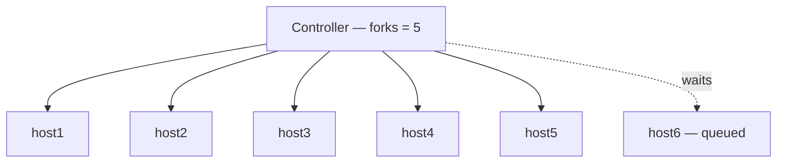
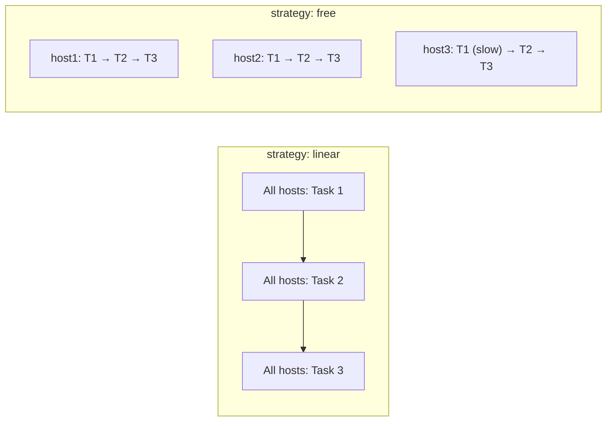
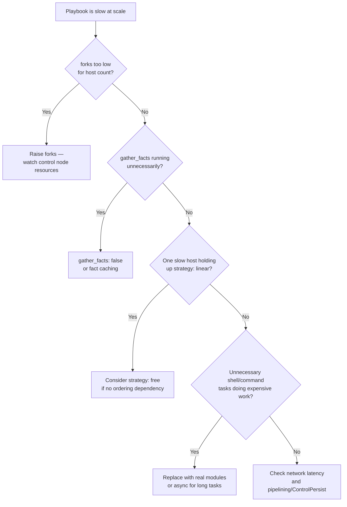

# Forks, Serial, Strategy, and Throttle

Four keywords, frequently confused with each other, that all sound like "how parallel is this." They control four genuinely different things.

## What You'll Learn

- What `forks` actually limits, and what it doesn't
- The difference between `strategy: linear` and `strategy: free`
- What `serial` and `throttle` add on top of forks, and why they solve different problems
- How to reason about a playbook that's slow across hundreds of hosts

## Forks: The Parallelism Ceiling

`forks` is the maximum number of hosts Ansible works on **at the same time**, for a single task. Default is 5.



With 100 hosts and `forks: 5`, Ansible processes them in batches of 5 for **each task** — host 6 doesn't start task 1 until one of the first 5 finishes it. Raise the ceiling:

```ini title="ansible.cfg"
[defaults]
forks = 20
```

```bash
ansible-playbook site.yml --forks 20
```

Higher forks means more simultaneous SSH connections and more simultaneous load on the control node (memory, file descriptors) and on whatever the tasks themselves hit (a package mirror, a database). It is **not** free — raising `forks` past what the control node or the target infrastructure can absorb makes things slower, not faster.

## Strategy: How Hosts Move Through the Task List

```yaml
- hosts: web
  strategy: linear   # default
  tasks: ...
```

- **`linear`** (default) — every host must finish the current task before **any** host moves to the next one. A slow host holds up the whole batch, task by task.
- **`free`** — each host runs through the entire task list independently, as fast as it can, with no per-task synchronization across hosts.



`free` is faster in aggregate when hosts have meaningfully different task durations and there's no cross-host ordering dependency in the play. It is **wrong** the moment a later task assumes an earlier task already completed on *every* host (a common pattern: "wait for all web servers to be updated before touching the load balancer") — `linear` is what makes that assumption safe.

## Serial: Batching a Rollout, Not Parallelism

```yaml
- hosts: web
  serial: 2
  tasks: ...
```

`serial` limits how many hosts go through the **entire play** at once — a canary/rolling-deployment control, independent of `forks`. `serial: 2` on 20 hosts means: run the whole play against 2 hosts, then the next 2, and so on — never touching the other 18 until the first batch is done.

```yaml
- hosts: web
  serial: [1, 5, "100%"]
```

A stepped list canaries a rollout: one host first, then five, then everyone else. Each batch starts when the previous one finishes, but **finishing isn't succeeding**: by default a host that fails is dropped and the next batch starts anyway. [Stopping a Bad Rollout](#stopping-a-bad-rollout) covers what actually halts it.

**`forks` vs. `serial`, precisely:** `forks` bounds simultaneous connections *within* whatever batch is currently running; `serial` decides how big that batch is in the first place. `serial: 2` with `forks: 20` still only ever touches 2 hosts, because `serial` is the tighter constraint.

## Stopping a Bad Rollout

By default, Ansible keeps going as long as there are hosts in the play that haven't failed. With `serial`, that has a consequence most people discover during an incident: the canary fails, Ansible drops it, and the next batch starts. Only a batch in which **every** host fails ends the play. Two keywords change that:

```yaml
- hosts: web
  serial: [1, "10%", "100%"]
  max_fail_percentage: 0     # any failed host in a batch stops the play
  # or: any_errors_fatal: true
```

- **`max_fail_percentage`** is checked per batch, and the percentage must be **exceeded**, not met. With `serial: 4` and `max_fail_percentage: 50`, two failures (exactly 50%) don't stop the play; three do. To stop at two, use `49`.
- **`any_errors_fatal: true`** stops on the first error: Ansible finishes the failing task on every host in the current batch, then ends the play.
- A failure handled by [`block`/`rescue`](../playbook-engineering/01-blocks-rescue-always.md) counts as a success, so it never trips either setting.

Try your own numbers. The planner reproduces ansible-core's batching, including its rounding:

<div class="cc-tool" data-cc-tool="serial" markdown>
**Serial batch planner** (needs JavaScript). With `serial: [1, "25%", "100%"]` on 20 hosts, Ansible runs batches of 1, 5, and 14. Percentages are of all hosts in the play, rounded down, and never below 1.
</div>

!!! incident "Real incident: CrowdStrike, July 2024"
    A content update for CrowdStrike's Falcon sensor went to every online Windows machine at once, and Microsoft estimated 8.5 million devices crashed. CrowdStrike's review committed to a staggered deployment that starts with a canary, which in Ansible is a `serial` list **plus** a stop condition. The playbook is in [Automation Outages](../case-studies/08-automation-outages-and-guardrails.md#crowdstrike-2024-one-update-every-machine).

## Throttle: A Per-Task Ceiling Inside a Play

```yaml
- name: Call a rate-limited external API
  ansible.builtin.uri:
    url: "https://api.example.com/register"
  throttle: 3
```

`throttle` caps parallelism for **one specific task**, even if `forks`/`serial` would otherwise allow more — useful when only one task in an otherwise-fine play needs to be gentler (a rate-limited third-party API, a database that can't take 20 simultaneous migration connections).

## `run_once` and `delegate_to`

Related, but answering a different question — "should this run on every host at all" rather than "how many at once." Covered in [Delegation and Become](../playbook-engineering/04-delegation-and-become.md).

## Putting It Together at Scale

| Keyword | Controls | Default |
|---|---|---|
| `forks` | Max simultaneous hosts, per task | 5 |
| `strategy` | Whether hosts stay in lockstep per task | `linear` |
| `serial` | Batch size for the whole play (rollout control) | unset (all hosts at once) |
| `throttle` | Max simultaneous hosts, for one specific task | unset (inherits `forks`) |

## Diagnosing a Slow Playbook Across Many Hosts



## What Most Engineers Miss

- **Percentages round down, in floating point.** ansible-core computes `int((pct / 100.0) * hosts)`, never less than 1. `serial: "25%"` of 10 hosts is 2, not 3, and `serial: "29%"` of 100 hosts is **28**, because 0.29 × 100 is 28.999… as a float.
- **Percentages are of the whole play**, not of the hosts still waiting. `serial: ["10%", "50%"]` on 100 hosts runs 10, then 50, then the last 40.
- **The last list value repeats.** `serial: [1, 5]` on 20 hosts runs 1, 5, 5, 5, then 4.
- **`run_once` runs once per batch**, not once per play. With `serial: 1` on 30 hosts, a `run_once` task runs 30 times. Put work that must happen once in its own play.
- **`throttle` can only lower parallelism.** It has an effect only when it's smaller than both `forks` and the batch size.
- **`forks` is a control-node setting.** 50 forks means up to 50 worker processes and 50 SSH connections from the machine running Ansible, which is usually the first thing to run out of memory.

## Common Mistakes

- Raising `forks` far past what the control node or target systems can absorb, making things slower, not faster.
- Using `strategy: free` on a play where a later task silently assumes every host finished an earlier one.
- Confusing `serial` with `forks` — `serial` doesn't make anything faster; it deliberately trades speed for a smaller blast radius during rollout.
- Applying `throttle` globally via `forks` when only one specific rate-limited task actually needs the lower ceiling.
- Relying on `serial` alone as a canary. Without `max_fail_percentage` or `any_errors_fatal`, a failed canary doesn't stop the next batch.

## Check Yourself

!!! quiz "Exactly half failed"
    A play has `serial: 4` and `max_fail_percentage: 50`. Two hosts in the first batch fail. What happens?

    - [ ] The play stops: 2 of 4 is 50%
    - [x] The play continues: the percentage must be exceeded, so it takes 3 failures
    - [ ] The play stops only if `any_errors_fatal` is also set

    Ansible stops when failed hosts divided by the batch size is **greater than** the percentage. 2 / 4 = 50% isn't greater than 50%. Use `max_fail_percentage: 49` to stop at two.

!!! quiz "How often does run_once run?"
    A play with `serial: 2` targets 6 hosts. How many times does a task with `run_once: true` run?

    - [ ] Once
    - [x] Three times, once per batch
    - [ ] Six times, once per host

    With `serial`, `run_once` means once per batch. Three batches of two hosts run it three times.

!!! quiz "What does 30% mean?"
    `serial: "30%"` on a play with 20 hosts. What are the batch sizes?

    - [ ] 6, then 4, then 3 (30% of whatever is left each time)
    - [x] 6, 6, 6, then 2
    - [ ] 7, 7, 6 (30% rounded up)

    The percentage is of all 20 hosts in the play, rounded down: 6. The value repeats until the remaining 2 hosts form the last batch.

## Interview Questions

- What's the difference between `forks` and `serial`?
- When would `strategy: free` be actively wrong for a play, not just unnecessary?
- You manage 5,000 hosts and a playbook run is taking two hours — what's your investigation process?

See [Interview Prep: Architecture & Performance](../interview-prep/02-architecture-and-performance-questions.md) and the full scenario in [Interview Prep: Scenario-Based Questions](../interview-prep/03-scenario-based-questions.md) for the complete reasoning walkthrough.

## Next

Continue to [Fact Caching](02-fact-caching.md) — the next lever once forks/strategy/serial are already tuned.
