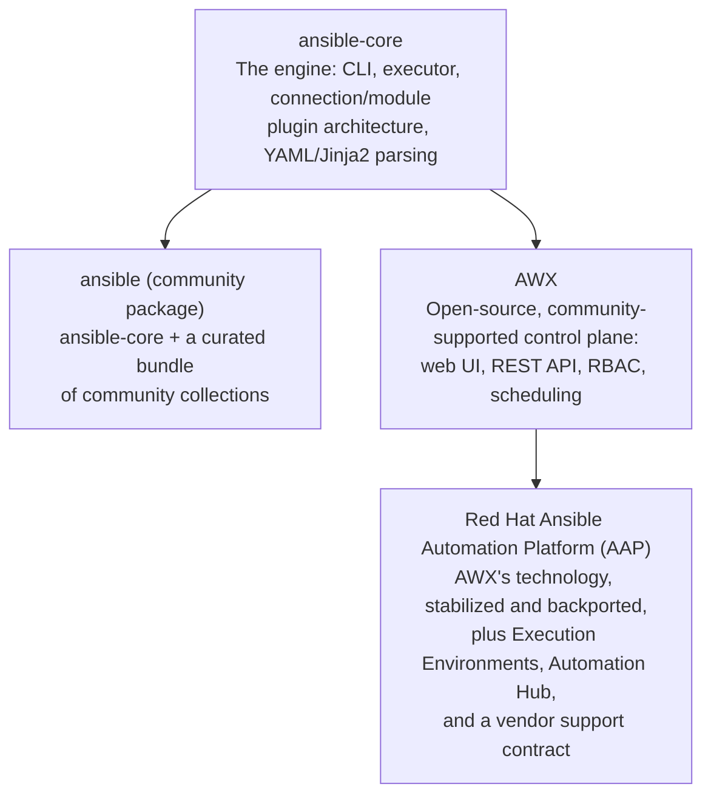
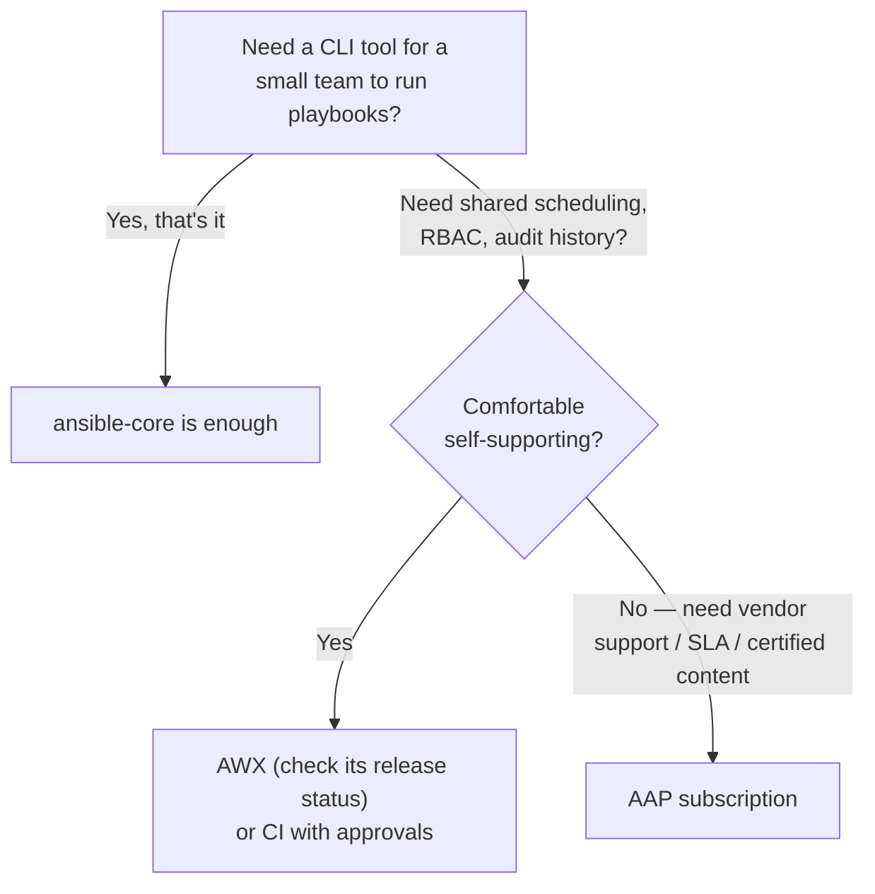

# Ansible vs ansible-core vs AWX vs AAP

**ansible-core** is the automation engine and its command-line tools. The **ansible** package is ansible-core plus a curated bundle of community collections. **AWX** is the free, open-source web UI and API that runs those playbooks for a team. **Red Hat Ansible Automation Platform (AAP)** is Red Hat's supported, subscription product, whose automation controller is built from AWX.

## What You'll Learn

- Four distinct things people mean when they say "Ansible," disambiguated precisely
- How the `ansible` package relates to `ansible-core`, and how to tell which you have
- Where AWX fits relative to Red Hat Ansible Automation Platform, and where AWX stands in 2026
- How to decide which layer a project actually needs

## Why This Matters

Job postings, vendor pitches, and casual conversation all say "Ansible" to mean four genuinely different things. Someone asked to "set up Ansible" for a team could reasonably end up running `pip install ansible-core`, or provisioning a full AAP cluster with role-based access control and a scheduling UI — wildly different scopes of work, and the word alone doesn't disambiguate which one was meant.

## Comparison at a Glance

As of November 2026:

| | ansible-core | ansible (package) | AWX | AAP |
|---|---|---|---|---|
| **What it is** | The engine and CLI: `ansible`, `ansible-playbook`, `ansible-galaxy` | ansible-core plus a curated bundle of community collections | Web UI, REST API, RBAC, scheduling, and credential storage around ansible-core | Red Hat's supported platform: automation controller, automation hub, Event-Driven Ansible, execution environments, and more |
| **Install** | `pip install ansible-core` | `pip install ansible` | On Kubernetes, with the AWX Operator | Containers on RHEL 9 or 10, or the OpenShift operator |
| **Interface** | Command line | Command line | Web UI and API | Web UI and API |
| **Support** | Community | Community | Community only | Red Hat subscription |
| **Cost and license** | Free, GPL-3.0 | Free, GPL-3.0 | Free, Apache-2.0 | Paid subscription |
| **Release status** | 2.22.0, November 2026; a new version about every six months | 15.0.0, November 2026 | No release since 24.6.1 in July 2024 | 2.7 is the newest; 2.5, 2.6, and 2.7 are supported |
| **Best for** | Running playbooks from a terminal or CI | Getting common modules without installing collections one by one | Teams that self-support and can live with the release pause | Organizations that need vendor support, certified content, and SLAs |

## The Four Layers



- **`ansible-core`** — the engine itself: the CLI tools, the task execution engine, the connection/module/plugin architecture, YAML and Jinja2 parsing. Everything in [Getting Started](../getting-started/index.md) through [Build Your Own](../build-your-own/index.md) is entirely `ansible-core`.
- **`ansible` (the community package)** — `ansible-core` plus a curated bundle of community collections, installed together for convenience. Most beginners who `pip install ansible` (rather than `ansible-core`) get this — see [Installing Ansible](../getting-started/04-installing-ansible.md).
- **AWX** — the open-source, community-supported web UI/API control plane. Job scheduling, RBAC, credential storage, and a REST API sit in front of the same `ansible-core` engine underneath. No formal vendor support or backport guarantees. It runs on Kubernetes, installed with the AWX Operator.
- **Red Hat Ansible Automation Platform (AAP)** — the same Controller technology as AWX, stabilized and backported onto a supported release cadence, packaged with Execution Environments, Automation Hub (certified content), and Event-Driven Ansible, and backed by a Red Hat support contract. Since AAP 2.5, one **platform gateway** gives all of these a single login, UI, and API.

!!! note "Where Ansible Tower went"
    **Ansible Tower** was the earlier name of AAP's web UI and API. With AAP 2.0 in 2021, Red Hat renamed it **automation controller**. "AWX vs Tower" and "AWX vs AAP" are the same question.

**AWX is to AAP roughly what Fedora is to RHEL** — the open-source upstream that AAP's Controller is a stabilized, commercially supported downstream of.

## ansible vs ansible-core

`pip install ansible-core` gives you the engine and a small set of built-in modules (`ansible.builtin`). `pip install ansible` installs a matching `ansible-core` as a dependency, then adds a large bundle of community collections, such as `community.general` and the cloud collections. The two are versioned separately:

| ansible package | Released | Depends on |
|---|---|---|
| 15.0.0 | November 2026 | ansible-core 2.22 |
| 14.0.0 | June 2026 | ansible-core 2.21 |
| 13.0.0 | November 2025 | ansible-core 2.20 |

ansible-core 2.22, and therefore ansible 15, needs Python 3.13 or newer on the control node.

To see what you have:

```bash
ansible --version          # first line shows the engine, for example "ansible [core 2.22.0]"
pip show ansible ansible-core
```

If only the engine is installed, `pip show` prints `WARNING: Package(s) not found: ansible` and then the `ansible-core` details. In production, install ansible-core and only the collections you use, listed in a `requirements.yml`, so every change to your dependencies is explicit.

!!! warning "AWX releases are still paused"
    AWX's last release was 24.6.1, in July 2024. Releases were paused while the codebase was refactored into a pluggable architecture. In January 2026, Red Hat [said on the Ansible forum](https://forum.ansible.com/t/awx-modernization-moving-forward/45134) that the refactoring was complete and that the next phase would focus on developer documentation. As of November 2026 there is still no new release, and users in that thread are asking when releases will resume. Existing installations keep working, but they get no new features or security fixes in the meantime. Check the [AWX repository](https://github.com/ansible/awx) before building anything new on it.

    For a free web UI today, [Semaphore UI](https://semaphoreui.com/) is an MIT-licensed, actively maintained alternative, with regular releases through November 2026. Many teams simply run playbooks from CI (GitHub Actions, GitLab CI) with an approval gate.

## AAP Versions and Installation

According to Red Hat's [AAP life cycle page](https://access.redhat.com/support/policy/updates/ansible-automation-platform), AAP 2.7 is the newest release, and 2.5, 2.6, and 2.7 are all supported:

| AAP version | RPM installer | Containerized installer | OpenShift operator |
|---|---|---|---|
| 2.5 | RHEL 8 and 9 | RHEL 9 and 10 | Yes |
| 2.6 | RHEL 9 | RHEL 9 and 10 | Yes |
| 2.7 | Not available | RHEL 9 and 10 | Yes |

New installations should plan for containers or OpenShift. The same page lists ansible-core 2.16 as the platform default. Execution environments with ansible-core 2.18 are supported in 2.5 through 2.7, and 2.7 adds an ansible-core 2.20 stream.

## A Decision Framework



## What Most Engineers Miss

- **AAP doesn't run the ansible-core you test with.** Your laptop may have ansible-core 2.22, while AAP's default execution environment uses 2.16, and its newest supported stream is 2.20. A playbook that relies on newer behavior can pass locally and fail in the controller. Test in the same execution environment you deploy with, using `ansible-navigator`.
- **The package and engine version numbers are unrelated.** "Ansible 15" is the package; its engine is ansible-core 2.22. Bug reports and compatibility notes almost always mean the ansible-core version.
- **A paused project is a security decision.** An AWX installation from 2024 gets no fixes for its own vulnerabilities, or for those in the libraries it bundles. Plan around that rather than discovering it in an audit.

## Common Mistakes

- Describing a project as "using Ansible" without specifying which layer — leads to mismatched expectations about UI, RBAC, or support availability before a single playbook is even discussed.
- Assuming AAP (or AWX) replaces the need to understand `ansible-core` and playbooks — it's a control plane **around** the same playbooks covered throughout the rest of this documentation, not a replacement for writing them.
- Assuming AWX and AAP are functionally interchangeable long-term — AWX moves on its own schedule and doesn't carry the backport/support guarantees that matter for regulated or mission-critical environments; see [Licensing and Adoption](04-licensing-and-adoption.md).

## Check Yourself

!!! quiz "Which version is it?"
    A teammate says the team runs "Ansible 15". Which ansible-core release is that?

    - [ ] ansible-core 15
    - [x] ansible-core 2.22: the `ansible` package and the engine are versioned separately
    - [ ] ansible-core 2.15

    `ansible --version` shows the engine on its first line, which is the number that matters for behavior and bug reports.

!!! quiz "Free web UI"
    A small team wants a free web UI with scheduling and RBAC for its playbooks, starting this month. What should it weigh before choosing AWX?

    - [ ] Nothing: AWX is the community edition of AAP and ships regularly
    - [x] AWX hasn't released since July 2024, so it gets no new fixes; compare it with a maintained tool or CI with approvals
    - [ ] AWX only runs on RHEL

    Releases are paused while the project is modernized. Existing installs keep working, but nothing new ships until releases resume.

## Interview Questions

- What's the difference between `ansible-core` and the `ansible` package?
- What's the relationship between AWX and Ansible Automation Platform?
- If a company says they "use Ansible," what follow-up questions would clarify what they actually mean?

## Next

Continue to [Automation Controller and Automation Mesh](02-automation-controller-and-mesh.md).
