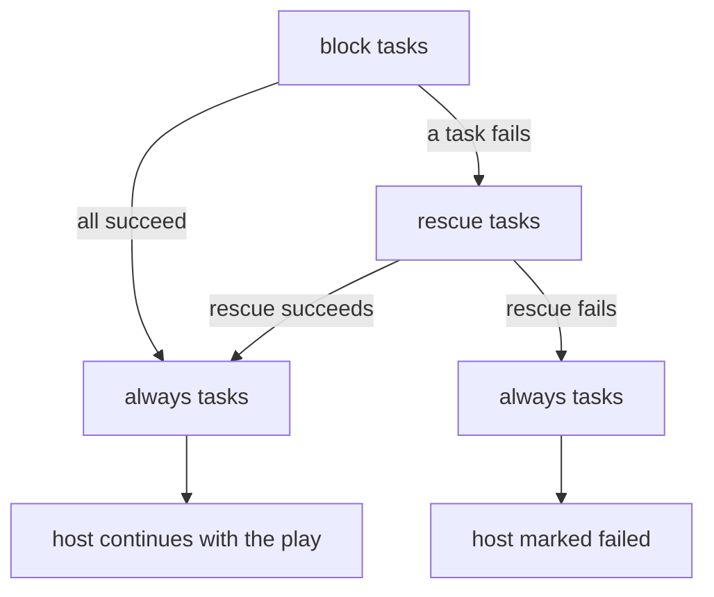

# Blocks, Rescue, and Always

`block` groups tasks, `rescue` runs only if a task inside the block fails, and `always` runs either way — Ansible's version of try/except/finally.

## What You'll Learn

- How `block:` groups tasks and shares keywords like `when`, `become`, and `tags`
- How `rescue:` and `always:` give you try/except/finally behavior, per host
- Which magic variables tell a `rescue` section what failed
- What happens to notified handlers when a block fails
- A complete deploy-with-rollback pattern you can adapt

## A Minimal Example

Save this as `block-demo.yml` and run it with `ansible-playbook block-demo.yml`. It needs no inventory, because it targets `localhost`:

```yaml title="block-demo.yml"
- name: block, rescue, and always
  hosts: localhost
  gather_facts: false
  tasks:
    - name: Upgrade the app, roll back if it fails
      block:
        - name: Run the database migration
          ansible.builtin.fail:
            msg: "Migration 42 failed: column already exists"

        - name: Never reached after the failure
          ansible.builtin.debug:
            msg: Upgrade finished

      rescue:
        - name: Report what failed
          ansible.builtin.debug:
            msg: "{{ ansible_failed_task.name }}: {{ ansible_failed_result.msg }}"

      always:
        - name: Runs whether the block failed or not
          ansible.builtin.debug:
            msg: Maintenance mode off
```

The output from ansible-core 2.22:

```text
TASK [Run the database migration] **********************************************
[ERROR]: Task failed: Action failed: Migration 42 failed: column already exists
Origin: /home/you/block-demo.yml:7:11

5     - name: Upgrade the app, roll back if it fails
6       block:
7         - name: Run the database migration
            ^ column 11

fatal: [localhost]: FAILED! => {"changed": false, "msg": "Migration 42 failed: column already exists"}

TASK [Report what failed] ******************************************************
ok: [localhost] => {
    "msg": "Run the database migration: Migration 42 failed: column already exists"
}

TASK [Runs whether the block failed or not] ************************************
ok: [localhost] => {
    "msg": "Maintenance mode off"
}

PLAY RECAP *********************************************************************
localhost                  : ok=2    changed=0    unreachable=0    failed=0    skipped=0    rescued=1    ignored=0
```

Three things to notice:

- The failure is still printed as `[ERROR]` and `fatal:`. That's normal: `rescue` runs after Ansible reports the failure.
- The second task in the block never ran. The block stops at the first failure, for that host.
- The recap says `failed=0` and `rescued=1`. Once `rescue` finishes, the host counts as recovered.

## Why This Exists

A flat task list has no concept of "if any of these three tasks fail, do this instead" — `block`/`rescue`/`always` is Ansible's answer, modeled loosely on try/except/finally from general-purpose languages, but evaluated per host.

## Mental Model

> `block` is the *try*. If any task in it fails **on a host**, Ansible stops the block for that host and runs `rescue` (the *except*). `always` (the *finally*) runs afterwards whether the block succeeded, failed, or was rescued. If `rescue` completes successfully, the host is considered recovered and continues with the rest of the play.



## Grouping Without Error Handling

Even without `rescue`, a block saves repetition. Keywords on the block apply to every task inside:

```yaml
- name: Install and configure PostgreSQL on Debian hosts
  when: ansible_facts['os_family'] == 'Debian'
  become: true
  tags: [database]
  block:
    - name: Install PostgreSQL
      ansible.builtin.apt:
        name: postgresql-16
        state: present

    - name: Deploy pg_hba.conf
      ansible.builtin.template:
        src: pg_hba.conf.j2
        dest: /etc/postgresql/16/main/pg_hba.conf
      notify: Reload postgresql
```

The `when:` is evaluated **for each task** inside the block, not once for the block as a whole.

## rescue and always

```yaml
- name: Attempt a risky schema change
  block:
    - name: Apply migration
      ansible.builtin.command: /opt/checkout/bin/migrate --to 42
      register: migration

  rescue:
    - name: Show what failed
      ansible.builtin.debug:
        msg: >-
          Task '{{ ansible_failed_task.name }}' failed:
          {{ ansible_failed_result.msg | default(ansible_failed_result.stderr | default('no message')) }}

    - name: Roll the schema back
      ansible.builtin.command: /opt/checkout/bin/migrate --to 41

  always:
    - name: Remove the maintenance lock whatever happened
      ansible.builtin.file:
        path: /opt/checkout/shared/maintenance.lock
        state: absent
```

Inside `rescue:` you get:

| Variable | Contains |
|---|---|
| `ansible_failed_task` | The task object that failed (`.name`, `.action`) |
| `ansible_failed_result` | That task's result (`.msg`, `.rc`, `.stderr`) |

A rescued host shows up as `rescued=1` in the play recap instead of `failed=1`.

## Worked Example: Deploy, Roll Back, Always Notify

```yaml title="playbooks/deploy_checkout.yml"
- name: Deploy checkout with automatic rollback
  hosts: web
  become: true
  serial: 1
  vars:
    releases_dir: /opt/checkout/releases

  tasks:
    - name: Remember the release that's live right now
      ansible.builtin.command: readlink -f /opt/checkout/current
      register: previous_release
      changed_when: false

    - name: Deploy the new release
      block:
        - name: Unpack release {{ app_release }}
          ansible.builtin.unarchive:
            src: "files/checkout-{{ app_release }}.tar.gz"
            dest: "{{ releases_dir }}"
            creates: "{{ releases_dir }}/{{ app_release }}"

        - name: Switch the current symlink
          ansible.builtin.file:
            src: "{{ releases_dir }}/{{ app_release }}"
            dest: /opt/checkout/current
            state: link

        - name: Restart checkout now, not at the end of the play
          ansible.builtin.systemd_service:
            name: checkout
            state: restarted

        - name: Wait for the health check to pass
          ansible.builtin.uri:
            url: http://localhost:8080/healthz
            status_code: 200
          register: health
          retries: 10
          delay: 3
          until: health.status == 200

      rescue:
        - name: Point current back at the previous release
          ansible.builtin.file:
            src: "{{ previous_release.stdout }}"
            dest: /opt/checkout/current
            state: link

        - name: Restart on the previous release
          ansible.builtin.systemd_service:
            name: checkout
            state: restarted

        - name: Fail the host after rolling back, so the rollout stops
          ansible.builtin.fail:
            msg: "Release {{ app_release }} failed its health check on {{ inventory_hostname }}; rolled back."

      always:
        - name: Post the outcome to the deploy channel
          ansible.builtin.uri:
            url: "{{ deploy_webhook_url }}"
            method: POST
            body_format: json
            body:
              host: "{{ inventory_hostname }}"
              release: "{{ app_release }}"
              result: "{{ 'rolled back' if ansible_failed_task is defined else 'deployed' }}"
          delegate_to: localhost
          become: false
          no_log: true
```

Two deliberate choices:

- The restart is a **task**, not a handler. Handlers wait until the end of the play, so the health check would run against the old process.
- `rescue` ends with `fail`. Without it the host counts as recovered, and `serial: 1` would happily move on to the next host with the same broken release.

## Handlers and Blocks

What happens to a handler that a block notified before one of its tasks failed depends on whether the host recovers. Each row below was run on ansible-core 2.22:

| The block fails, and... | The notified handler |
|---|---|
| `rescue` recovers the host | Runs at the end of the play, **after** the `rescue` tasks |
| Nothing rescues it | Never runs: the host failed, and its notified handlers are dropped |
| Nothing rescues it, with `force_handlers: true` (or `--force-handlers`) | Runs anyway, even though the host failed |
| `meta: flush_handlers` comes right after the notifying task | Runs immediately, **before** the failure and before `rescue` |

The first row is the one that surprises people. The handler still fires after `rescue` has rolled things back, at the end of the play rather than when you expected, so a service your `rescue` already restarted gets reloaded a second time. When a reload has to happen at a specific point, such as before a health check, flush handlers right where you need them:

```yaml
    - name: Apply queued service reloads now
      ansible.builtin.meta: flush_handlers
```

[Handlers](../core-concepts/08-handlers.md) covers how notification and flushing work in general.

## Limits of block

- You can't `loop:` over a block. Put the tasks in a file and `loop` over `include_tasks` instead.
- `rescue` catches task **failures**, not unreachable hosts or syntax errors.
- A block is not a transaction: tasks that already succeeded aren't undone unless your `rescue` undoes them.

## rescue, ignore_errors, or failed_when?

Three tools change what a failure does, and they're easy to mix up:

| Tool | What it does | Does `rescue` run? | In the recap |
|---|---|---|---|
| `block` + `rescue` | Runs recovery tasks when a task in the block fails | Yes | `rescued=1` |
| `ignore_errors: true` | Lets the task fail and carries on with the next task | No: the failure is ignored before `rescue` sees it | `ignored=1` |
| `failed_when` | Decides what counts as a failure: `failed_when: false` never fails, a condition can fail a task that exited 0 | Only if the condition makes the task fail | `failed=1`, or `rescued=1` inside a block |

Use `failed_when` to define failure correctly, `rescue` to recover from it, and `ignore_errors` only when a failure genuinely doesn't matter. [Error Handling](02-error-handling.md) covers `failed_when`, `changed_when`, and `any_errors_fatal` in detail.

## What Most Engineers Miss

- **A rescued failure doesn't count as a failure.** The Ansible docs say it plainly: a rescued task is considered successful and doesn't trigger `max_fail_percentage` or `any_errors_fatal` (see [serial and max_fail_percentage](../advanced-execution/01-forks-serial-strategy-throttle.md)). A rolling deploy whose `rescue` rolls back without re-failing will happily move on to the next batch with the same broken release, which is why the worked example above ends `rescue` with `fail`.
- **`always` doesn't run for unreachable hosts either.** Invalid task definitions and unreachable hosts trigger neither `rescue` nor `always`, so a cleanup step in `always` (removing a maintenance lock, re-enabling a load balancer member) won't run on a host that dropped off the network mid-block.
- **`ignore_errors: true` hides failures from `rescue`.** A task that fails with `ignore_errors` is treated as done, the block continues, and `rescue` never runs. Use one or the other, not both.
- **`failed_when` decides what `rescue` sees.** A `command` that exits 0 but prints an error isn't a failure until `failed_when` says so, and then it's caught like any other.

## Common Mistakes

- Assuming a failure inside `rescue:` itself is silently swallowed — it isn't; an unhandled failure there still fails the host.
- Forgetting `always:` runs even on a host that never entered `rescue:` (the `block` fully succeeded) — it isn't only for the failure path.
- Rolling back in `rescue` without re-failing, so a rolling deploy continues to the next host as though nothing happened.
- Relying on a handler restart inside the block and health-checking before the handler has run.
- Expecting `rescue` to catch an `UNREACHABLE` host.

## Check Yourself

!!! quiz "Does the rollout stop?"
    A play with `serial: 1` and `max_fail_percentage: 0` deploys inside a `block`. On the first host the health check fails, `rescue` rolls back successfully, and `rescue` doesn't call `fail`. What happens next?

    - [ ] The play stops: the host failed and the threshold is 0%
    - [x] The next host is deployed: a rescued failure counts as a success
    - [ ] Ansible retries the first host

    Rescued tasks don't trigger `max_fail_percentage` or `any_errors_fatal`. End the `rescue` with `ansible.builtin.fail` when the rollout should stop.

!!! quiz "The host that vanished"
    Mid-block, a host loses network connectivity and becomes `UNREACHABLE`. Which sections run for it?

    - [ ] `rescue`, then `always`
    - [ ] Only `always`
    - [x] Neither: unreachable hosts don't trigger `rescue` or `always`

    `block` error handling covers task failures. Cleanup that must happen even when a host disappears needs to run from somewhere else, such as a later play or a `delegate_to` task on another host.

!!! quiz "The handler after a rescue"
    A block's first task changes a config file and notifies `Reload app`. The next task fails, and `rescue` rolls the file back successfully. Does the handler run?

    - [ ] No: handlers are dropped as soon as a task fails
    - [x] Yes, at the end of the play, after the `rescue` tasks
    - [ ] Yes, immediately, before `rescue` starts

    The host recovered, so its notified handlers still run at the end of the play. Add `meta: flush_handlers` right after the notifying task if the reload must happen first.

## Interview Questions

- What's the difference between `rescue:` and `always:`?
- How would you implement a deployment rollback using `block`/`rescue`?
- After `rescue` runs successfully, is the host considered failed? How do you change that?
- Why might a health check inside a block pass against the *old* version of a service?

## Next

Continue to [Error Handling](02-error-handling.md).
