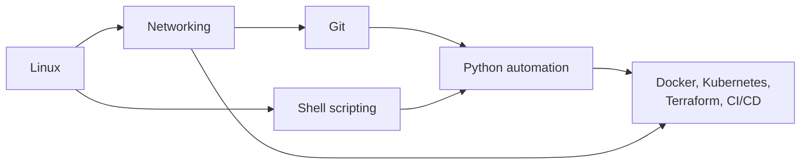

# DevOps Foundations

Docker, Kubernetes, Terraform, and CI/CD all sit on the same handful of skills. A container is a Linux process. A Service is a network address and a DNS name. A pipeline starts with a Git push. And the glue between tools is usually a script. When those foundations are solid, every tool on top becomes easier to learn and much easier to debug.

## What You'll Learn

- How to operate and troubleshoot Linux servers with confidence
- How traffic actually moves — IP, TCP, DNS, HTTP, TLS, and load balancers
- How Git works internally, and how teams branch, review, and recover
- How to write Python automation that is safe to run unattended

## The Tracks

| Track | Why it matters | Start |
|---|---|---|
| **Linux for DevOps** | Every server, container, and CI runner is Linux. Permissions, processes, systemd, disks, and performance are daily work. | [Linux](linux/index.md) |
| **Shell Scripting** | Turning runbook commands into safe, repeatable scripts is the first step of automation. | [Shell Scripting](shell-scripting/index.md) |
| **Networking** | Most production incidents involve DNS, TLS, timeouts, or a load balancer. | [Networking](networking/index.md) |
| **Git and Branching** | Git is the interface to CI/CD and GitOps. Recovery skills prevent lost work. | [Git](git/index.md) |
| **Python Automation** | When a shell script outgrows itself, Python handles APIs, data, and error handling cleanly. | [Python](python/index.md) |

## Interactive Tools

Paste real output from your own machine and get an answer, not a lecture. Each tool runs in your browser and follows the rules of the software it models.

| Tool | Paste or type | You get |
|---|---|---|
| [Bash argument viewer](shell-scripting/01-bash-fundamentals.md#how-bash-turns-a-line-into-arguments) | A command line and its variables | The exact arguments the program receives, with warnings for empty variables, splitting, and `rm -rf` disasters |
| [Permission walker](linux/01-filesystem-and-permissions.md#debugging-permission-denied) | `namei -l` and `id` output | The path component that blocks you, why, and the smallest fix |
| [Exit status decoder](linux/02-processes-and-signals.md#reading-an-exit-status) | 137, 143, -9, 127… | Which signal or error it was, and where to look next |
| [Cron schedule preview](linux/03-systemd-and-journald.md#reading-and-writing-cron-jobs) | A crontab line | The next eight runs and the traps in the expression |
| [CIDR planner](networking/01-tcp-ip-ports-and-sockets.md#ip-addresses-and-cidr) | Your VPC, VPN, and cluster ranges | Overlaps, including Docker and Kubernetes defaults |
| [Ephemeral port budget](networking/01-tcp-ip-ports-and-sockets.md#ephemeral-ports) | Connection rate and range | How close you are to `Cannot assign requested address` |
| [Certificate lifetime planner](networking/03-http-and-tls.md#certificate-lifetimes-and-automation) | `openssl x509 -dates` output | Days left, renewal date, and what 47-day certificates will cost |
| [Reflog rescue](git/04-undo-and-recovery.md#read-your-own-reflog) | `git reflog` output | The commit to go back to after a bad reset, rebase, or deleted branch |

## Real Outages Behind the Basics

Steam's launcher deleted users' files with an empty variable. A leap second pinned servers at 100% CPU. Slack's DNS rollback took 24 hours because of a record it didn't control. PyTorch users installed a malicious package because of how pip picks between indexes. [Real Outages Behind the Fundamentals](real-world-outages.md) walks through these incidents and more, each tied to a chapter and a guardrail.

## What Changed in 2025 and 2026

| Change | Why it matters | Read |
|---|---|---|
| Ubuntu 25.10 and 26.04 LTS use the Rust `sudo-rs` and uutils coreutils by default | Scripts relying on rare GNU flags or output need testing | [Packages and Patching](linux/06-package-management-and-updates.md#what-most-engineers-miss) |
| systemd 258 removed cgroup v1; systemd 260 removed SysV init script support | Old agents and `/etc/init.d` services break on upgrade | [systemd](linux/03-systemd-and-journald.md#what-most-engineers-miss) |
| OpenSSH 10.0 removed DSA and defaults to post-quantum key exchange; 10.1 warns without it | Old servers trigger warnings; DSA keys stop working | [SSH Hardening](linux/05-users-sudo-and-ssh-hardening.md#what-most-engineers-miss) |
| Bash 5.3 added `${ cmd; }` command substitution without a subshell | Faster scripts, but only where Bash 5.3 is installed | [Bash Fundamentals](shell-scripting/01-bash-fundamentals.md#what-most-engineers-miss) |
| Public TLS certificates are capped at 200 days, falling to 47 by 2029; Let's Encrypt ended OCSP and expiry emails | Manual renewal and email-based monitoring no longer work | [HTTP and TLS](networking/03-http-and-tls.md#what-most-engineers-miss) |
| Python 3.15 makes UTF-8 the default encoding; Python 3.10 reached end of life | `open()` without `encoding=` changes behavior on some systems | [Project Setup](python/01-project-setup.md#what-most-engineers-miss) |
| Git's 3.0 plan: SHA-256 and `main` as defaults, Rust required | Tooling that assumes SHA-1 hashes needs a plan | [How Git Works](git/01-how-git-works.md#what-most-engineers-miss) |

## Suggested Order

You don't need to finish everything before moving on. A good rule: complete **Linux** and **Networking** before the [Docker course](../docker/index.md), and **Git** before [CI/CD Pipelines](../cicd/index.md).

## How to Practice

- **Use a disposable Linux machine.** A local VM (Multipass, UTM, VirtualBox), a WSL2 distribution, or a small cloud instance you can delete. The examples use Ubuntu 24.04 LTS and Rocky/RHEL 9 or 10; newer LTS releases behave the same for nearly everything here.
- **Break things on purpose.** Fill a disk, kill a process, misconfigure DNS — then fix it with the tools each chapter teaches.
- **Write down what changed and why.** Your notes become your runbooks.

!!! warning "Practice safely"
    Commands that change users, firewalls, disks, or SSH settings can lock you out or destroy data. Run them on a machine you can rebuild, and keep a second session open when editing SSH or firewall rules.

## Related Sections

- [Real Outages Behind the Fundamentals](real-world-outages.md) — incidents and guardrails for every track
- [Shell Scripting](shell-scripting/index.md) — turn the commands from these chapters into safe, reusable scripts
- [SRE Practices](../sre/index.md) — the reliability practices these skills support
- [Security](../security/index.md) — secrets, supply chain, and hardening beyond the basics

## Further Reading

- [Linux man-pages online](https://man7.org/linux/man-pages/)
- [Pro Git book](https://git-scm.com/book/en/v2)
- [IETF RFC index](https://www.rfc-editor.org/) — the specifications behind TCP/IP, DNS, HTTP, and TLS

## Next

Start with [Linux for DevOps](linux/index.md).
