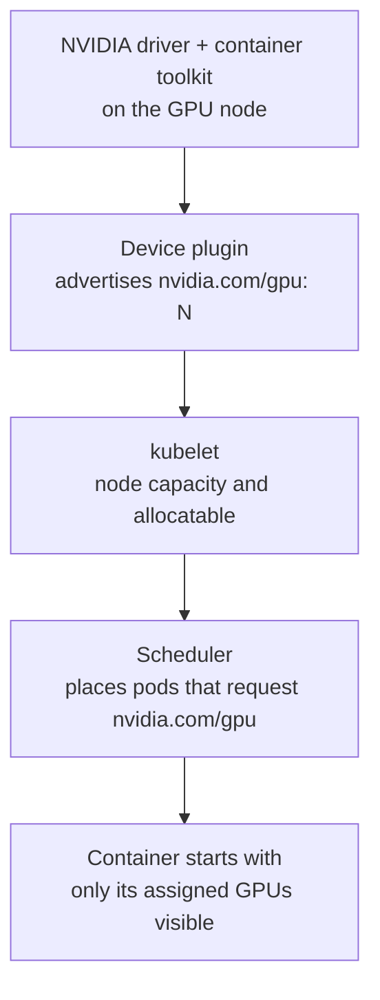

# GPUs on Kubernetes

## What You'll Learn

- How a GPU becomes a schedulable resource: driver, device plugin, and `nvidia.com/gpu`
- What Dynamic Resource Allocation (DRA) changes, and where it stands in November 2026
- When to share a GPU with MIG or time-slicing, and what each one costs you
- How to work out whether a model fits on a GPU, including the KV cache that sets your concurrency

## Why This Matters

GPU nodes are usually the most expensive nodes in a cluster, and often the hardest to get: cloud quotas, reservations, and regional shortages are normal. Two failures waste most of that money. GPUs sit idle because pods can't schedule onto them (a missing toleration, the wrong resource name, the wrong GPU model). Or a model is sized for its weights alone, fits, and then serves only a handful of requests at a time because nothing was left for the KV cache.

## Mental Model

> To the scheduler, a GPU is a counter on a node: `nvidia.com/gpu: 8`. Pods take whole units from that counter. Nothing else about the GPU, such as its memory, model, or topology, is visible to scheduling unless node labels or DRA expose it.



## How It Works

### The NVIDIA GPU Operator

Few teams install GPU components by hand. The [NVIDIA GPU Operator](https://docs.nvidia.com/datacenter/cloud-native/gpu-operator/latest/index.html) runs them as DaemonSets on GPU nodes: the driver (unless the node image already has one), the NVIDIA Container Toolkit, the device plugin, GPU Feature Discovery labels, and the DCGM exporter for metrics.

```bash
helm repo add nvidia https://helm.ngc.nvidia.com/nvidia
helm install gpu-operator nvidia/gpu-operator \
  --namespace gpu-operator --create-namespace
# Pin --version in real installs. On images that ship a driver: --set driver.enabled=false

kubectl get nodes -o custom-columns='NAME:.metadata.name,GPUS:.status.allocatable.nvidia\.com/gpu'
```

Managed platforms often pre-install the driver and device plugin on GPU node pools. Check what is already running before you add the Operator on top.

### Requesting a GPU with the device plugin

```yaml
apiVersion: v1
kind: Pod
metadata:
  name: cuda-smoke-test
spec:
  restartPolicy: Never
  containers:
    - name: cuda
      image: nvidia/cuda:13.0.0-base-ubuntu24.04
      command: ["nvidia-smi"]
      resources:
        limits:
          nvidia.com/gpu: 1          # whole GPUs only; the request defaults to the limit
  tolerations:
    - key: nvidia.com/gpu            # many platforms taint GPU nodes with this key
      operator: Exists
      effect: NoSchedule
```

The rules from the [Kubernetes GPU guide](https://kubernetes.io/docs/tasks/manage-gpus/scheduling-gpus/):

- GPUs go in `limits`. You may also set `requests`, but they must equal the limit, and a request without a limit is rejected.
- With the device plugin you get whole devices: `nvidia.com/gpu: 0.5` is not a thing. Sharing works differently (see below).
- GPU nodes are usually tainted so that ordinary pods stay off them. If the taint key is the resource name (`nvidia.com/gpu`) and the `ExtendedResourceToleration` admission plugin is enabled, Kubernetes adds the toleration to any pod that requests a GPU, so you can leave it out of the spec.

To pick a GPU model, use node labels. GPU Feature Discovery adds labels such as `nvidia.com/gpu.product`, and managed platforms add their own (GKE uses `cloud.google.com/gke-accelerator`):

```yaml
  nodeSelector:
    nvidia.com/gpu.product: NVIDIA-L4
```

### Dynamic Resource Allocation (DRA)

The device plugin model has hard limits: integer counts, no way to ask for "a GPU with at least 40 GB", and no sharing of one device between pods by design. [DRA](https://kubernetes.io/docs/concepts/scheduling-eviction/dynamic-resource-allocation/) replaces the counter with a claim. A DRA driver publishes each device and its attributes (model, memory, MIG profiles) in `ResourceSlice` objects, pods reference a `ResourceClaim`, and the scheduler picks a device that matches.

DRA graduated to GA in Kubernetes 1.34 under `resource.k8s.io/v1`. Later features build on it: prioritized lists ("an H100, or else two L4s") are stable since 1.36, and partitionable devices are beta since 1.36.

```yaml
apiVersion: resource.k8s.io/v1
kind: ResourceClaimTemplate
metadata:
  name: one-gpu
spec:
  spec:
    devices:
      requests:
        - name: gpu
          exactly:
            deviceClassName: gpu.nvidia.com   # installed by NVIDIA's DRA driver
---
apiVersion: v1
kind: Pod
metadata:
  name: dra-gpu-test
spec:
  restartPolicy: Never
  resourceClaims:
    - name: gpu
      resourceClaimTemplateName: one-gpu      # one claim is created per pod
  containers:
    - name: cuda
      image: nvidia/cuda:13.0.0-base-ubuntu24.04
      command: ["nvidia-smi", "-L"]
      resources:
        claims:
          - name: gpu                         # refers to spec.resourceClaims[].name
```

!!! warning "DRA is GA; NVIDIA's GPU support for it is not, yet"
    NVIDIA's DRA driver now lives at [kubernetes-sigs/dra-driver-nvidia-gpu](https://github.com/kubernetes-sigs/dra-driver-nvidia-gpu) (v0.5.1, October 2026). Its README lists ComputeDomains (multi-node NVLink) as officially supported, but says GPU allocation is not yet officially supported, so the GPU plugin is disabled by default in the Helm chart. For production GPU serving in November 2026, the device plugin is still the default path. Try DRA on a non-critical node pool.

### Sharing a GPU

A small model on an 80 GB GPU wastes most of it. NVIDIA offers two main ways to split one:

| Option | Isolation | Good for | Watch out for |
|---|---|---|---|
| Whole GPU (default) | Complete | Production model serving | Low utilization for small models |
| MIG (Multi-Instance GPU) | Memory and faults isolated in hardware | Several small models, multi-tenant serving | Only on MIG-capable data-center GPUs (A100, H100 and newer); fixed slice sizes; changing the layout drains the node |
| Time-slicing | None: no memory or fault isolation | Dev, notebooks, light or bursty inference | One pod can use all the memory and crash its neighbours |

Time-slicing is configured on the device plugin. With the GPU Operator, you write a ConfigMap and point the `ClusterPolicy` at it:

```yaml
apiVersion: v1
kind: ConfigMap
metadata:
  name: time-slicing-config
  namespace: gpu-operator
data:
  any: |-
    version: v1
    flags:
      migStrategy: none
    sharing:
      timeSlicing:
        resources:
          - name: nvidia.com/gpu
            replicas: 4          # each physical GPU is advertised as 4
```

```bash
kubectl patch clusterpolicies.nvidia.com/cluster-policy -n gpu-operator --type merge \
  -p '{"spec": {"devicePlugin": {"config": {"name": "time-slicing-config", "default": "any"}}}}'
```

NVIDIA's [GPU sharing docs](https://docs.nvidia.com/datacenter/cloud-native/gpu-operator/latest/gpu-sharing.html) list the catches: requesting two time-sliced replicas doesn't guarantee twice the compute, the DCGM exporter can't attribute metrics to containers while time-slicing is on, and the Operator doesn't watch the ConfigMap, so restart the device plugin DaemonSet after changing it.

### Models bigger than one node

Up to the number of GPUs in a node, a model is split with tensor parallelism inside one pod: request `nvidia.com/gpu: 4` and start the engine with a tensor-parallel size of 4. Beyond one node, several pods must start together and act as one replica:

- [LeaderWorkerSet](https://lws.sigs.k8s.io/) (v1.0) deploys a group of pods (one leader, N workers) as a unit of replication, built for multi-host inference.
- Gang scheduling makes sure all pods of a group get placed or none do, so half-started groups don't hold GPUs hostage. Kubernetes has a native [Workload and PodGroup API](https://kubernetes.io/docs/concepts/scheduling-eviction/gang-scheduling/) for this: alpha in 1.35, beta but off by default (feature gate `GenericWorkload`) in 1.37. [Kueue](https://kueue.sigs.k8s.io/) adds quotas and admission on top and integrates with LeaderWorkerSet.

## Will the Model Fit?

GPU memory holds three things: the weights, the KV cache, and working memory for activations.

- **Weights** ≈ parameters × bytes per parameter: 2 for BF16/FP16, 1 for FP8, about 0.5 for 4-bit.
- **KV cache per token** = 2 (keys and values) × layers × KV heads × head dimension × bytes per value.

A worked example with [Qwen3-8B](https://huggingface.co/Qwen/Qwen3-8B), which has 8.2 billion parameters, 36 layers, 8 KV heads, and a head dimension of 128, served in BF16:

- Weights: 8.2 B × 2 bytes ≈ **16.4 GB**
- KV cache: 2 × 36 × 8 × 128 × 2 bytes = 147,456 bytes ≈ **144 KiB per token**

On a 24 GB NVIDIA L4, vLLM by default plans to use 90% of GPU memory, about 21.6 GB. Take away the weights and roughly 1.5 GB of working memory, and about 3.7 GB is left for the KV cache: **roughly 25,000 tokens in flight across all requests**. At 8,000 tokens per conversation, that's three full conversations at once.

The same model on an 80 GB H100 leaves about 53 GB for the cache, roughly 350,000 tokens. The GPU has 3.3 times the memory but holds about 14 times the tokens, because the weights are a fixed cost you pay once. FP8 weights (about 8 GB) would roughly triple the L4's KV budget.

vLLM prints the KV cache size it actually got, in tokens, when it starts. Read it before load testing, not after.

## What Most Engineers Miss

- **The KV cache, not the weights, sets your concurrency.** "It fits" only means the weights fit. Size GPUs for the number of tokens in flight at peak, then check the startup log.
- **A bigger GPU is often cheaper per token.** Because the weights are a fixed cost, moving from 24 GB to 80 GB multiplies usable cache far more than it multiplies memory, as the example above shows.
- **GPU node scale-up is slow.** A new node may need minutes for the driver container to install, then minutes more to pull a multi-gigabyte engine image and load the weights. If you need capacity fast, keep warm nodes or reserved capacity.
- **Time-slicing hides failures.** With no memory isolation, one notebook allocating everything turns into out-of-memory errors in an unrelated inference pod on the same GPU.
- **DRA status depends on the driver, not on Kubernetes.** The API is GA, but each vendor's driver has its own maturity. Read the driver's README, not the Kubernetes release notes.

## Common Mistakes

- Pods stuck `Pending` with `untolerated taint` because the GPU node taint has no matching toleration.
- Putting `nvidia.com/gpu` in `requests` only. The API server rejects the pod: extended resources need a limit.
- Installing the GPU Operator's driver on node images that already ship one. Set `driver.enabled=false` on those pools.
- Mixing GPU models in one node pool without a `nodeSelector`, so a model sized for 80 GB lands on a 24 GB GPU and fails to start.
- Editing the time-slicing ConfigMap and expecting it to apply without restarting the device plugin.

## Check Yourself

!!! quiz "Fits, but slow"
    An 8B model's weights take 16 GB of a 24 GB GPU. vLLM starts fine, but under modest load requests queue and time to first token climbs. What's the most likely limit?

    - [ ] The GPU's compute is too slow for an 8B model
    - [x] The KV cache: only a few GB are left for in-flight tokens, so few requests fit in a batch
    - [ ] The HPA's `maxReplicas`

    Weights are a fixed cost. What's left after them is the KV cache, and it caps how many tokens (and therefore requests) the engine can batch at once.

!!! quiz "Requests without limits"
    A pod spec sets `resources.requests` to `nvidia.com/gpu: 1` and has no limits. What happens?

    - [ ] The pod schedules with one GPU
    - [x] The API server rejects the pod, because extended resources like GPUs need a limit
    - [ ] The pod schedules onto a time-sliced share of a GPU

    For extended resources, the limit is required and any request must equal it. Put GPUs in `limits`.

## Interview Questions

- Walk through how a container gets access to a GPU on Kubernetes, from the node driver to the scheduler.
- Compare MIG and time-slicing. Which would you use for multi-tenant inference, and why?
- What does DRA change compared to the device plugin, and why isn't everyone using it for GPUs yet?
- Does a 70B-parameter model in BF16 fit on two 80 GB GPUs? What would you change to serve long contexts on it?

## Further Reading

- [Schedule GPUs](https://kubernetes.io/docs/tasks/manage-gpus/scheduling-gpus/) and [Dynamic Resource Allocation](https://kubernetes.io/docs/concepts/scheduling-eviction/dynamic-resource-allocation/) (Kubernetes docs)
- [NVIDIA GPU Operator](https://docs.nvidia.com/datacenter/cloud-native/gpu-operator/latest/index.html) and its [GPU sharing guide](https://docs.nvidia.com/datacenter/cloud-native/gpu-operator/latest/gpu-sharing.html)
- [NVIDIA DRA driver for GPUs](https://github.com/kubernetes-sigs/dra-driver-nvidia-gpu)
- [LeaderWorkerSet](https://lws.sigs.k8s.io/) and [Kueue](https://kueue.sigs.k8s.io/)

## Next

Continue to [Serving LLMs with vLLM](02-serving-llms-with-vllm.md) to put a model on these GPUs.
