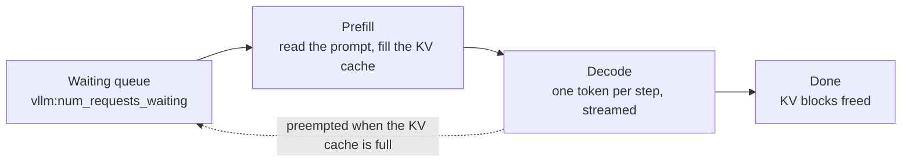

# Serving LLMs on Kubernetes with vLLM

To deploy vLLM on Kubernetes, run the `vllm/vllm-openai` image in a Deployment that requests a GPU, cache the model weights on a volume, give the pod a startup probe long enough for the model to load, and autoscale on the request queue rather than on CPU. This page builds that setup step by step and explains each choice.

## What You'll Learn

- What a model server does that a normal web server doesn't: continuous batching, the KV cache, and streaming
- A production-shaped vLLM Deployment: a model cache, `/dev/shm`, and probes for slow starts
- Why CPU-based autoscaling fails for LLMs, and how to scale on queue depth instead
- When to use tensor parallelism, KServe, or llm-d instead of a plain Deployment

## Why This Matters

[vLLM](https://docs.vllm.ai/) is a widely used open-source inference engine with an OpenAI-compatible API. llm-d and KServe's LLM serving build on it. Deploying it like a stateless web app goes wrong in predictable ways. Liveness probes kill pods while the model is still loading. Every restart downloads 16 GB of weights again. The HPA watches CPU, which never moves. Tensor-parallel pods crash because a container's default `/dev/shm` is only 64 MB.

## Mental Model

> One vLLM replica is one copy of the model's weights on one or more GPUs, plus a KV cache filling the rest of their memory. The replica serves many requests at once by batching them one token step at a time (continuous batching). Batching gives you throughput, and the KV cache caps how much you can batch.



Time to first token (TTFT) is time in the queue plus prefill. The pace of the stream after that (inter-token latency) depends on how many requests share each decode step.

## How It Works

### Deploy a model

This serves [Qwen3-8B](https://huggingface.co/Qwen/Qwen3-8B), an Apache-2.0 model that needs no Hugging Face token, on one 24 GB GPU:

```yaml
apiVersion: v1
kind: Namespace
metadata:
  name: llm
---
apiVersion: v1
kind: PersistentVolumeClaim
metadata:
  name: hf-cache
  namespace: llm
spec:
  accessModes: ["ReadWriteOnce"]
  resources:
    requests:
      storage: 50Gi
---
apiVersion: apps/v1
kind: Deployment
metadata:
  name: qwen3-8b
  namespace: llm
  labels:
    app: qwen3-8b
spec:
  replicas: 1
  strategy:
    type: Recreate                       # a ReadWriteOnce cache can't attach to two pods
  selector:
    matchLabels:
      app: qwen3-8b
  template:
    metadata:
      labels:
        app: qwen3-8b
    spec:
      terminationGracePeriodSeconds: 120 # let in-flight streams finish
      containers:
        - name: vllm
          image: vllm/vllm-openai:v0.34.0
          command: ["vllm", "serve"]
          args:
            - Qwen/Qwen3-8B
            - --max-model-len=8192
            - --gpu-memory-utilization=0.90
            - --port=8000
          env:
            - name: HF_TOKEN             # only needed for gated models
              valueFrom:
                secretKeyRef:
                  name: hf-token
                  key: token
                  optional: true
          ports:
            - name: http
              containerPort: 8000
          resources:
            requests:
              cpu: "4"
              memory: 16Gi
              nvidia.com/gpu: "1"
            limits:
              memory: 24Gi
              nvidia.com/gpu: "1"
          volumeMounts:
            - name: hf-cache
              mountPath: /root/.cache/huggingface
            - name: shm
              mountPath: /dev/shm
          startupProbe:
            httpGet:
              path: /health
              port: http
            periodSeconds: 10
            failureThreshold: 90         # up to 15 minutes to download and load weights
          readinessProbe:
            httpGet:
              path: /health
              port: http
            periodSeconds: 5
          livenessProbe:
            httpGet:
              path: /health
              port: http
            periodSeconds: 10
            failureThreshold: 6
      volumes:
        - name: hf-cache
          persistentVolumeClaim:
            claimName: hf-cache
        - name: shm
          emptyDir:
            medium: Memory               # vLLM uses shared memory for tensor parallelism
            sizeLimit: 2Gi
      tolerations:
        - key: nvidia.com/gpu
          operator: Exists
          effect: NoSchedule
---
apiVersion: v1
kind: Service
metadata:
  name: qwen3-8b
  namespace: llm
spec:
  selector:
    app: qwen3-8b
  ports:
    - name: http
      port: 8000
      targetPort: http
```

Why each piece is there:

- **`--max-model-len=8192`.** Without it, vLLM uses the model's full context, 40,960 tokens for Qwen3-8B. If the KV cache can't hold one sequence that long, vLLM refuses to start. On a 24 GB GPU the cache holds roughly 25,000 tokens (see [the sizing example](01-gpus-on-kubernetes.md#will-the-model-fit)), so set the limit to what your use case needs.
- **The cache volume** keeps downloaded weights across restarts. Without it, every restart pulls 16 GB from Hugging Face.
- **`strategy: Recreate`.** A rolling update would start a second pod that needs a second GPU and the same `ReadWriteOnce` volume. With several replicas, give each its own cache, or use a `ReadWriteMany` volume, and use a [rolling update](../workloads-and-scheduling/01-deployment-strategies.md) with `maxSurge: 0`.
- **The probes.** The server doesn't answer `/health` until the weights are loaded, which takes minutes. The [startup probe](../observability/01-probes-liveness-readiness-startup.md) gives it that time, and liveness checks only begin after startup succeeds.

### Talk to it

```bash
kubectl -n llm logs deploy/qwen3-8b -f        # wait for the server to finish starting
kubectl -n llm port-forward svc/qwen3-8b 8000:8000

curl -s localhost:8000/v1/models | jq -r '.data[].id'
curl -s localhost:8000/v1/chat/completions -H 'Content-Type: application/json' -d '{
  "model": "Qwen/Qwen3-8B",
  "messages": [{"role": "user", "content": "Explain a Kubernetes readiness probe in one sentence."}],
  "max_tokens": 200,
  "chat_template_kwargs": {"enable_thinking": false}
}' | jq -r '.choices[0].message.content'
```

Qwen3 writes out its reasoning before answering by default. `enable_thinking: false` skips that for short answers. Look in the startup log for the line that reports the KV cache size in tokens, which tells you how much concurrency you really have.

### Get weights onto nodes faster

The first start of a new replica is dominated by moving weights. Options, roughly from simplest to fastest:

| Approach | Trade-off |
|---|---|
| Download at startup into a `ReadWriteOnce` volume (above) | Simple; each new volume pays the full download once |
| Shared `ReadWriteMany` volume (NFS, Filestore, EFS) | Download once for all replicas; network file systems can load slower than local disk |
| Pre-pull onto local NVMe on node startup | Fast loads; you build and maintain the node bootstrap |
| Bake weights into the container image | One artifact to version; images of tens of GB slow every pull |

Once weights are cached, setting `HF_HUB_OFFLINE=1` stops vLLM from contacting the Hub at startup, so a Hub outage can't block a restart. Only set it after the first download has finished.

### Autoscale on the queue, not on CPU

An LLM server's CPU stays low no matter how busy it is, and GPU utilization reads high even at modest load (see [AI Observability](../../ai-guide/ai-observability.md#gpu-metrics-dcgm-exporter)). The honest signal is the queue: `vllm:num_requests_waiting` counts requests that arrived but can't join the batch yet.

First, let [Prometheus](../../monitoring-tools/prometheus.md) scrape vLLM's `/metrics` endpoint. It's served on the same port as the API:

```yaml
apiVersion: monitoring.coreos.com/v1
kind: PodMonitor
metadata:
  name: vllm
  namespace: llm
spec:
  selector:
    matchLabels:
      app: qwen3-8b
  podMetricsEndpoints:
    - port: http
      path: /metrics
      interval: 15s
```

Then scale on queue depth with [KEDA](https://keda.sh/docs/latest/scalers/prometheus/):

```yaml
apiVersion: keda.sh/v1alpha1
kind: ScaledObject
metadata:
  name: qwen3-8b
  namespace: llm
spec:
  scaleTargetRef:
    name: qwen3-8b
  minReplicaCount: 1
  maxReplicaCount: 4
  advanced:
    horizontalPodAutoscalerConfig:
      behavior:
        scaleDown:
          stabilizationWindowSeconds: 900   # a new replica takes minutes; don't flap
  triggers:
    - type: prometheus
      metadata:
        serverAddress: http://prometheus-operated.monitoring.svc:9090
        query: sum(vllm:num_requests_waiting{namespace="llm", model_name="Qwen/Qwen3-8B"})
        threshold: "4"
```

KEDA divides the query result by the threshold to get the target replica count, so 12 waiting requests means 3 replicas. KEDA drives an HPA underneath, so the scaling behavior in [Autoscaling](../workloads-and-scheduling/06-autoscaling.md#event-driven-scaling-with-keda) applies. Two cautions:

- A new replica takes minutes to become ready, so autoscaling smooths daily curves but can't absorb a sudden spike. Keep headroom in `minReplicaCount` for the traffic you can't afford to queue.
- Scale-to-zero (`minReplicaCount: 0`) works, but the first request then waits for a GPU node, an image pull, and a weight load. Use it for batch and development, not for interactive traffic.

Your PodMonitor is only picked up if your Prometheus instance's `podMonitorSelector` matches it. With kube-prometheus-stack, that usually means adding the chart's release label.

### More than one GPU per replica

When the weights or the needed KV cache don't fit on one GPU, split the model across several with tensor parallelism: request the GPUs and pass the same number to vLLM. Qwen3-32B has about 66 GB of weights in BF16, so it needs two 80 GB GPUs, not two 24 GB ones:

```yaml
          args:
            - Qwen/Qwen3-32B
            - --tensor-parallel-size=2
          resources:
            limits:
              nvidia.com/gpu: "2"
```

Keep tensor parallelism inside one node, where GPUs talk over NVLink or PCIe. For models that need several nodes, use [LeaderWorkerSet](https://lws.sigs.k8s.io/) or llm-d's well-lit paths, covered on [the next page](03-inference-routing-with-gateway-api.md#llm-d-the-full-stack).

### Beyond a plain Deployment

| Option | What it is | Choose it when |
|---|---|---|
| vLLM Deployment (this page) | One engine per pod, plain Kubernetes objects | You want to understand and control every piece |
| [SGLang](https://docs.sglang.io/) | Another open-source engine with an OpenAI-compatible server | Your models benchmark better on it |
| [KServe](https://kserve.github.io/website/) `LLMInferenceService` | CNCF incubating project; its LLM resource is built on llm-d | You want a platform API that many teams use to deploy models |
| [llm-d](https://llm-d.ai/) | Kubernetes-native distributed inference stack running vLLM, SGLang, and others; CNCF Sandbox, v1.0 in October 2026 | Many replicas, prefix-cache-aware routing, prefill/decode disaggregation |
| [vLLM production stack](https://docs.vllm.ai/projects/production-stack/) | Helm-based reference deployment with a router and dashboards | A quick start with the pieces already wired together |

## What Most Engineers Miss

- **The KV cache is the capacity number.** A replica with three 8,000-token conversations can be full while a dashboard shows "3 requests". Watch tokens and KV cache usage, not request counts.
- **Preemption is a warning sign.** When the KV cache fills, vLLM pauses requests and recomputes them later. A rising `vllm:num_preemptions_total` means you're out of memory headroom, and it shows up as tail latency before anything errors.
- **Memory-backed `emptyDir` counts against the pod's memory limit.** A 2 GiB `/dev/shm` plus the process's own memory must fit under `limits.memory`, or the kernel kills the container.
- **Pod termination cuts streams.** When a pod is deleted, it's removed from endpoints at the same time as it receives SIGTERM. Give in-flight requests time with `terminationGracePeriodSeconds`, and use a `preStop` sleep so the gateway stops sending traffic first.
- **The OpenAI-compatible API has no authentication by default.** Don't expose vLLM directly. Put it behind a gateway, or at least set `--api-key`.

## Common Mistakes

- A liveness probe with no startup probe, so the pod is killed in the middle of loading weights, forever.
- Scaling on CPU or GPU utilization instead of queue depth.
- No persistent cache, so every restart re-downloads the model.
- Using the `latest` image tag, so a node replacement silently upgrades the engine.
- Leaving `--max-model-len` at the model's maximum and wondering why vLLM won't start on a smaller GPU.

## Check Yourself

!!! quiz "Restart loop"
    New vLLM pods restart every few minutes and never become Ready. Events show `Liveness probe failed: connection refused`. What fixes it?

    - [ ] Raise the memory limit
    - [x] Add a startup probe with a long `failureThreshold` so liveness checks wait for the model to load
    - [ ] Switch the readiness probe to a TCP check

    vLLM doesn't listen until the weights are loaded. Without a startup probe, the liveness probe counts that loading time as failure and restarts the pod, which then starts loading again.

!!! quiz "The HPA that never scales"
    An HPA targeting 70% CPU never adds replicas, though users wait 20 seconds for the first token at peak. What should it scale on?

    - [ ] GPU utilization from the DCGM exporter
    - [x] Queue depth: `vllm:num_requests_waiting`
    - [ ] Container memory usage

    LLM serving is GPU-bound and CPU stays low. GPU utilization reads high even at modest load. Waiting requests rise exactly when users start to wait.

## Interview Questions

- Walk through what happens to a chat request inside vLLM, from arrival to the last token.
- Why does CPU-based autoscaling fail for LLM serving, and what would you scale on instead?
- How would you keep startup time under control for a 70B model?
- When would you choose KServe or llm-d over a plain Deployment?

## Further Reading

- [vLLM on Kubernetes](https://docs.vllm.ai/en/latest/deployment/k8s.html) and [vLLM metrics](https://docs.vllm.ai/en/latest/usage/metrics.html)
- [KEDA Prometheus scaler](https://keda.sh/docs/latest/scalers/prometheus/)
- [KServe](https://kserve.github.io/website/) and [llm-d](https://llm-d.ai/)

## Next

Continue to [Inference Routing with the Gateway API Inference Extension](03-inference-routing-with-gateway-api.md) to route traffic across replicas based on what each one is doing.
