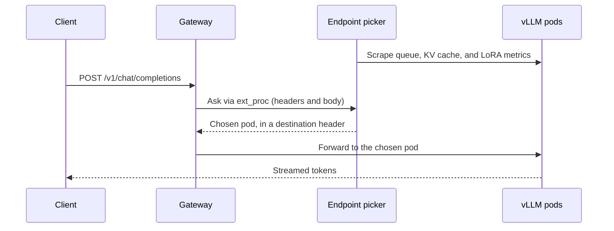

# Inference Routing with the Gateway API Inference Extension

## What You'll Learn

- Why round-robin load balancing fails for LLM traffic
- How an `InferencePool` and an endpoint picker make routing model-aware
- How to route a model through a Gateway with the llm-d router
- How priorities and flow control protect a shared GPU pool when demand outruns it

## Why This Matters

A Service or an ordinary Gateway route spreads requests evenly across pods. That works when requests cost about the same. LLM requests don't: a 50-token question and a 30,000-token document differ in cost by orders of magnitude. Even spreading leaves some replicas with full KV caches and long queues while others sit idle. It also throws away cached work. When the next turn of a conversation lands on a different replica, that replica recomputes the whole prompt instead of reusing the prefix the first replica already had in its cache.

The result is a long tail of time to first token and GPUs you pay for but don't use. The [Gateway API Inference Extension](https://gateway-api-inference-extension.sigs.k8s.io/) fixes this inside the standard [Gateway API](../networking/07-gateway-api.md).

## Mental Model

> An `InferencePool` is a "Service for model servers" that the gateway does not balance by itself. For each request, the gateway asks the pool's **endpoint picker** (EPP) which pod should serve it. The picker knows every pod's queue length, KV cache usage, cached prefixes, and loaded LoRA adapters, because it scrapes their metrics.



The gateway talks to the picker over Envoy's external processing (`ext_proc`) protocol, and the picker answers with the chosen pod in the `x-gateway-destination-endpoint` header. Any gateway that implements this protocol can use any conforming picker.

## How It Works

### The pieces, and where they live now

The project reorganized in 2026. Tutorials from 2025 show resources and charts that have since moved:

| Piece | API | Lives in (November 2026) | Role |
|---|---|---|---|
| `InferencePool` | `inference.networking.k8s.io/v1`, GA | Gateway API Inference Extension (v1.6.2) | Selects model-server pods and names their endpoint picker |
| Endpoint picker (EPP) | ext_proc service | [llm-d router](https://github.com/llm-d/llm-d-router) (v1.0.0) | Scores pods for each request |
| `InferenceObjective` | `llm-d.ai/v1` | llm-d router | Gives a workload a priority |
| `InferenceModelRewrite` | `llm-d.ai` | llm-d router | Rewrites model names, for canaries and A/B tests |
| Payload processor | ext_proc service | [llm-d Inference Payload Processor](https://github.com/llm-d/llm-d-inference-payload-processor) | Reads the request body to route by model name |

!!! note "Following an older tutorial?"
    In Gateway API Inference Extension v1.6.0, the endpoint picker, `InferenceObjective`, `InferenceModelRewrite`, and body-based routing moved to the llm-d project. The old `InferenceModel` resource and the `inference.networking.x-k8s.io` group for pools are gone: llm-d router v1.0 removed support for that group. The extension's own repository keeps the `InferencePool` API, the endpoint picker protocol, conformance tests, and a lightweight picker that is not meant for production.

### The InferencePool

```yaml
apiVersion: inference.networking.k8s.io/v1
kind: InferencePool
metadata:
  name: qwen3-8b
  namespace: llm
spec:
  selector:
    matchLabels:
      app: qwen3-8b            # the vLLM pods from the previous page
  targetPorts:
    - number: 8000
  endpointPickerRef:
    name: qwen3-8b-epp         # the Service in front of the picker
    port:
      number: 9002
    failureMode: FailClose     # the API default; FailOpen lets the gateway choose if the picker is down
```

- `selector` accepts only `matchLabels`, and only matches pods in the pool's own namespace.
- Each entry in `targetPorts` (up to 8) is treated as a separate endpoint, so one pod can serve several engine processes.
- `failureMode` decides what happens when the picker fails: `FailClose` (the default) drops the request, and `FailOpen` lets the gateway pick an endpoint itself.

You rarely write this by hand. The llm-d router's Helm chart creates the pool and its picker together, as shown next.

### Route a model through a Gateway

The steps below use Istio, which the llm-d router chart has a preset for, and the vLLM Deployment from [the previous page](02-serving-llms-with-vllm.md).

**1. Install the Gateway API and InferencePool CRDs:**

```bash
kubectl apply --server-side -f \
  https://github.com/kubernetes-sigs/gateway-api/releases/download/v1.6.3/standard-install.yaml
kubectl apply -f \
  https://github.com/kubernetes-sigs/gateway-api-inference-extension/releases/download/v1.6.2/v1-manifests.yaml
```

**2. Install a gateway implementation that supports `InferencePool`.** For Istio, inference support is switched on with a pilot setting:

```bash
istioctl install -y --set values.pilot.env.ENABLE_GATEWAY_API_INFERENCE_EXTENSION=true
```

Then create a Gateway for inference traffic:

```yaml
apiVersion: gateway.networking.k8s.io/v1
kind: Gateway
metadata:
  name: inference-gateway
  namespace: llm
spec:
  gatewayClassName: istio
  listeners:
    - name: http
      protocol: HTTP
      port: 80
```

**3. Install the endpoint picker and the pool:**

```bash
helm install qwen3-8b oci://ghcr.io/llm-d/charts/llm-d-router-gateway \
  --version v1.0.0 --namespace llm \
  --set router.modelServers.matchLabels.app=qwen3-8b \
  --set provider.name=istio \
  --set httpRoute.create=true
```

This creates an `InferencePool` named after the release, the picker Deployment and its `qwen3-8b-epp` Service on port 9002, and, because of `httpRoute.create=true`, this route:

```yaml
apiVersion: gateway.networking.k8s.io/v1
kind: HTTPRoute
metadata:
  name: qwen3-8b
  namespace: llm
spec:
  parentRefs:
    - group: gateway.networking.k8s.io
      kind: Gateway
      name: inference-gateway
  rules:
    - backendRefs:
        - group: inference.networking.k8s.io
          kind: InferencePool         # instead of a Service
          name: qwen3-8b
      matches:
        - path:
            type: PathPrefix
            value: /
      timeouts:
        request: 300s                 # long generations stream for minutes
```

**4. Send a request through the gateway:**

```bash
GW=$(kubectl -n llm get gateway inference-gateway -o jsonpath='{.status.addresses[0].value}')
curl -s http://$GW/v1/chat/completions -H 'Content-Type: application/json' -d '{
  "model": "Qwen/Qwen3-8B",
  "messages": [{"role": "user", "content": "Hello"}],
  "max_tokens": 50
}'

kubectl -n llm get inferencepool qwen3-8b -o yaml   # status.parents shows Accepted and ResolvedRefs
```

Gateway implementations listed as conformant on the [project's implementations page](https://gateway-api-inference-extension.sigs.k8s.io/implementations/gateways/): Alibaba Cloud ACK Gateway with Inference Extension, Istio (1.28 or later), agentgateway, Higress, and NGINX Gateway Fabric. llm-d also documents setups for GKE and Agent Router (formerly Envoy AI Gateway).

### How the picker chooses a pod

The llm-d router runs each request through a pipeline. Flow control and admission come first. Then each scheduling profile runs three stages:

1. **Filters** remove pods that can't serve the request, such as pods without the requested LoRA adapter.
2. **Scorers** rate the remaining pods, and their weighted scores are added up.
3. **A picker** chooses one, by default the highest score.

The chart's default configuration balances three signals:

```yaml
apiVersion: llm-d.ai/v1
kind: EndpointPickerConfig
plugins:
  - type: queue-scorer                  # fewer waiting requests scores higher
  - type: kv-cache-utilization-scorer   # more free KV cache scores higher
  - type: prefix-cache-scorer           # pods likely to hold this prompt's prefix score higher
schedulingProfiles:
  - name: default
    plugins:
      - pluginRef: queue-scorer
        weight: 2
      - pluginRef: kv-cache-utilization-scorer
        weight: 2
      - pluginRef: prefix-cache-scorer
        weight: 3
```

The data comes from scraping each model server's metrics. For vLLM that means `vllm:num_requests_waiting`, `vllm:kv_cache_usage_perc`, and `vllm:lora_requests_info`. Other scorers handle LoRA affinity, session affinity, and predicted latency.

Prefix-cache affinity is where most of the win comes from in chat and agent workloads. A long system prompt or conversation history that's already cached on one replica doesn't need to be prefilled again. That cuts time to first token and frees GPU time. Weight it too heavily, though, and popular prefixes pile onto one pod, which is why queue and KV cache scores balance it.

### Priorities and flow control

When several workloads share one pool, an `InferenceObjective` gives each a priority:

```yaml
apiVersion: llm-d.ai/v1
kind: InferenceObjective
metadata:
  name: interactive
  namespace: llm
spec:
  priority: 100
  poolRefs:
    - name: qwen3-8b
---
apiVersion: llm-d.ai/v1
kind: InferenceObjective
metadata:
  name: batch
  namespace: llm
spec:
  priority: -10          # negative priority marks requests as sheddable
  poolRefs:
    - name: qwen3-8b
```

A request selects an objective with the `x-llm-d-inference-objective` header, and a tenant with `x-llm-d-inference-fairness-id`. Without an objective header, a request gets priority 0.

Flow control is off by default. Turn it on with the `flowControl` feature gate in the picker's configuration. When it's on, and the pool is saturated, the picker holds requests in central queues instead of piling them onto pods. It always serves the highest priority band first, and takes turns between tenants within a band. Negative-priority bands get bounded queues, so batch traffic is shed in a controlled way instead of crowding out interactive users.

!!! warning "Don't let clients choose their own priority"
    Anyone who can set `x-llm-d-inference-objective: interactive` can jump the queue. Strip these headers from external requests and set them at a trusted layer, such as an API gateway or an authorization filter that maps API keys to tenants and objectives.

### Many models behind one endpoint

OpenAI-style APIs put the model name in the JSON body, and HTTPRoute can't match on a body. The payload processor's `body-field-to-header` plugin copies the `model` field into an `X-Gateway-Model-Name` header. Ordinary header matches then choose the pool, and that pool's picker chooses the pod:

```yaml
apiVersion: gateway.networking.k8s.io/v1
kind: HTTPRoute
metadata:
  name: models
  namespace: llm
spec:
  parentRefs:
    - name: inference-gateway
  rules:
    - matches:
        - headers:
            - name: X-Gateway-Model-Name
              value: Qwen/Qwen3-8B
      backendRefs:
        - group: inference.networking.k8s.io
          kind: InferencePool
          name: qwen3-8b
      timeouts:
        request: 300s
    - matches:
        - headers:
            - name: X-Gateway-Model-Name
              value: Qwen/Qwen3-32B
      backendRefs:
        - group: inference.networking.k8s.io
          kind: InferencePool
          name: qwen3-32b
      timeouts:
        request: 300s
```

### llm-d: the full stack

[llm-d](https://llm-d.ai/) is a Kubernetes-native distributed inference stack. It was founded by Red Hat, Google Cloud, IBM Research, CoreWeave, and NVIDIA, became a CNCF Sandbox project in March 2026, and released v1.0 in October 2026. The router on this page is one part of it. The rest are "well-lit paths": tested recipes for harder setups.

- **Prefix-cache-aware routing**, approximate or "precise" (driven by KV cache events from the engines), plus KV cache offloading to CPU memory and disk.
- **Prefill/decode disaggregation**: separate pods for reading prompts and for generating, with the KV cache moved between them over RDMA. This helps when long prompts and long outputs compete for the same GPUs.
- **Wide expert parallelism** for large mixture-of-experts models across many GPUs.
- **SLO-aware autoscaling** built on KEDA and metrics from the picker.

It runs on GPUs, TPUs, and other accelerators, and uses LeaderWorkerSet for multi-node replicas. KServe's `LLMInferenceService` is built on llm-d, so the same ideas sit under that platform API too.

## What Most Engineers Miss

- **The picker is in the request path.** With `FailClose`, which is the API default, a broken picker means a broken endpoint. The llm-d chart sets `FailOpen`, which keeps traffic flowing but falls back to model-blind routing. Either way, run more than one picker replica: llm-d runs extra replicas as warm standbys with leader election by default.
- **Timeouts are easy to miss.** Long generations stream for minutes, and some proxies close requests after 15 seconds by default (Envoy's route timeout). Set a request timeout on every inference route.
- **One pool, one model.** Every pod in a pool must serve the same base model, because the picker treats them as interchangeable apart from their state. Use one pool per model and route between pools.
- **The picker must reach the pods' metrics.** NetworkPolicies that block the picker from the model servers' metrics port quietly turn smart routing into guessing.

## Common Mistakes

- Following a 2025 tutorial that uses `InferenceModel`, the `inference.networking.x-k8s.io` group, or the old extension Helm chart.
- Using a gateway implementation without `InferencePool` support. The route shows `ResolvedRefs=False` and traffic goes nowhere.
- Pointing the HTTPRoute at the model Service instead of the pool. It works, but you lose model-aware routing.
- Mixing different models, or different versions of one model, in one pool.
- Trusting priority headers sent by clients.

## Check Yourself

!!! quiz "Uneven replicas"
    Two vLLM replicas sit behind a regular Service. One shows 95% KV cache usage and 12 waiting requests, and the other 30% and none. Nothing is broken. Why?

    - [x] The Service balances connections, not per-request cost or cache state
    - [ ] The HPA is misconfigured
    - [ ] The readiness probe is failing on the busy pod

    Requests differ hugely in cost, and the Service can't see queues or KV caches. An endpoint picker can.

!!! quiz "The picker goes down"
    The endpoint picker's pods crash. The `InferencePool` doesn't set `failureMode`. What happens to new requests?

    - [ ] The gateway round-robins them across the pool
    - [x] They fail, because the default failure mode is `FailClose`
    - [ ] They queue at the gateway until the picker returns

    Only `FailOpen` lets the gateway pick an endpoint on its own when the picker is unavailable.

## Interview Questions

- Why does round-robin balancing work poorly for LLM serving, and what signals would a better balancer use?
- Explain `InferencePool`, the endpoint picker, and `HTTPRoute`, and trace a request through them.
- How would you give interactive traffic priority over batch jobs on a shared GPU pool, without letting clients cheat?
- The endpoint picker is down. What happens, and how would you design for it?

## Further Reading

- [Gateway API Inference Extension](https://gateway-api-inference-extension.sigs.k8s.io/) and its [implementations list](https://gateway-api-inference-extension.sigs.k8s.io/implementations/gateways/)
- [llm-d router](https://github.com/llm-d/llm-d-router) and its [Helm charts](https://github.com/llm-d/llm-d-router/tree/main/config/charts)
- [llm-d flow control](https://github.com/llm-d/llm-d/blob/main/docs/architecture/router/flow-control.md)
- [llm-d](https://llm-d.ai/)

## Next

Continue to [Agents and Agent Gateways](04-agents-and-agent-gateways.md) for the traffic that calls these models: agents, tools, and the gateways that govern them.
