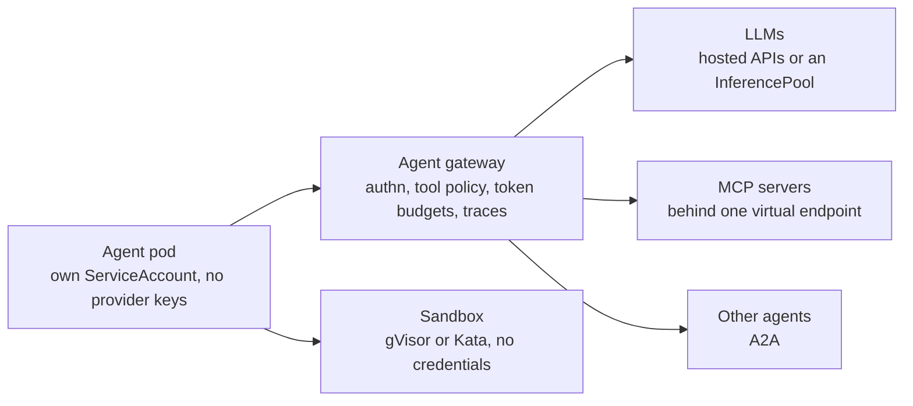

# AI Agents and Agent Gateways on Kubernetes

An agent gateway is a proxy between AI agents and everything they call: language models, MCP tool servers, and other agents. It authenticates each agent, decides which tools it may use, enforces token budgets, and records every call. This page covers running agents on Kubernetes with an agent gateway in front and sandboxes for the code they write.

## What You'll Learn

- What changes when the workload is an agent rather than a request/response service
- What an agent gateway does for LLM, MCP, and agent-to-agent (A2A) traffic
- How to put an MCP server behind agentgateway on Kubernetes
- How to run code that agents write with Agent Sandbox and Agent Substrate

## Why This Matters

An [agent](../../ai-guide/ai-agents.md) is a loop: it calls a model, decides which tools to use, and acts through MCP servers, internal APIs, and other agents. Every hop carries credentials, and every piece of text the agent reads can try to steer it (see [prompt injection](../../ai-guide/agent-labs/08-prompt-injection.md)). Without one place to apply policy, each agent team builds its own authentication, rate limits, and audit logging. MCP servers multiply, each holding its own API keys. Token spending has no owner until the invoice arrives.

## Mental Model

> Treat agents as untrusted, bursty clients with powerful tools. Give each one its own identity, send everything it calls through one policy point (the agent gateway), and run any code it writes in a sandbox that holds nothing worth stealing.



## How It Works

### Agents are workloads with extra needs

An agent runs as an ordinary Deployment, but lock it down more than a typical service:

- **Its own [ServiceAccount](../security/03-service-accounts.md)**, with `automountServiceAccountToken: false` unless it really needs the Kubernetes API. An agent that "helps debug the cluster" with cluster-admin rights is one injected instruction away from deleting it. Grant only what it needs with [RBAC](../security/02-rbac.md).
- **No provider API keys in the pod.** The gateway holds them and injects them into outbound requests, so a compromised agent has nothing to leak.
- **Default-deny egress.** An agent that can fetch any URL can be talked into sending data anywhere. Allow only the gateway and DNS with a [NetworkPolicy](../networking/04-network-policies.md):

```yaml
apiVersion: networking.k8s.io/v1
kind: NetworkPolicy
metadata:
  name: support-agent-egress
  namespace: agents
spec:
  podSelector:
    matchLabels:
      app: support-agent
  policyTypes: ["Egress"]
  egress:
    - to:
        - namespaceSelector:
            matchLabels:
              kubernetes.io/metadata.name: agentgateway-system
    - to:
        - namespaceSelector:
            matchLabels:
              kubernetes.io/metadata.name: kube-system
          podSelector:
            matchLabels:
              k8s-app: kube-dns
      ports:
        - protocol: UDP
          port: 53
        - protocol: TCP
          port: 53
```

If you'd rather declare agents than write Deployments, [kagent](https://kagent.dev/) is a Kubernetes-native agent framework and a CNCF Sandbox project. Version 1.0 (November 2026) defines agents with CRDs in `api.kagent.dev/v1alpha3`, such as `Agent`, `AgentTemplate`, `ModelConfig`, and `RemoteMCPServer`, and runs them on Agent Substrate (described below).

### The traffic an agent gateway sees

| Traffic | What it is | What the gateway can do with it |
|---|---|---|
| LLM calls | OpenAI- or Anthropic-style APIs to hosted providers or self-hosted models | Route between providers and models, fail over, count tokens, enforce budgets |
| MCP | The [Model Context Protocol](https://modelcontextprotocol.io/), how agents discover and call tools ([build an MCP server](../../ai-guide/agent-labs/04-build-an-mcp-server.md)) | Combine many servers into one endpoint, authorize per tool, audit every call |
| A2A | Agent-to-agent protocol for delegating tasks between agents ([A2A lab](../../ai-guide/agent-labs/10-a2a-protocol.md)) | Authenticate both sides, route by agent, trace across agents |

MCP's current specification (revision 2026-07-28) made the protocol stateless. It removed the `initialize` handshake and the `Mcp-Session-Id` session header, and every request over Streamable HTTP now carries `MCP-Protocol-Version`, `Mcp-Method`, and `Mcp-Name` headers. Load balancers and gateways can route and authorize on the tool name without parsing the JSON body, and any replica can serve any request. Servers still on a 2025 revision keep sessions inside one replica. Run those as a single replica, use session affinity, or upgrade them.

### Agent gateways in November 2026

| Gateway | Status | Notes |
|---|---|---|
| [agentgateway](https://agentgateway.dev/) | Linux Foundation project; v1.7.0 (October 2026); Apache-2.0 | Proxy built for LLM, MCP, and A2A traffic. Implements the Gateway API (`gatewayClassName: agentgateway`) with `AgentgatewayBackend` and `AgentgatewayPolicy` resources. Also a conformant `InferencePool` implementation |
| [Agent Router](https://theagentrouter.ai/) (formerly Envoy AI Gateway) | Agentic AI Foundation project; v1.3.0 (November 2026); Apache-2.0 | Built on Envoy Gateway. `AIGatewayRoute` for LLM providers, `MCPRoute` for MCP, `QuotaPolicy` for token budgets. Supports `InferencePool`. The CRDs keep the `aigateway.envoyproxy.io` group |
| GKE Agent Gateway | Preview (November 2026), GKE 1.37.2+ in the Rapid channel | Managed control of traffic to, from, and between agents on GKE |

### Example: an MCP server behind agentgateway

Install the controller (it needs the Gateway API CRDs first):

```bash
kubectl apply --server-side -f \
  https://github.com/kubernetes-sigs/gateway-api/releases/download/v1.6.3/standard-install.yaml
helm install agentgateway-crds oci://cr.agentgateway.dev/charts/agentgateway-crds \
  --version v1.7.0 --namespace agentgateway-system --create-namespace
helm install agentgateway oci://cr.agentgateway.dev/charts/agentgateway \
  --version v1.7.0 --namespace agentgateway-system
```

Create the gateway that agents will call:

```yaml
apiVersion: gateway.networking.k8s.io/v1
kind: Gateway
metadata:
  name: agentgateway-proxy
  namespace: agentgateway-system
spec:
  gatewayClassName: agentgateway
  listeners:
    - name: http
      protocol: HTTP
      port: 80
      allowedRoutes:
        namespaces:
          from: All          # tighten with a namespace Selector in production
```

Run the MCP server as a normal Deployment and Service. `appProtocol: agentgateway.dev/mcp` tells agentgateway that this port speaks MCP:

```yaml
apiVersion: apps/v1
kind: Deployment
metadata:
  name: tickets-mcp
  namespace: mcp-tools
spec:
  replicas: 2
  selector:
    matchLabels:
      app: tickets-mcp
  template:
    metadata:
      labels:
        app: tickets-mcp
    spec:
      automountServiceAccountToken: false
      containers:
        - name: server
          image: registry.example.com/tools/tickets-mcp:1.4.0   # your MCP server
          ports:
            - containerPort: 8000
---
apiVersion: v1
kind: Service
metadata:
  name: tickets-mcp
  namespace: mcp-tools
spec:
  selector:
    app: tickets-mcp
  ports:
    - port: 80
      targetPort: 8000
      appProtocol: agentgateway.dev/mcp
```

Then describe the MCP backend and route `/mcp` to it:

```yaml
apiVersion: agentgateway.dev/v1alpha1
kind: AgentgatewayBackend
metadata:
  name: tickets
  namespace: mcp-tools
spec:
  mcp:
    targets:
      - name: tickets
        static:
          backendRef:
            name: tickets-mcp
          port: 80
          protocol: StreamableHTTP
---
apiVersion: gateway.networking.k8s.io/v1
kind: HTTPRoute
metadata:
  name: mcp
  namespace: mcp-tools
spec:
  parentRefs:
    - name: agentgateway-proxy
      namespace: agentgateway-system
  rules:
    - matches:
        - path:
            type: PathPrefix
            value: /mcp
      backendRefs:
        - group: agentgateway.dev
          kind: AgentgatewayBackend
          name: tickets
```

Agents now use one MCP endpoint, `http://agentgateway-proxy.agentgateway-system/mcp`. Add more targets to the backend and agentgateway merges their tools into one virtual server. From here, add policy with `AgentgatewayPolicy`: OAuth or JWT authentication for MCP clients, CEL rules that allow a tool only for callers with certain JWT claims, and token budgets for LLM routes.

### Budgets and per-tool authorization

Whichever gateway you choose, these are the policies that matter most:

- **Authenticate every caller.** MCP over HTTP uses OAuth-based authorization, and gateways also accept JWTs and API keys. Map each agent to its own identity, not a shared key.
- **Authorize per tool, not per server.** "The support agent may call `get_ticket` and `add_comment`, not `close_ticket`." agentgateway expresses this as CEL rules over JWT claims, and Agent Router's `MCPRoute` has an authorization section that also uses CEL.
- **Budget tokens per agent and per tenant.** agentgateway applies token-unit rate limits through `AgentgatewayPolicy`, and Agent Router's `QuotaPolicy` charges a CEL-defined cost per request against a budget, answering `429` once it's spent. A single agent stuck in a tool loop can otherwise burn a month of budget in a night.
- **Trace everything.** Both gateways export OpenTelemetry traces and token metrics. That is where you see which agent called which tool with how many tokens. See [AI Observability](../../ai-guide/ai-observability.md).

### Running the code agents write

Coding and data-analysis agents run code they generated. That code must never run in the agent's own container, which has its identity and network access. Two Kubernetes projects target this:

**[Agent Sandbox](https://agent-sandbox.sigs.k8s.io/)** is a Kubernetes SIG Apps project (v1.0.12, November 2026) for isolated, stateful, single-pod workloads. A `Sandbox` (`agents.x-k8s.io/v1beta1`) is one pod with a stable identity that can hibernate and resume. `SandboxTemplate`, `SandboxClaim`, and `SandboxWarmPool` (`extensions.agents.x-k8s.io/v1beta1`) let you stamp sandboxes out from a template and keep pre-warmed ones ready. Isolation comes from the pod's `runtimeClassName`:

```yaml
apiVersion: agents.x-k8s.io/v1beta1
kind: Sandbox
metadata:
  name: code-runner-7f3a
  namespace: agent-sandboxes
spec:
  podTemplate:
    spec:
      runtimeClassName: gvisor            # or kata-qemu; the RuntimeClass must exist
      automountServiceAccountToken: false
      containers:
        - name: runner
          image: python:3.13-slim
          command: ["sleep", "infinity"]
          resources:
            limits:
              cpu: "1"
              memory: 1Gi
---
apiVersion: networking.k8s.io/v1
kind: NetworkPolicy
metadata:
  name: deny-all
  namespace: agent-sandboxes
spec:
  podSelector: {}
  policyTypes: ["Ingress", "Egress"]
```

**[Agent Substrate](https://github.com/agent-substrate/substrate)** (Apache-2.0, v1.0.1, November 2026) is a runtime for very large numbers of mostly idle agents. Every agent runs in a gVisor or Cloud Hypervisor sandbox. Idle agents are snapshotted out of memory and resumed onto a small pool of warm worker pods when a request arrives. Each agent gets a short-lived SPIFFE identity, and an egress gateway injects credentials outside the sandbox, so the agent never holds them. kagent 1.0 uses it as its runtime.

| | Agent Sandbox | Agent Substrate |
|---|---|---|
| Unit | One isolated pod per sandbox | Many agents multiplexed onto fewer worker pods |
| Best for | Per-session code execution, development environments | Platforms hosting thousands of mostly idle agents |
| Isolation | Your choice of RuntimeClass (gVisor, Kata) | Always gVisor or a microVM |

On GKE, both became generally available in November 2026.

## What Most Engineers Miss

- **Prompt injection turns tool access into attacker access.** Least privilege has to apply per tool, enforced outside the model. A system prompt saying "never call `close_ticket`" is not a control.
- **Budgets are a reliability feature.** Runaway agent loops are the LLM equivalent of a fork bomb. Per-agent token limits stop the damage. Alerts tell you after it's done.
- **Agent egress is an SSRF problem.** "Fetch this URL" tools can reach cloud metadata endpoints and internal services unless egress is default-deny.
- **Gateways see every prompt.** Their logs and traces contain whatever users and tools sent. Decide what gets stored before you turn on content capture.
- **Older MCP servers are stateful.** Before the 2026-07-28 revision, Streamable HTTP sessions lived inside one replica. Scaling such a server behind a plain Service produces random "session not found" errors.

## Common Mistakes

- Giving an agent's ServiceAccount broad cluster permissions "so it can investigate problems".
- Mounting provider API keys into agent pods instead of letting the gateway inject them.
- Running agent-generated code inside the agent container.
- Sharing one powerful token between every agent and every MCP server.
- Shipping agents with no per-agent token budget.

## Check Yourself

!!! quiz "Hidden instructions"
    An agent with a file-reading tool reads a web page that contains hidden text telling it to upload `~/.kube/config` to an external site. Which defense actually stops the upload?

    - [ ] A larger model that is better at spotting manipulation
    - [x] No credentials in the agent pod, per-tool authorization, and default-deny egress
    - [ ] A longer system prompt that forbids uploading files

    Model behavior can be steered by text it reads. Controls enforced outside the model hold regardless of what the model decides.

!!! quiz "Session not found"
    A team scales its MCP server from 1 to 3 replicas behind a Service. Clients now fail at random with "session not found". The server implements the 2025-06-18 revision of MCP and assigns session IDs. Why?

    - [ ] The Service needs `appProtocol: http2`
    - [x] Sessions in that revision live in one replica, so requests in a session must keep hitting it
    - [ ] Three replicas exceed the gateway's connection limit

    Use session affinity, run one replica, or move to the stateless 2026-07-28 revision, where any replica can serve any request.

## Interview Questions

- What does an agent gateway do that a regular API gateway doesn't?
- How would you isolate code that an agent writes and executes on Kubernetes?
- How do you stop one runaway agent from spending the whole month's token budget?
- Design authentication and authorization for 20 agents calling 15 MCP servers.

## Further Reading

- [agentgateway Kubernetes docs](https://agentgateway.dev/docs/kubernetes/latest/)
- [Agent Router documentation](https://theagentrouter.ai/docs/)
- [Model Context Protocol specification](https://modelcontextprotocol.io/specification/2026-07-28)
- [Agent Sandbox](https://agent-sandbox.sigs.k8s.io/) and [Agent Substrate](https://github.com/agent-substrate/substrate)
- [kagent](https://kagent.dev/)

## Next

Continue to [AI Observability](../../ai-guide/ai-observability.md) to monitor the models and agents you've deployed, or move on to [OpenShift](../openshift/index.md).
