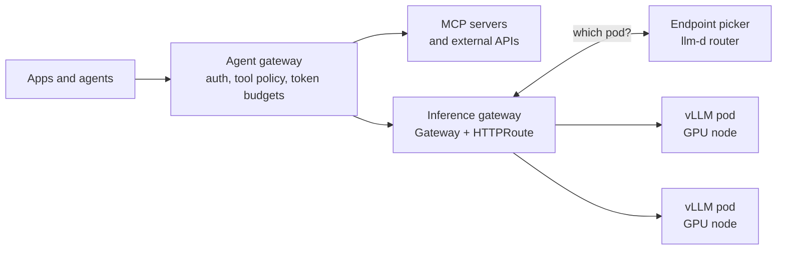

# AI Workloads on Kubernetes

Serving large language models has become one of the main reasons teams run Kubernetes, and it breaks assumptions that hold for ordinary web services:

- **GPUs are scarce, expensive, and indivisible.** A pod gets whole GPUs or nothing, and a model that doesn't fit in GPU memory doesn't run at all.
- **Requests are not interchangeable.** One request is a 20-token question, the next a 30,000-token document. Each replica keeps a KV cache of the conversations it is serving, so *which* replica gets a request matters.
- **"Healthy" is not "has capacity".** A model server can pass every probe while its queue grows and users wait ten seconds for the first token.
- **Agents act.** They call models, tools, and other agents with real credentials, and the text they read can steer them.

This section covers the stack that has formed around those problems: GPU scheduling, model servers, model-aware routing with the Gateway API Inference Extension and llm-d, and gateways and sandboxes for agents.

## Mental Model

> A request from an app or agent passes through an **agent gateway** (identity, tool policy, token budgets), then an **inference gateway** that asks an **endpoint picker** which model-server pod should serve it, based on each pod's queue and cache. The pods run an engine such as **vLLM** on GPU nodes.

## The Stack, Layer by Layer

| Layer | Problem it solves | What teams use (November 2026) | Covered in |
|---|---|---|---|
| GPUs | Getting scarce accelerators to the right pods | NVIDIA GPU Operator and device plugin; Dynamic Resource Allocation as drivers mature | [GPUs on Kubernetes](01-gpus-on-kubernetes.md) |
| Model serving | Batching requests, managing the KV cache, an OpenAI-compatible API | vLLM, SGLang, KServe `LLMInferenceService`, llm-d | [Serving LLMs with vLLM](02-serving-llms-with-vllm.md) |
| Inference routing | Sending each request to the replica that can serve it best | Gateway API Inference Extension (`InferencePool`) with the llm-d router | [Inference Routing](03-inference-routing-with-gateway-api.md) |
| Agents | Identity, tool access, token budgets, isolating generated code | agentgateway, Agent Router, Agent Sandbox, Agent Substrate, kagent | [Agents and Agent Gateways](04-agents-and-agent-gateways.md) |
| Observability | Time to first token, tokens and cost, GPU saturation, agent traces | vLLM and DCGM metrics, OpenTelemetry GenAI conventions | [AI Observability](../../ai-guide/ai-observability.md) |

## Read in This Order

1. [GPUs on Kubernetes](01-gpus-on-kubernetes.md): how a GPU becomes schedulable, DRA, MIG and time-slicing, and how to tell whether a model fits
2. [Serving LLMs with vLLM](02-serving-llms-with-vllm.md): a production-shaped vLLM Deployment, probes for slow starts, and autoscaling on queue depth
3. [Inference Routing with the Gateway API Inference Extension](03-inference-routing-with-gateway-api.md): `InferencePool`, the endpoint picker, priorities, and llm-d
4. [Agents and Agent Gateways](04-agents-and-agent-gateways.md): MCP and A2A traffic, agent gateways, and sandboxes for code that agents write

Then read [AI Observability](../../ai-guide/ai-observability.md) to monitor what you've built.

!!! info "This area moves fast"
    Versions on these pages are current as of November 2026: Kubernetes 1.37 (1.38 in beta), vLLM 0.34, Gateway API Inference Extension 1.6, llm-d 1.0, agentgateway 1.7. Several APIs moved or were renamed in 2026, so check the release notes before copying a version pin or following an older tutorial.

!!! tip "Prerequisites"
    This section assumes you know [Deployments](../core-concepts/02-replicasets-and-deployments.md), [taints and tolerations](../workloads-and-scheduling/04-scheduling-affinity-and-taints.md), [probes](../observability/01-probes-liveness-readiness-startup.md), [autoscaling](../workloads-and-scheduling/06-autoscaling.md), and the [Gateway API](../networking/07-gateway-api.md).

## Next

Start with [GPUs on Kubernetes](01-gpus-on-kubernetes.md).
