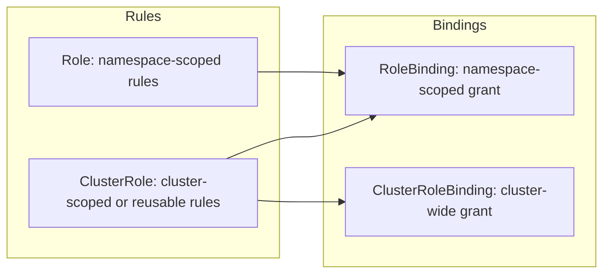

# RBAC

**Kubernetes RBAC (role-based access control)** decides what an authenticated user or service account may do: which verbs (`get`, `list`, `create`, `delete`, and so on) on which resources, in which namespaces. It is built from four objects in the `rbac.authorization.k8s.io` API group: Role, ClusterRole, RoleBinding, and ClusterRoleBinding.

## What You'll Learn

- The four RBAC objects and exactly which combinations are valid
- How to read and write rules built from `apiGroups`, `resources`, and `verbs`
- How to design a least-privilege Role from scratch, and verify it with `kubectl auth can-i`

## Why This Matters

RBAC is the authorization mode nearly every real cluster runs, and it's also the security control most commonly misconfigured — either too loose (a ClusterRoleBinding to `cluster-admin` handed out "just to unblock someone") or too rigid (an app can't read its own ConfigMap because nobody wrote the Role). Understanding the object model precisely is what lets you design access that's both safe and usable, and it's one of the most reliably-asked topics in Kubernetes interviews.

## Mental Model

> RBAC has exactly two kinds of objects: **rules that define permissions** (Role, ClusterRole) and **bindings that hand those permissions to someone** (RoleBinding, ClusterRoleBinding). A permission by itself does nothing until it's bound to a subject.

| Object | Scope | Grants permissions on |
|---|---|---|
| **Role** | Single namespace | Resources within that one namespace |
| **ClusterRole** | Cluster-wide | Cluster-scoped resources (nodes, PVs), non-resource URLs, *or* namespaced resources across **all** namespaces |
| **RoleBinding** | Single namespace | Binds a Role **or a ClusterRole** to subjects, scoped to that one namespace |
| **ClusterRoleBinding** | Cluster-wide | Binds a ClusterRole to subjects, cluster-wide |

The one combination that surprises people: a **ClusterRoleBinding + Role does not exist** — Roles are always namespace-local, so nothing cluster-wide can bind to one. But a **RoleBinding can reference a ClusterRole**, which is the standard pattern for reusing one set of rules (e.g. "view") across many namespaces without redefining it each time.



## How It Works

### Anatomy of a rule

Every RBAC rule is built from three parts: which API group the resource belongs to, which resource(s), and which verbs are allowed on them.

```yaml
apiVersion: rbac.authorization.k8s.io/v1
kind: Role
metadata:
  namespace: production
  name: pod-reader
rules:
  - apiGroups: [""]              # "" is the core API group (pods, services, configmaps...)
    resources: ["pods", "pods/log"]
    verbs: ["get", "list", "watch"]
```

Common verbs: `get`, `list`, `watch` (read), `create`, `update`, `patch`, `delete` (write), and `deletecollection`. `apiGroups: [""]` is the core group; `apps` covers Deployments/StatefulSets, `rbac.authorization.k8s.io` covers RBAC objects themselves, and `*` matches all groups — reserve `*` for genuinely cluster-admin-equivalent roles.

### Binding a Role to a subject

```yaml
apiVersion: rbac.authorization.k8s.io/v1
kind: RoleBinding
metadata:
  name: read-pods
  namespace: production
subjects:
  - kind: User
    name: jane
    apiGroup: rbac.authorization.k8s.io
  - kind: ServiceAccount
    name: ci-deployer
    namespace: production
roleRef:
  kind: Role
  name: pod-reader
  apiGroup: rbac.authorization.k8s.io
```

Subjects can be `User`, `Group`, or `ServiceAccount` — RBAC treats all three uniformly once bound.

### ClusterRole reused across namespaces

```yaml
apiVersion: rbac.authorization.k8s.io/v1
kind: ClusterRole
metadata:
  name: configmap-reader
rules:
  - apiGroups: [""]
    resources: ["configmaps"]
    verbs: ["get", "list"]
---
apiVersion: rbac.authorization.k8s.io/v1
kind: RoleBinding
metadata:
  name: read-configmaps
  namespace: staging
subjects:
  - kind: Group
    name: platform-team
    apiGroup: rbac.authorization.k8s.io
roleRef:
  kind: ClusterRole
  name: configmap-reader
  apiGroup: rbac.authorization.k8s.io
```

This grants `configmap-reader` only inside `staging`, even though it's defined as a ClusterRole. To grant it everywhere, use a ClusterRoleBinding instead.

### A least-privilege design walkthrough

Say a CI pipeline needs to deploy to the `checkout` namespace: create/update Deployments and Services, read Pods and their logs to verify the rollout, but nothing else — no Secrets, no RBAC objects, no other namespace.

```yaml
apiVersion: rbac.authorization.k8s.io/v1
kind: Role
metadata:
  namespace: checkout
  name: ci-deployer
rules:
  - apiGroups: ["apps"]
    resources: ["deployments"]
    verbs: ["get", "list", "create", "update", "patch"]
  - apiGroups: [""]
    resources: ["services"]
    verbs: ["get", "list", "create", "update", "patch"]
  - apiGroups: [""]
    resources: ["pods", "pods/log"]
    verbs: ["get", "list", "watch"]
---
apiVersion: rbac.authorization.k8s.io/v1
kind: RoleBinding
metadata:
  name: ci-deployer-binding
  namespace: checkout
subjects:
  - kind: ServiceAccount
    name: ci-deployer
    namespace: checkout
roleRef:
  kind: Role
  name: ci-deployer
  apiGroup: rbac.authorization.k8s.io
```

Notice what's absent: no `delete` verb (the pipeline never needs to delete a Deployment), no `secrets` resource, and a Role — not a ClusterRole — because this identity has no business touching any other namespace.

### Verifying access

```bash
# Can the current identity do this?
kubectl auth can-i create deployments --namespace checkout

# Check as a different identity, without needing their credentials
kubectl auth can-i delete secrets --namespace checkout --as=system:serviceaccount:checkout:ci-deployer

# List everything the current identity can do in a namespace
kubectl auth can-i --list --namespace checkout
```

`kubectl auth can-i` is the fastest way to prove an RBAC design does what you intended — always verify with `--as` before assuming a Role works.

### Permissions That Are Quietly Equivalent to Admin

Some grants look narrow but hand over far more than they appear to. Treat these like `cluster-admin` in review:

| Permission | Why it's dangerous |
|---|---|
| `create` on `pods` (or Deployments, Jobs, ...) | The Pod can mount any Secret in the namespace and run as any ServiceAccount there, inheriting its permissions |
| `get`/`list` on `secrets` | Reads every credential in the namespace; `list` returns them all in one call |
| `escalate` or `bind` on roles | Lets a subject grant itself permissions it doesn't have |
| `impersonate` on users, groups, or serviceaccounts | Act as anyone, including administrators |
| `create` on `pods/exec` or `pods/attach` | A shell in any Pod, with that Pod's tokens and mounted secrets |
| `get` on `nodes/proxy` | Direct access to the kubelet API on every node |
| `update` on `validatingwebhookconfigurations` / `mutatingwebhookconfigurations` | Disable or redirect admission policy for the whole cluster |

Audit these regularly (tools like `kubectl-who-can` or `rbac-tool` make it quick), and keep them out of anything bound to CI pipelines or default ServiceAccounts.

## Reading a Forbidden Error

Every RBAC denial says exactly what was missing. Read it left to right:

```text
Error from server (Forbidden): pods is forbidden: User "system:serviceaccount:ci:deployer" cannot list resource "pods" in API group "" in the namespace "checkout"
```

| Part | What it tells you |
|---|---|
| `User "system:serviceaccount:ci:deployer"` | Who asked: the ServiceAccount `deployer` in namespace `ci`. People appear as their username, and `system:anonymous` means no credentials were accepted at all |
| `cannot list` | The verb that was denied |
| `resource "pods"` | The resource. Subresources follow a slash: `pods/log`, `pods/exec`, `deployments/scale` |
| `in API group ""` | The API group: `""` is the core group, `apps` covers Deployments, `batch` covers Jobs |
| `in the namespace "checkout"` | Where. `at the cluster scope` means a cluster-scoped resource such as `nodes`, or a request across all namespaces |

That's everything a Role needs. Paste any `Forbidden` message here to get the smallest Role and binding that allow exactly that request, plus the command to verify it:

<div class="cc-tool" data-cc-tool="forbidden" markdown>
**Forbidden error to RBAC** (needs JavaScript). Without it, copy the verb, resource, API group, and namespace from the error into a Role like the `pod-reader` example above, and bind it to the user or ServiceAccount named in the message.
</div>

!!! incident "Real incidents: Tesla (2018) and RBAC Buster (2023)"
    Tesla's Kubernetes console was reachable without a password, and a Pod inside held AWS credentials; attackers used the cluster to mine cryptocurrency. In 2023, attackers who found API servers granting privileges to anonymous requests created a ClusterRole, a `kube-controller` ServiceAccount in `kube-system`, and a binding between them, a backdoor that outlives the original misconfiguration, then mined Monero from a DaemonSet on at least 60 clusters. The checks for both are in [Kubernetes Outages](../case-studies/07-real-world-outages-and-lessons.md#rbac-buster-2023-anonymous-access-became-a-backdoor).

## What Most Engineers Miss

- **There are no deny rules.** RBAC only adds permissions: a subject can do whatever any binding grants to it, to any of its groups, or to `system:authenticated`. You can't carve an exception out of a broad grant, only avoid making it.
- **`system:masters` bypasses RBAC entirely.** Requests from that group are allowed before RBAC is consulted, so deleting bindings changes nothing, and a leaked certificate in that group can't be revoked short of rotating the cluster CA. Since kubeadm 1.29, `admin.conf` uses the `kubeadm:cluster-admins` group, which is bound to `cluster-admin` and can be revoked, and the `system:masters` credential lives separately in `super-admin.conf` for break-glass use.
- **`list` and `watch` return Secret values, not just names.** There's no names-only permission for Secrets; granting `list` "just to see what exists" hands over every value in the namespace.
- **The built-in `admin`, `edit`, and `view` roles grow on their own.** They're aggregated: any ClusterRole labeled `rbac.authorization.k8s.io/aggregate-to-edit: "true"` is merged into `edit` automatically. Installing an operator can quietly widen what everyone with `edit` can do.
- **You can't grant what you don't have.** Creating a Role or binding is checked against your own permissions, so a namespace admin can't hand out `cluster-admin`. The `escalate` and `bind` verbs switch that check off, which is why they're on the dangerous list above.
- **`kubectl auth whoami` shows who the API server thinks you are**, username and groups included. When a `Forbidden` makes no sense, check this before touching any Role.

## Common Mistakes

- Reaching for `ClusterRoleBinding` to `cluster-admin` to "just get past" a permissions error instead of writing the specific rule needed.
- Using `resources: ["*"]` or `verbs: ["*"]` out of laziness rather than because the identity genuinely needs full access.
- Forgetting that a Role and a RoleBinding must live in the **same** namespace — a RoleBinding cannot reference a Role from a different namespace (only a ClusterRole).
- Not realizing `pods/log` is a distinct sub-resource from `pods` — a Role that grants `get` on `pods` doesn't automatically let you read `pods/log`.
- Editing RBAC objects directly with `kubectl edit` in production instead of through version-controlled manifests, which erases the audit trail of who changed access and when.

## Check Yourself

!!! quiz "A ClusterRole in one namespace"
    A RoleBinding in namespace `dev` references the ClusterRole `view`. What does its subject get?

    - [ ] Read access to every namespace, because `view` is a ClusterRole
    - [x] Read access in `dev` only
    - [ ] Nothing: a RoleBinding can only reference a Role

    The binding sets the scope. Reusing a ClusterRole through RoleBindings is the standard way to grant the same rules in many namespaces without redefining them.

!!! quiz "Taking one permission away"
    A team has `edit` in its namespace, and you want it to have everything except deleting Secrets. How do you write that in RBAC?

    - [ ] Add a rule with `verbs: ["!delete"]`
    - [ ] Create a second Role that denies `delete` on `secrets` and bind it too
    - [x] You can't subtract: build a narrower Role that never grants it

    RBAC has no deny rules. Every binding only adds, so the only way to withhold a permission is to not grant it.

!!! quiz "Only create pods"
    A CI ServiceAccount has a single permission: `create` on `pods` in namespace `shop`. What can it effectively do?

    - [ ] Start Pods, nothing more
    - [x] Read any Secret in `shop` and act as any ServiceAccount there, by starting a Pod that mounts them
    - [ ] Nothing until it also gets `get` on `pods`

    A Pod can mount any Secret and use any ServiceAccount in its namespace, so `create pods` is close to admin for that namespace. Pod Security Admission and admission policies are what limit it further.

## Interview Questions

- What's the difference between a Role and a ClusterRole, and when would a ClusterRole be bound with a RoleBinding instead of a ClusterRoleBinding?
- Can a ClusterRoleBinding reference a Role? Why or why not?
- How would you design a least-privilege Role for a CI pipeline that only deploys to one namespace?
- How does `kubectl auth can-i --as` help you verify an RBAC design before rolling it out?

See [Interview Prep](../interview-prep/index.md) for full answers.

## Next

Continue to [Service Accounts](03-service-accounts.md) to see the identity RBAC rules are most often bound to for in-cluster workloads.
