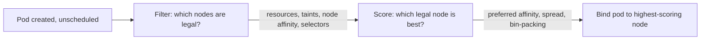

# Scheduling, Affinity, and Taints

## What You'll Learn

- How `kube-scheduler` actually chooses a node for a pod, step by step
- The difference between node affinity, pod affinity/anti-affinity, and taints/tolerations — and when to use each
- How topology spread constraints keep pods distributed across zones or nodes instead of piling onto one

## Why This Matters

Every scheduling primitive answers the same underlying question — "where should this pod run" — but from a different direction. Affinity says "prefer/require nodes/pods like this." Taints and tolerations say "nodes can repel pods unless they explicitly tolerate it." Mixing them up (e.g. using a taint when you meant affinity) either fails to schedule anything or schedules everything onto one overloaded node.

## Mental Model

> The scheduler runs two phases for every unscheduled pod: **filtering** (which nodes are even legal — enough resources, matching affinity/selectors, tolerated taints) and **scoring** (of the legal nodes, which is best — spreading pods out, bin-packing, respecting preferred affinity). It picks the highest-scoring node from the filtered set.



| Mechanism | Direction | Question it answers |
|---|---|---|
| Node affinity | Pod → node | "Which nodes am I allowed/prefer to land on?" |
| Pod affinity/anti-affinity | Pod → other pods | "Do I want to be near/away from pods with this label?" |
| Taints + tolerations | Node → pod | "This node repels pods unless they explicitly tolerate me." |
| Topology spread constraints | Pod → topology | "Spread pods evenly across zones/nodes, don't just pick one good node repeatedly." |

## How It Works

### Node affinity

```yaml
apiVersion: v1
kind: Pod
metadata:
  name: gpu-inference
spec:
  affinity:
    nodeAffinity:
      requiredDuringSchedulingIgnoredDuringExecution:
        nodeSelectorTerms:
          - matchExpressions:
              - key: node-type
                operator: In
                values: ["gpu"]
      preferredDuringSchedulingIgnoredDuringExecution:
        - weight: 80
          preference:
            matchExpressions:
              - key: topology.kubernetes.io/zone
                operator: In
                values: ["us-east-1a"]
  containers:
    - name: inference
      image: registry.example.com/inference:2.3.0
```

`required...` is a hard filter (no matching node = pod stays `Pending`); `preferred...` only influences scoring. `IgnoredDuringExecution` means a node's labels changing after the pod is already running doesn't evict it — affinity is only evaluated at scheduling time.

### Pod affinity and anti-affinity

```yaml
  affinity:
    podAntiAffinity:
      requiredDuringSchedulingIgnoredDuringExecution:
        - labelSelector:
            matchLabels:
              app: postgres
          topologyKey: kubernetes.io/hostname   # never co-locate two postgres pods on one node
    podAffinity:
      preferredDuringSchedulingIgnoredDuringExecution:
        - weight: 50
          podAffinityTerm:
            labelSelector:
              matchLabels:
                app: checkout-api
            topologyKey: topology.kubernetes.io/zone   # prefer being near checkout-api, same zone
```

Anti-affinity is the standard way to guarantee replicas of the same app land on different nodes (or zones), so one node failure doesn't take out every replica.

### Taints and tolerations

Taints go on **nodes**; tolerations go on **pods**. A pod can only schedule onto a tainted node if it tolerates that specific taint.

```bash
kubectl taint nodes gpu-node-1 nvidia.com/gpu=true:NoSchedule
```

```yaml
  tolerations:
    - key: nvidia.com/gpu
      operator: Equal
      value: "true"
      effect: NoSchedule
```

| Effect | Behavior |
|---|---|
| `NoSchedule` | New pods without a matching toleration won't be scheduled here |
| `PreferNoSchedule` | Scheduler tries to avoid this node, but will use it if needed |
| `NoExecute` | Existing pods without a matching toleration are **evicted**, not just blocked from scheduling |

A common pattern: taint expensive nodes (GPU, high-memory) so nothing lands there by accident, and only pods that explicitly need that hardware tolerate the taint.

### Topology spread constraints

```yaml
  topologySpreadConstraints:
    - maxSkew: 1
      topologyKey: topology.kubernetes.io/zone
      whenUnsatisfiable: DoNotSchedule
      labelSelector:
        matchLabels:
          app: checkout-api
```

`maxSkew: 1` means no zone can have more than one pod more than the least-populated zone for pods matching this selector — this is what actually gets you "3 replicas, one per zone" instead of relying on anti-affinity rules that only look at pairs.

## What Most Engineers Miss

- **Every Pod waits five minutes on a dead node.** Unless a Pod sets its own, Kubernetes adds tolerations for `node.kubernetes.io/not-ready` and `node.kubernetes.io/unreachable` with `tolerationSeconds: 300`. When a node dies, its Pods aren't evicted for five minutes. Set a shorter `tolerationSeconds` on workloads that should fail over faster:

    ```yaml
      tolerations:
        - key: node.kubernetes.io/unreachable
          operator: Exists
          effect: NoExecute
          tolerationSeconds: 30
    ```

- **DaemonSet Pods ignore most of this.** They tolerate `unschedulable`, so cordoning a node doesn't keep them off, and they tolerate `not-ready` and `unreachable` with no time limit, so they're never evicted from a failing node.
- **The control-plane label and taint were renamed.** `node-role.kubernetes.io/master` became `node-role.kubernetes.io/control-plane` for both. A `nodeSelector` or toleration still using the old name is valid YAML that matches nothing on a current cluster, and nothing warns you.
- **Inter-pod affinity is expensive.** Pod affinity and anti-affinity make the scheduler compare each Pod against Pods across the cluster, and the Kubernetes docs advise against them in clusters larger than several hundred nodes. Topology spread constraints are the cheaper way to say "spread out".
- **Spreading is checked at scheduling time only.** Scale-downs, evictions, and node replacements can leave one zone holding most replicas, and nothing moves them back. The [descheduler](https://github.com/kubernetes-sigs/descheduler) can rebalance when that matters.

!!! incident "Real incident: Reddit, March 2023"
    Reddit's Calico route reflectors were selected with the label `node-role.kubernetes.io/master`. The upgrade to Kubernetes 1.24 removed that label, the selector quietly matched zero nodes, Pod networking collapsed, and Reddit was down for 314 minutes. Search for old labels and taints before every upgrade: `kubectl get deploy,ds,sts -A -o yaml | grep node-role.kubernetes.io/master`. [The full story](../case-studies/07-real-world-outages-and-lessons.md#reddit-2023-a-removed-node-label-took-down-pod-networking).

## Common Mistakes

- Using `podAntiAffinity` with `topologyKey: kubernetes.io/hostname` on a cluster smaller than the replica count — `required...` anti-affinity then leaves pods `Pending` forever because there aren't enough distinct nodes.
- Expecting a taint to attract pods — taints only repel; tolerations only cancel that repulsion, they never make a pod prefer that node (use affinity for attraction).
- Confusing `NoSchedule` with `NoExecute` — assuming a taint added to an already-schedulable node won't touch running pods, then being surprised when a `NoExecute` taint evicts them.
- Forgetting `IgnoredDuringExecution` semantics — labeling a node differently after pods are already running doesn't retroactively reschedule them.

## Check Yourself

!!! quiz "A node dies"
    A worker node loses power. Its Pods have no tolerations of their own. When are they evicted so their controllers can replace them elsewhere?

    - [ ] Immediately
    - [ ] As soon as the node is marked `NotReady`
    - [x] About five minutes after the node is marked unreachable, when the default 300-second toleration runs out

    The node controller first waits out its grace period and taints the node as unreachable; then the Pods' default `tolerationSeconds: 300` must expire. Set a shorter toleration for workloads that need faster failover.

!!! quiz "Cordoned, but still running"
    You cordon a node with `kubectl cordon`. Which new Pods can still be scheduled onto it?

    - [ ] None
    - [x] DaemonSet Pods, which tolerate the `unschedulable` taint
    - [ ] Pods with the highest PriorityClass

    Cordoning adds `node.kubernetes.io/unschedulable:NoSchedule`, which DaemonSet Pods tolerate automatically. Draining is what evicts the other Pods.

!!! quiz "An old selector"
    A DaemonSet uses `nodeSelector: { node-role.kubernetes.io/master: "" }` on a cluster built with a current kubeadm. What happens?

    - [ ] It runs on the control-plane nodes
    - [ ] The API server rejects it
    - [x] It's accepted and runs nowhere: no node carries that label

    The label was renamed to `node-role.kubernetes.io/control-plane`. A selector that matches nothing isn't an error, which is what made Reddit's outage so hard to spot.

## Interview Questions

- Walk through the scheduler's filter-then-score process for a single pod.
- What's the practical difference between pod anti-affinity and a topology spread constraint — why would you need both?
- What happens to already-running pods when you add a `NoExecute` taint to their node?

See [Interview Prep](../interview-prep/index.md) for full answers.

## Next

Continue to [Resource Requests, Limits, and QoS](05-resource-requests-limits-and-qos.md) — the other input the scheduler's filtering phase depends on.
