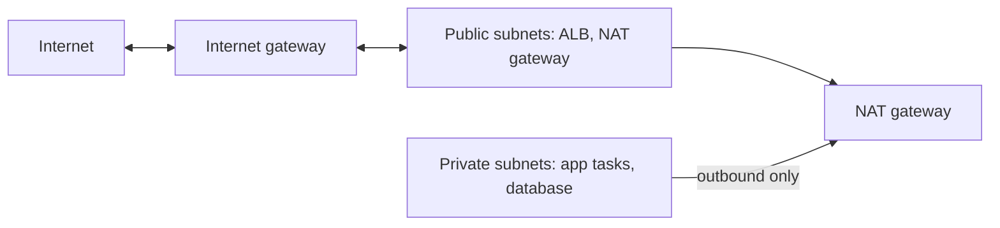

# Step 3: Network and Security Groups

## What You'll Learn

- How to lay out a VPC with public and private subnets across Availability Zones
- How `count` and `cidrsubnet()` generate subnets from one CIDR block
- What a NAT gateway is for, and the cost and availability trade-off of having one or several
- How security groups that reference each other replace IP-based firewall rules

## Mental Model



- **Public subnets** have a route to the internet gateway. Only the load balancer and the NAT gateway live there.
- **Private subnets** have no inbound route from the internet. Their outbound traffic, such as pulling images from ECR, goes through the NAT gateway.
- **Two Availability Zones** for everything, because an Application Load Balancer requires subnets in at least two, and because one AZ can fail.

## Step 1: The Stack's Foundation

In `webapp/infra`, create four files. First the Terraform and provider settings:

```hcl title="infra/versions.tf"
terraform {
  required_version = ">= 1.10"

  required_providers {
    aws = {
      source  = "hashicorp/aws"
      version = "~> 6.0"
    }
  }

  # Settings come from backend.hcl: terraform init -backend-config=backend.hcl
  backend "s3" {}
}

provider "aws" {
  region = var.region

  default_tags {
    tags = {
      Project     = var.project
      Environment = var.environment
      ManagedBy   = "terraform"
    }
  }
}
```

`backend "s3" {}` is a **partial backend configuration**: the bucket and key come from `backend.hcl` at `init` time, so the same code can point at a different state file per environment. `default_tags` puts `Project`, `Environment`, and `ManagedBy` on every resource, which makes cost reports and cleanup much easier.

Then every input the stack takes:

```hcl title="infra/variables.tf"
variable "region" {
  type    = string
  default = "us-east-1"
}

variable "project" {
  type        = string
  description = "Short name used in resource names. Must match the ECR repository from the bootstrap stack."
  default     = "webapp"
}

variable "environment" {
  type = string
  validation {
    condition     = contains(["dev", "staging", "prod"], var.environment)
    error_message = "environment must be dev, staging, or prod."
  }
}

# ---------------------------------------------------------------- network

variable "vpc_cidr" {
  type    = string
  default = "10.20.0.0/16"
}

variable "az_count" {
  type        = number
  description = "How many Availability Zones to spread subnets across."
  default     = 2
  validation {
    condition     = var.az_count >= 2 && var.az_count <= 3
    error_message = "Use 2 or 3 Availability Zones. A load balancer needs at least 2."
  }
}

variable "single_nat_gateway" {
  type        = bool
  description = "One NAT gateway for all AZs (cheaper) instead of one per AZ (survives an AZ outage)."
  default     = true
}

# ---------------------------------------------------------------- application

variable "image_tag" {
  type        = string
  description = "Tag of the image in ECR to run, usually the Git commit SHA."
}

variable "container_port" {
  type    = number
  default = 8000
}

variable "cpu_architecture" {
  type    = string
  default = "ARM64" # Graviton: cheaper per vCPU than X86_64 on Fargate
  validation {
    condition     = contains(["ARM64", "X86_64"], var.cpu_architecture)
    error_message = "cpu_architecture must be ARM64 or X86_64, and must match how the image was built."
  }
}

variable "task_cpu" {
  type    = number
  default = 256 # 0.25 vCPU
}

variable "task_memory" {
  type    = number
  default = 512 # MiB
}

variable "desired_count" {
  type        = number
  description = "Tasks to run normally. Also the autoscaling minimum."
  default     = 2
}

variable "max_count" {
  type    = number
  default = 4
}

# ---------------------------------------------------------------- database

variable "db_instance_class" {
  type    = string
  default = "db.t4g.micro"
}

variable "db_engine_version" {
  type    = string
  default = "17"
}

variable "db_multi_az" {
  type        = bool
  description = "A standby in a second AZ with automatic failover. Doubles the database cost."
  default     = false
}

# ---------------------------------------------------------------- optional HTTPS

variable "domain_name" {
  type        = string
  description = "Serve the app on this name over HTTPS, for example app.example.com. Empty means HTTP on the ALB's DNS name."
  default     = ""
}

variable "hosted_zone_name" {
  type        = string
  description = "Route 53 public hosted zone that contains domain_name, for example example.com."
  default     = ""
}
```

`image_tag` has no default on purpose. Terraform refuses to plan without it, so nobody deploys an unknown image by accident.

Shared locals and lookups:

```hcl title="infra/main.tf"
locals {
  name  = "${var.project}-${var.environment}"
  azs   = slice(data.aws_availability_zones.available.names, 0, var.az_count)
  https = var.domain_name != ""
}

data "aws_availability_zones" "available" {
  state = "available"
  filter {
    name   = "opt-in-status"
    values = ["opt-in-not-required"] # skip Local Zones and Wavelength Zones
  }
}

# Created once by the bootstrap stack; this stack only reads it.
data "aws_ecr_repository" "app" {
  name = var.project
}
```

`data "aws_ecr_repository"` reads the repository the bootstrap stack created. This stack never creates or deletes it.

Per-environment values:

```hcl title="infra/dev.tfvars"
environment        = "dev"
az_count           = 2
single_nat_gateway = true
desired_count      = 2
max_count          = 4
db_instance_class  = "db.t4g.micro"
db_multi_az        = false

# Optional HTTPS. Both must be set, and the hosted zone must already exist in Route 53.
# domain_name      = "app.example.com"
# hosted_zone_name = "example.com"
```

## Step 2: The VPC

```hcl title="infra/network.tf"
# A VPC with public subnets for the load balancer and NAT gateway, and private subnets
# for the app and database, spread across Availability Zones.

resource "aws_vpc" "main" {
  cidr_block           = var.vpc_cidr
  enable_dns_support   = true
  enable_dns_hostnames = true
  tags                 = { Name = local.name }
}

resource "aws_internet_gateway" "main" {
  vpc_id = aws_vpc.main.id
  tags   = { Name = local.name }
}

# 10.20.0.0/24, 10.20.1.0/24, ... : one /24 per AZ
resource "aws_subnet" "public" {
  count             = var.az_count
  vpc_id            = aws_vpc.main.id
  availability_zone = local.azs[count.index]
  cidr_block        = cidrsubnet(var.vpc_cidr, 8, count.index)
  tags              = { Name = "${local.name}-public-${local.azs[count.index]}" }
}

# 10.20.10.0/24, 10.20.11.0/24, ... : nothing here gets a public IP
resource "aws_subnet" "private" {
  count             = var.az_count
  vpc_id            = aws_vpc.main.id
  availability_zone = local.azs[count.index]
  cidr_block        = cidrsubnet(var.vpc_cidr, 8, count.index + 10)
  tags              = { Name = "${local.name}-private-${local.azs[count.index]}" }
}

resource "aws_route_table" "public" {
  vpc_id = aws_vpc.main.id
  route {
    cidr_block = "0.0.0.0/0"
    gateway_id = aws_internet_gateway.main.id
  }
  tags = { Name = "${local.name}-public" }
}

resource "aws_route_table_association" "public" {
  count          = var.az_count
  subnet_id      = aws_subnet.public[count.index].id
  route_table_id = aws_route_table.public.id
}

# Private subnets reach the internet (ECR, CloudWatch Logs, Secrets Manager) through NAT.
resource "aws_eip" "nat" {
  count  = var.single_nat_gateway ? 1 : var.az_count
  domain = "vpc"
  tags   = { Name = "${local.name}-nat-${count.index}" }
}

resource "aws_nat_gateway" "main" {
  count         = var.single_nat_gateway ? 1 : var.az_count
  allocation_id = aws_eip.nat[count.index].id
  subnet_id     = aws_subnet.public[count.index].id
  tags          = { Name = "${local.name}-${local.azs[count.index]}" }
  depends_on    = [aws_internet_gateway.main]
}

resource "aws_route_table" "private" {
  count  = var.az_count
  vpc_id = aws_vpc.main.id
  route {
    cidr_block     = "0.0.0.0/0"
    nat_gateway_id = aws_nat_gateway.main[var.single_nat_gateway ? 0 : count.index].id
  }
  tags = { Name = "${local.name}-private-${local.azs[count.index]}" }
}

resource "aws_route_table_association" "private" {
  count          = var.az_count
  subnet_id      = aws_subnet.private[count.index].id
  route_table_id = aws_route_table.private[count.index].id
}
```

`count = var.az_count` creates one subnet per AZ, and `cidrsubnet()` carves each one out of the VPC's range. You can check the math in `terraform console`:

```text
$ terraform console
> cidrsubnet("10.20.0.0/16", 8, 0)
"10.20.0.0/24"
> cidrsubnet("10.20.0.0/16", 8, 1)
"10.20.1.0/24"
> cidrsubnet("10.20.0.0/16", 8, 10)
"10.20.10.0/24"
```

Public subnets get `10.20.0.0/24` and `10.20.1.0/24`. Private subnets start at `10.20.10.0/24`, which leaves room to add a third AZ later without renumbering.

### One NAT Gateway or One per AZ?

| `single_nat_gateway` | Cost | If one AZ fails |
|---|---|---|
| `true` (dev) | One NAT gateway, about $33 a month | Private subnets in every AZ lose outbound access if the NAT's AZ fails |
| `false` (prod) | One per AZ | Each AZ keeps its own outbound path |

The private route tables handle both cases with one expression: `aws_nat_gateway.main[var.single_nat_gateway ? 0 : count.index]`.

## Step 3: Security Groups

```hcl title="infra/security.tf"
# Three security groups that chain together: internet -> ALB -> app -> database.
# Each rule allows traffic from the group in front of it, never from an IP range,
# so tasks and database instances can come and go without rule changes.

# ---------------------------------------------------------------- load balancer

resource "aws_security_group" "alb" {
  name        = "${local.name}-alb"
  description = "Public HTTP and HTTPS"
  vpc_id      = aws_vpc.main.id
}

resource "aws_vpc_security_group_ingress_rule" "alb_http" {
  security_group_id = aws_security_group.alb.id
  cidr_ipv4         = "0.0.0.0/0"
  ip_protocol       = "tcp"
  from_port         = 80
  to_port           = 80
}

resource "aws_vpc_security_group_ingress_rule" "alb_https" {
  count             = local.https ? 1 : 0
  security_group_id = aws_security_group.alb.id
  cidr_ipv4         = "0.0.0.0/0"
  ip_protocol       = "tcp"
  from_port         = 443
  to_port           = 443
}

resource "aws_vpc_security_group_egress_rule" "alb_to_app" {
  security_group_id            = aws_security_group.alb.id
  referenced_security_group_id = aws_security_group.app.id
  ip_protocol                  = "tcp"
  from_port                    = var.container_port
  to_port                      = var.container_port
}

# ---------------------------------------------------------------- app tasks

resource "aws_security_group" "app" {
  name        = "${local.name}-app"
  description = "App tasks: traffic from the ALB only"
  vpc_id      = aws_vpc.main.id
}

resource "aws_vpc_security_group_ingress_rule" "app_from_alb" {
  security_group_id            = aws_security_group.app.id
  referenced_security_group_id = aws_security_group.alb.id
  ip_protocol                  = "tcp"
  from_port                    = var.container_port
  to_port                      = var.container_port
}

# Tasks need outbound HTTPS for ECR, CloudWatch Logs, and Secrets Manager, and 5432 for the database.
resource "aws_vpc_security_group_egress_rule" "app_all" {
  security_group_id = aws_security_group.app.id
  cidr_ipv4         = "0.0.0.0/0"
  ip_protocol       = "-1"
}

# ---------------------------------------------------------------- database

resource "aws_security_group" "db" {
  name        = "${local.name}-db"
  description = "PostgreSQL, from the app tasks only"
  vpc_id      = aws_vpc.main.id
}

resource "aws_vpc_security_group_ingress_rule" "db_from_app" {
  security_group_id            = aws_security_group.db.id
  referenced_security_group_id = aws_security_group.app.id
  ip_protocol                  = "tcp"
  from_port                    = 5432
  to_port                      = 5432
}
```

Read the rules as a chain:

| Group | Allows in | From |
|---|---|---|
| `alb` | TCP 80 (and 443 with HTTPS) | Anywhere |
| `app` | TCP 8000 | The `alb` security group only |
| `db` | TCP 5432 | The `app` security group only |

Because each rule names a security group instead of a CIDR, a new task with a new IP address is allowed automatically, and nothing else in the VPC is. These use the newer `aws_vpc_security_group_ingress_rule` and `egress_rule` resources, one rule per resource, instead of inline `ingress {}` blocks. Inline blocks and separate rule resources fight each other if you mix them on one group.

The ALB's egress rule only allows traffic to the app tasks. The app's egress is open, because it needs HTTPS to ECR, CloudWatch Logs, and Secrets Manager, plus PostgreSQL to the database. A stricter design adds VPC endpoints for those services and limits egress to them.

## Step 4: Plan and Apply

Initialize with the backend settings from step 1:

```bash
terraform init -backend-config=backend.hcl
```

Plan, passing the image tag from step 2:

```bash
terraform plan -var-file=dev.tfvars -var "image_tag=$TAG" -out=network.tfplan
```

```text
Plan: 23 to add, 0 to change, 0 to destroy.
```

Read the plan before applying it. Check that two public and two private subnets are planned, one NAT gateway with one Elastic IP, and three security groups. Then apply exactly that plan:

```bash
terraform apply network.tfplan
```

The NAT gateway takes a minute or two. Then look at what you built:

```bash
aws ec2 describe-subnets \
  --filters "Name=tag:Project,Values=webapp" \
  --query 'Subnets[].[Tags[?Key==`Name`]|[0].Value,CidrBlock,AvailabilityZone]' \
  --output table
```

!!! tip "Save the plan, apply the plan"
    `plan -out` followed by `apply <planfile>` applies exactly what you reviewed. A plain `terraform apply` makes a new plan, which can differ if anything changed in between.

## What Most Engineers Miss

- **NAT gateways charge per GB as well as per hour.** Pulling large images through NAT on every deploy adds up. An S3 gateway endpoint is free and keeps ECR layer downloads off the NAT.
- **Public IPv4 addresses cost money** since 2024, about $3.60 a month each. The ALB uses one per AZ and the NAT gateway uses one.
- **Plan your CIDR ranges before you need VPC peering or Transit Gateway.** Overlapping ranges can't be connected later without renumbering. `10.20.0.0/16` here is arbitrary. Pick one that doesn't clash with your other networks.
- **`count` on subnets means reordering is destructive.** If you remove the first AZ from the list, every later subnet shifts index and gets replaced. `for_each` keyed by AZ name avoids that, at the cost of slightly more complex code.

!!! quiz "Security group references"
    An ECS task restarts and gets a new private IP address. What has to change for it to reach the database?

    - [ ] Add the new IP to the database security group
    - [x] Nothing. The database allows the app's security group, and the new task is in it.
    - [ ] Restart the database

    Rules that reference security groups follow membership, not addresses.

!!! quiz "NAT gateway"
    Why do the private subnets need a NAT gateway at all?

    - [ ] So users can reach the app tasks
    - [x] So tasks can make outbound connections, such as pulling images from ECR, without being reachable from the internet
    - [ ] So the database can be backed up

    Inbound traffic comes through the ALB. NAT is for outbound traffic only.

## Common Mistakes

- Putting app tasks or databases in public subnets "to make it work", then forgetting to move them.
- Opening the database security group to the VPC CIDR instead of to the app's security group.
- Mixing inline `ingress` blocks with separate rule resources on the same security group.
- Running `terraform apply` without a saved plan in automation.
- Choosing a VPC range that overlaps the office network or another VPC you'll need to connect to.

## Interview Questions

- What makes a subnet public or private in AWS?
- Why does an Application Load Balancer need subnets in two Availability Zones?
- Compare one NAT gateway per VPC with one per AZ.
- Why reference security groups in rules instead of CIDR blocks?
- What's the risk of using `count` to create subnets?

## Next

Continue to [Step 4: The Database](04-database.md).
