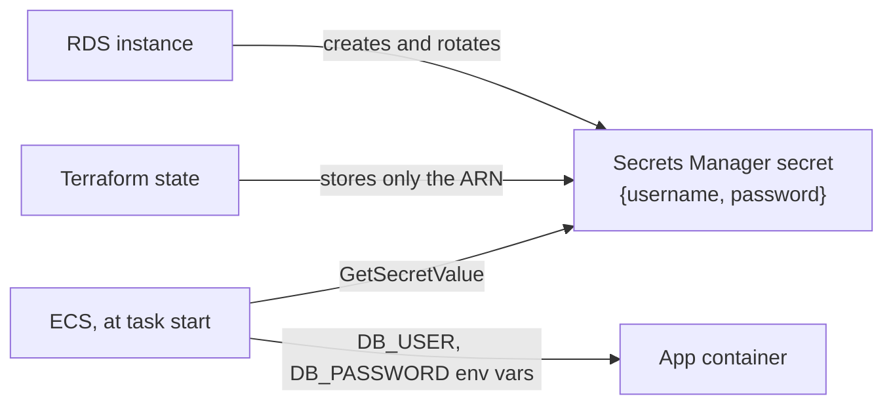

# Step 4: The Database

## What You'll Learn

- How to create a private, encrypted RDS PostgreSQL instance with Terraform
- How `manage_master_user_password` keeps the password out of your code and state
- How to make production data hard to delete while keeping dev disposable
- The rotation trap: what happens to running apps when RDS rotates the password

## Step 1: Add the Database

Add this file to `infra/`:

```hcl title="infra/database.tf"
# PostgreSQL on RDS, reachable only from the app's security group.

resource "aws_db_subnet_group" "main" {
  name       = local.name
  subnet_ids = aws_subnet.private[*].id
}

resource "aws_db_instance" "main" {
  identifier     = local.name
  engine         = "postgres"
  engine_version = var.db_engine_version
  instance_class = var.db_instance_class

  allocated_storage     = 20
  max_allocated_storage = 100 # storage autoscaling up to this size
  storage_type          = "gp3"
  storage_encrypted     = true

  db_name  = "app"
  username = "app_admin"
  # RDS generates the password, stores it in Secrets Manager, and rotates it.
  # It never appears in Terraform state or in your code.
  manage_master_user_password = true

  db_subnet_group_name   = aws_db_subnet_group.main.name
  vpc_security_group_ids = [aws_security_group.db.id]
  publicly_accessible    = false
  multi_az               = var.db_multi_az

  backup_retention_period    = 7
  copy_tags_to_snapshot      = true
  auto_minor_version_upgrade = true

  # Protect production data; let dev and staging be torn down freely.
  deletion_protection       = var.environment == "prod"
  skip_final_snapshot       = var.environment != "prod"
  final_snapshot_identifier = "${local.name}-final"
  apply_immediately         = var.environment != "prod"
}
```

The settings, grouped by why they're there:

| Concern | Settings |
|---|---|
| **Placement** | `db_subnet_group_name` puts it in the private subnets; `publicly_accessible = false`; the `db` security group from step 3 only allows the app. |
| **Secrets** | `manage_master_user_password = true`. There's no `password` argument at all. |
| **Encryption** | `storage_encrypted = true` encrypts the disk, snapshots, and backups with the AWS-managed RDS key. |
| **Recovery** | 7 days of automated backups with point-in-time restore; `copy_tags_to_snapshot`. |
| **Growth** | gp3 storage starting at 20 GB, autoscaling up to 100 GB. |
| **Environment rules** | Production gets `deletion_protection` and a final snapshot; dev and staging can be destroyed in one step. |

### Where the Password Lives

With `manage_master_user_password`, RDS generates the password, stores it in a Secrets Manager secret it owns, and rotates it. Terraform only ever sees the secret's ARN:



Compare that with the old pattern, `password = random_password.db.result`: the password ends up in plain text in the state file, and anyone who can read state can read it.

## Step 2: Plan and Apply

```bash
terraform plan -var-file=dev.tfvars -var "image_tag=$TAG" -out=db.tfplan
```

```text
Plan: 2 to add, 0 to change, 0 to destroy.
```

```bash
terraform apply db.tfplan
```

Creating an RDS instance takes 5 to 10 minutes. When it's done, find the secret, without printing the password:

```bash
aws rds describe-db-instances --db-instance-identifier webapp-dev \
  --query 'DBInstances[0].{endpoint:Endpoint.Address,status:DBInstanceStatus,secret:MasterUserSecret.SecretArn}'

aws secretsmanager describe-secret --secret-id <the secret ARN> \
  --query '{rotation:RotationEnabled,days:RotationRules.AutomaticallyAfterDays}'
```

```json
{
    "rotation": true,
    "days": 7
}
```

You can't connect to this database from your laptop, and that's intended. Only things in the `app` security group can reach port 5432. Page 8 shows how to get a session for debugging without opening it up.

!!! warning "The rotation trap"
    RDS rotates the managed password every 7 days by default. ECS injects secrets into the container **when the task starts**, so a task that's been running for more than a week still has the old password, and new database connections fail with `password authentication failed`.

    For this lab, it doesn't matter. For anything that runs longer, pick one fix:

    - Have the app read the secret from Secrets Manager itself, cache it, and re-read it when authentication fails. This is the most robust option.
    - Start new tasks after each rotation, for example with an EventBridge rule on the rotation event that calls `aws ecs update-service --force-new-deployment`.
    - Give the app its own database user, separate from the master user, with credentials you rotate on your own schedule.

## What Most Engineers Miss

- **The app should not use the master user.** This lab does it to stay short. In production, create a role with only the privileges the app needs, and keep the master user for migrations and emergencies.
- **`skip_final_snapshot = false` needs `final_snapshot_identifier`**, or the destroy fails at the very end. This stack sets both, and only skips the snapshot outside production.
- **`apply_immediately = false` in production** means changes such as a new instance class wait for the maintenance window. That's what you want for a live database. Plan accordingly, because Terraform reports success before the change actually happens.
- **Major version upgrades aren't automatic.** `auto_minor_version_upgrade` covers 17.x patch releases. Going from 17 to 18 is a planned change with `allow_major_version_upgrade`.
- **Multi-AZ is about availability, not backups.** A standby protects you from an AZ or instance failure. It replicates a `DROP TABLE` just as faithfully. Backups protect your data.

!!! quiz "Secrets in state"
    Which database setup keeps the master password out of Terraform state?

    - [ ] `password = var.db_password` with the variable marked `sensitive = true`
    - [ ] `password = random_password.db.result`
    - [x] `manage_master_user_password = true`

    `sensitive` only hides values in CLI output. They're still stored in plain text in the state file.

!!! quiz "Rotation"
    The app has worked for 9 days. Today new requests fail with `password authentication failed`, but the database is up. What's the most likely cause?

    - [ ] The security group changed
    - [x] RDS rotated the password, and the running tasks still have the old one from when they started
    - [ ] The database ran out of storage

    Injected secrets are read once, at task start. Restart the tasks now, then fix it properly with one of the options above.

## Common Mistakes

- Marking a password variable `sensitive` and assuming it's safe in state.
- Making the database publicly accessible to debug a connection problem, and leaving it that way.
- Turning on deletion protection in dev, then fighting it every teardown, or leaving it off in production.
- Treating Multi-AZ as a backup strategy.
- Connecting the app as the master user indefinitely.

## Interview Questions

- How would you manage a database password with Terraform without storing it in state?
- What's the difference between Multi-AZ, read replicas, and automated backups in RDS?
- How should running applications handle secret rotation?
- How do you protect a production database from `terraform destroy`?

## Next

Continue to [Step 5: Load Balancer and ECS Service](05-load-balancer-and-ecs.md).
