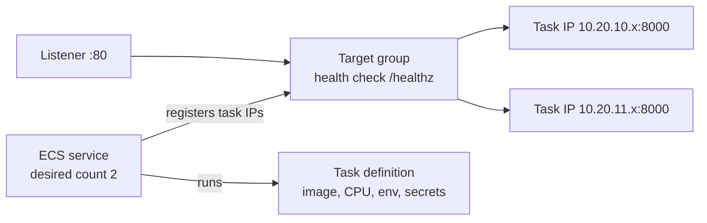

# Step 5: Load Balancer and ECS Service

## What You'll Learn

- How an ALB, a target group, and an ECS service fit together
- The difference between the task execution role and the task role
- How ECS injects secrets from Secrets Manager into a container
- How rolling deploys, the deployment circuit breaker, and autoscaling are configured
- How to verify a deployment from the command line

## Mental Model



The **service** keeps the desired number of tasks running from a **task definition**, and registers each task's IP address in the **target group**. The **load balancer** only sends traffic to targets that pass the health check.

## Step 1: The Load Balancer

```hcl title="infra/alb.tf"
# A public Application Load Balancer in front of the app tasks.
# With domain_name set, it also serves HTTPS with an ACM certificate and redirects HTTP to HTTPS.

resource "aws_lb" "app" {
  name                       = local.name
  load_balancer_type         = "application"
  subnets                    = aws_subnet.public[*].id
  security_groups            = [aws_security_group.alb.id]
  drop_invalid_header_fields = true
}

resource "aws_lb_target_group" "app" {
  name                 = local.name
  port                 = var.container_port
  protocol             = "HTTP"
  target_type          = "ip" # Fargate tasks register by IP address
  vpc_id               = aws_vpc.main.id
  deregistration_delay = 30

  health_check {
    path                = "/healthz"
    matcher             = "200"
    interval            = 15
    healthy_threshold   = 2
    unhealthy_threshold = 3
  }
}

resource "aws_lb_listener" "http" {
  load_balancer_arn = aws_lb.app.arn
  port              = 80
  protocol          = "HTTP"

  default_action {
    type             = local.https ? "redirect" : "forward"
    target_group_arn = local.https ? null : aws_lb_target_group.app.arn

    dynamic "redirect" {
      for_each = local.https ? [1] : []
      content {
        port        = "443"
        protocol    = "HTTPS"
        status_code = "HTTP_301"
      }
    }
  }
}

# ---------------------------------------------------------------- optional HTTPS

data "aws_route53_zone" "main" {
  count = local.https ? 1 : 0
  name  = var.hosted_zone_name
}

resource "aws_acm_certificate" "app" {
  count             = local.https ? 1 : 0
  domain_name       = var.domain_name
  validation_method = "DNS"

  lifecycle {
    create_before_destroy = true
  }
}

# One domain means one validation record. Using count (known at plan time) instead of
# for_each over domain_validation_options (known only after apply in some cases) keeps
# the first plan from failing.
resource "aws_route53_record" "cert_validation" {
  count   = local.https ? 1 : 0
  zone_id = data.aws_route53_zone.main[0].zone_id
  name    = one(aws_acm_certificate.app[0].domain_validation_options).resource_record_name
  type    = one(aws_acm_certificate.app[0].domain_validation_options).resource_record_type
  records = [one(aws_acm_certificate.app[0].domain_validation_options).resource_record_value]
  ttl     = 60
}

resource "aws_acm_certificate_validation" "app" {
  count                   = local.https ? 1 : 0
  certificate_arn         = aws_acm_certificate.app[0].arn
  validation_record_fqdns = [aws_route53_record.cert_validation[0].fqdn]
}

resource "aws_lb_listener" "https" {
  count             = local.https ? 1 : 0
  load_balancer_arn = aws_lb.app.arn
  port              = 443
  protocol          = "HTTPS"
  ssl_policy        = "ELBSecurityPolicy-TLS13-1-2-2021-06"
  certificate_arn   = aws_acm_certificate_validation.app[0].certificate_arn

  default_action {
    type             = "forward"
    target_group_arn = aws_lb_target_group.app.arn
  }
}

resource "aws_route53_record" "app" {
  count   = local.https ? 1 : 0
  zone_id = data.aws_route53_zone.main[0].zone_id
  name    = var.domain_name
  type    = "A"

  alias {
    name                   = aws_lb.app.dns_name
    zone_id                = aws_lb.app.zone_id
    evaluate_target_health = true
  }
}
```

For now, `domain_name` is empty, so only the top half matters: the ALB in the public subnets, a target group with `target_type = "ip"` (Fargate tasks register by IP), and an HTTP listener that forwards to it. The HTTPS resources below have `count = 0`. Page 6 turns them on.

`deregistration_delay = 30` gives in-flight requests 30 seconds to finish when a task is removed during a deploy. The default is 300, which makes every deploy wait five minutes per task for nothing.

## Step 2: The ECS Service

```hcl title="infra/ecs.tf"
# The app runs as an ECS service on Fargate in the private subnets, behind the ALB.

resource "aws_ecs_cluster" "main" {
  name = local.name
}

resource "aws_cloudwatch_log_group" "app" {
  name              = "/ecs/${local.name}"
  retention_in_days = 14
}

# ---------------------------------------------------------------- IAM

data "aws_iam_policy_document" "ecs_tasks_trust" {
  statement {
    actions = ["sts:AssumeRole"]
    principals {
      type        = "Service"
      identifiers = ["ecs-tasks.amazonaws.com"]
    }
  }
}

# Used by ECS itself: pull the image, write logs, and read the secrets it injects.
resource "aws_iam_role" "execution" {
  name               = "${local.name}-execution"
  assume_role_policy = data.aws_iam_policy_document.ecs_tasks_trust.json
}

resource "aws_iam_role_policy_attachment" "execution" {
  role       = aws_iam_role.execution.name
  policy_arn = "arn:aws:iam::aws:policy/service-role/AmazonECSTaskExecutionRolePolicy"
}

resource "aws_iam_role_policy" "execution_db_secret" {
  name = "read-db-secret"
  role = aws_iam_role.execution.id
  policy = jsonencode({
    Version = "2012-10-17"
    Statement = [{
      Effect   = "Allow"
      Action   = "secretsmanager:GetSecretValue"
      Resource = aws_db_instance.main.master_user_secret[0].secret_arn
    }]
  })
}

# Used by your code inside the container. Add app permissions here when it needs them.
resource "aws_iam_role" "task" {
  name               = "${local.name}-task"
  assume_role_policy = data.aws_iam_policy_document.ecs_tasks_trust.json
}

# ECS Exec: lets you open a shell in a running task through Session Manager, so you can
# debug inside the private network without opening any port.
resource "aws_iam_role_policy" "task_exec" {
  name = "ecs-exec"
  role = aws_iam_role.task.id
  policy = jsonencode({
    Version = "2012-10-17"
    Statement = [{
      Effect = "Allow"
      Action = [
        "ssmmessages:CreateControlChannel",
        "ssmmessages:CreateDataChannel",
        "ssmmessages:OpenControlChannel",
        "ssmmessages:OpenDataChannel",
      ]
      Resource = "*"
    }]
  })
}

# ---------------------------------------------------------------- task and service

resource "aws_ecs_task_definition" "app" {
  family                   = local.name
  requires_compatibilities = ["FARGATE"]
  network_mode             = "awsvpc"
  cpu                      = var.task_cpu
  memory                   = var.task_memory
  execution_role_arn       = aws_iam_role.execution.arn
  task_role_arn            = aws_iam_role.task.arn

  runtime_platform {
    operating_system_family = "LINUX"
    cpu_architecture        = var.cpu_architecture
  }

  container_definitions = jsonencode([{
    name      = "web"
    image     = "${data.aws_ecr_repository.app.repository_url}:${var.image_tag}"
    essential = true

    portMappings = [{ containerPort = var.container_port, protocol = "tcp" }]

    environment = [
      { name = "DB_HOST", value = aws_db_instance.main.address },
      { name = "DB_PORT", value = tostring(aws_db_instance.main.port) },
      { name = "DB_NAME", value = aws_db_instance.main.db_name },
      { name = "APP_VERSION", value = var.image_tag },
    ]

    # ECS reads these from Secrets Manager when the task starts. They never appear in
    # the task definition, the console, or Terraform state.
    secrets = [
      { name = "DB_USER", valueFrom = "${aws_db_instance.main.master_user_secret[0].secret_arn}:username::" },
      { name = "DB_PASSWORD", valueFrom = "${aws_db_instance.main.master_user_secret[0].secret_arn}:password::" },
    ]

    logConfiguration = {
      logDriver = "awslogs"
      options = {
        awslogs-group         = aws_cloudwatch_log_group.app.name
        awslogs-region        = var.region
        awslogs-stream-prefix = "web"
      }
    }
  }])
}

resource "aws_ecs_service" "app" {
  name            = local.name
  cluster         = aws_ecs_cluster.main.id
  task_definition = aws_ecs_task_definition.app.arn
  desired_count   = var.desired_count
  launch_type     = "FARGATE"

  # Rolling deploys: start new tasks before stopping old ones, and roll back automatically
  # if the new tasks never become healthy.
  deployment_minimum_healthy_percent = 100
  deployment_maximum_percent         = 200
  deployment_circuit_breaker {
    enable   = true
    rollback = true
  }
  health_check_grace_period_seconds = 30
  wait_for_steady_state             = true # `terraform apply` waits until the deploy succeeds or fails
  enable_execute_command            = true # ECS Exec, see the task_exec policy above

  network_configuration {
    subnets          = aws_subnet.private[*].id
    security_groups  = [aws_security_group.app.id]
    assign_public_ip = false
  }

  load_balancer {
    target_group_arn = aws_lb_target_group.app.arn
    container_name   = "web"
    container_port   = var.container_port
  }

  lifecycle {
    ignore_changes = [desired_count] # autoscaling owns the running count after the first apply
  }

  depends_on = [aws_lb_listener.http, aws_lb_listener.https]
}

# ---------------------------------------------------------------- autoscaling

resource "aws_appautoscaling_target" "app" {
  service_namespace  = "ecs"
  resource_id        = "service/${aws_ecs_cluster.main.name}/${aws_ecs_service.app.name}"
  scalable_dimension = "ecs:service:DesiredCount"
  min_capacity       = var.desired_count
  max_capacity       = var.max_count
}

resource "aws_appautoscaling_policy" "cpu" {
  name               = "${local.name}-cpu"
  policy_type        = "TargetTrackingScaling"
  service_namespace  = aws_appautoscaling_target.app.service_namespace
  resource_id        = aws_appautoscaling_target.app.resource_id
  scalable_dimension = aws_appautoscaling_target.app.scalable_dimension

  target_tracking_scaling_policy_configuration {
    target_value = 60
    predefined_metric_specification {
      predefined_metric_type = "ECSServiceAverageCPUUtilization"
    }
  }
}
```

### Two Roles, Two Jobs

| Role | Who uses it | Permissions here |
|---|---|---|
| **Execution role** | The ECS agent, *before and around* your container | Pull from ECR, write to CloudWatch Logs, read the database secret |
| **Task role** | *Your code*, inside the container | Only Session Manager channels for ECS Exec |

A common mistake is to give the task role the secret permission. The app never calls Secrets Manager. ECS does, with the execution role, and hands the values to the container as environment variables.

### Secrets Injection

```hcl
{ name = "DB_PASSWORD", valueFrom = "<secret ARN>:password::" }
```

The suffix `:password::` selects one JSON key from the secret RDS created. The format is `secret-arn:json-key:version-stage:version-id`, and empty fields mean the current version. The task definition, the console, and Terraform state only ever contain the ARN.

### Rolling Deploys

| Setting | Effect |
|---|---|
| `deployment_minimum_healthy_percent = 100` | Never drop below 2 healthy tasks during a deploy |
| `deployment_maximum_percent = 200` | Start up to 2 new tasks before stopping the old ones |
| `deployment_circuit_breaker` with `rollback = true` | If new tasks keep failing, stop the deploy and go back to the last working task definition |
| `wait_for_steady_state = true` | `terraform apply` doesn't finish until the deploy succeeds, or fails |
| `ignore_changes = [desired_count]` | After the first apply, autoscaling owns the task count. Without this, every apply would reset it to 2. |

## Step 3: Outputs

```hcl title="infra/outputs.tf"
output "app_url" {
  value = local.https ? "https://${var.domain_name}" : "http://${aws_lb.app.dns_name}"
}

output "cluster_name" {
  value = aws_ecs_cluster.main.name
}

output "service_name" {
  value = aws_ecs_service.app.name
}

output "log_group" {
  value = aws_cloudwatch_log_group.app.name
}

output "db_endpoint" {
  value = aws_db_instance.main.address
}

output "db_secret_arn" {
  description = "Secrets Manager secret holding the database username and password"
  value       = aws_db_instance.main.master_user_secret[0].secret_arn
}
```

## Step 4: Deploy

```bash
terraform plan -var-file=dev.tfvars -var "image_tag=$TAG" -out=app.tfplan
```

```text
Plan: 14 to add, 0 to change, 0 to destroy.
```

```bash
terraform apply app.tfplan
```

The apply waits while ECS starts two tasks, they pass health checks, and the service reaches a steady state. This usually takes 3 to 5 minutes:

```text
aws_ecs_service.app: Still creating... [02m30s elapsed]
aws_ecs_service.app: Creation complete after 2m48s [id=arn:aws:ecs:us-east-1:123456789012:service/webapp-dev/webapp-dev]
...
Apply complete! Resources: 14 added, 0 changed, 0 destroyed.

Outputs:

app_url = "http://webapp-dev-1234567890.us-east-1.elb.amazonaws.com"
cluster_name = "webapp-dev"
db_endpoint = "webapp-dev.abcdefghijkl.us-east-1.rds.amazonaws.com"
db_secret_arn = "arn:aws:secretsmanager:us-east-1:123456789012:secret:rds!db-..."
log_group = "/ecs/webapp-dev"
service_name = "webapp-dev"
```

## Step 5: Verify

Call the app a few times:

```bash
URL=$(terraform output -raw app_url)
for i in 1 2 3 4; do curl -s "$URL/" ; echo; done
```

```text
<h1>Hello from Terraform on AWS</h1><p>Visits: <strong>1</strong></p><p>Served by task <code>ip-10-20-10-37.ec2.internal</code>, ...
<h1>Hello from Terraform on AWS</h1><p>Visits: <strong>2</strong></p><p>Served by task <code>ip-10-20-11-184.ec2.internal</code>, ...
<h1>Hello from Terraform on AWS</h1><p>Visits: <strong>3</strong></p><p>Served by task <code>ip-10-20-10-37.ec2.internal</code>, ...
```

The visit count goes up across tasks, so both tasks share the database, and the task name changes, so the load balancer is spreading requests across AZs.

Check the target group and the logs:

```bash
TG=$(aws elbv2 describe-target-groups --names webapp-dev --query 'TargetGroups[0].TargetGroupArn' --output text)
aws elbv2 describe-target-health --target-group-arn "$TG" \
  --query 'TargetHealthDescriptions[].[Target.Id,TargetHealth.State]' --output table

aws logs tail /ecs/webapp-dev --since 10m --follow
```

You should see two `healthy` targets, and Gunicorn access log lines for your requests and for the load balancer's `/healthz` checks.

## What Most Engineers Miss

- **The circuit breaker only helps if the health check is meaningful.** A task that starts but serves errors passes a health check that returns 200 no matter what. Ours returns 200 only when the web server is up, which is what a liveness check should prove.
- **`health_check_grace_period_seconds`** gives a new task time to start before failed health checks count. Too short, and slow-starting apps get killed in a loop. Too long, and broken deploys take longer to detect.
- **`wait_for_steady_state` makes CI honest.** Without it, `terraform apply` succeeds as soon as ECS *accepts* the new task definition, and a deploy that never becomes healthy looks green in your pipeline.
- **Every apply with a new `image_tag` replaces the task definition.** Terraform registers a new revision and deregisters the old one, which becomes `INACTIVE`: still visible in the history, and still usable by the circuit breaker's rollback. Set `skip_destroy = true` on the task definition if you want old revisions to stay `ACTIVE` for manual rollbacks.

!!! quiz "Roles"
    Tasks fail to start with `ResourceInitializationError: unable to pull secrets`. Which role needs fixing?

    - [x] The execution role: ECS uses it to read secrets before the container starts
    - [ ] The task role: the app reads the secret
    - [ ] The GitHub deploy role

    The container never runs, so the app's own permissions aren't involved yet.

!!! quiz "Autoscaling and Terraform"
    Why does the service ignore changes to `desired_count`?

    - [ ] Fargate doesn't allow changing the count
    - [x] Autoscaling changes the count at runtime, and Terraform would otherwise reset it on every apply
    - [ ] To save money

    Without `ignore_changes`, a deploy during a traffic spike would scale the service back down to 2.

## Common Mistakes

- Giving secret access to the task role instead of the execution role.
- Leaving `deregistration_delay` at 300 seconds and wondering why deploys are slow.
- Health checks on `/` that touch the database, so a database blip restarts every task.
- Not setting `wait_for_steady_state`, so failed deploys look successful in CI.
- Letting Terraform and autoscaling fight over `desired_count`.

## Interview Questions

- Walk through what happens between `terraform apply` with a new image tag and users seeing the new version.
- What's the difference between an ECS task execution role and a task role?
- How does the ECS deployment circuit breaker decide to roll back?
- Why does an ALB target group for Fargate use `target_type = "ip"`?
- How do Terraform and Application Auto Scaling share control of an ECS service?

## Next

Continue to [Step 6: HTTPS and a Custom Domain](06-https-and-custom-domain.md), or skip to [Step 7: CI/CD](07-ci-cd-with-github-actions.md) if you don't have a domain in Route 53.
