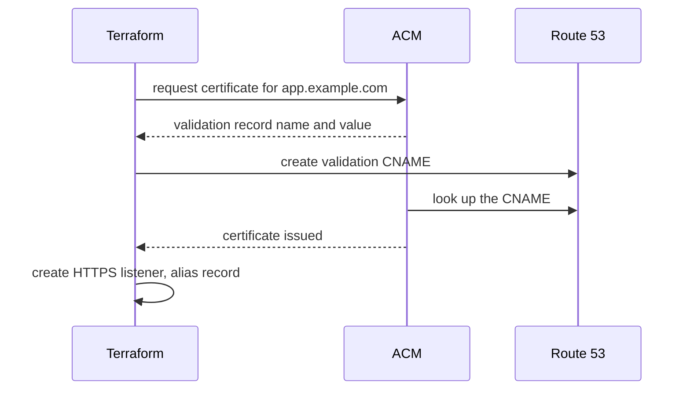

# Step 6: HTTPS and a Custom Domain

## What You'll Learn

- How ACM issues a free certificate and proves you own the domain with a DNS record
- How to make optional resources with `count` and a feature flag
- Why the validation record uses `count` and `one()` instead of the usual `for_each`
- How to redirect HTTP to HTTPS at the load balancer

This step is optional. You need a public hosted zone in Route 53 for a domain you own, such as `example.com`. If you don't have one, skip to [Step 7](07-ci-cd-with-github-actions.md). Everything else works on the ALB's HTTP address.

## How It Works



`aws_acm_certificate_validation` doesn't create anything in AWS. It waits until ACM has issued the certificate, so the HTTPS listener isn't created with a certificate that's still pending.

## Step 1: Turn It On

The resources are already in `alb.tf` and `security.tf` from steps 3 and 5, all behind `local.https`, which is true when `domain_name` is set. Uncomment the two lines in `dev.tfvars`:

```hcl
domain_name      = "app.example.com"
hosted_zone_name = "example.com"
```

When `local.https` is true:

| Resource | Change |
|---|---|
| `aws_vpc_security_group_ingress_rule.alb_https` | Opens 443 on the ALB |
| `aws_acm_certificate.app` | Requests the certificate |
| `aws_route53_record.cert_validation` | Creates the validation CNAME |
| `aws_acm_certificate_validation.app` | Waits for issuance |
| `aws_lb_listener.https` | Serves HTTPS with a TLS 1.2 and 1.3 policy |
| `aws_route53_record.app` | Points `app.example.com` at the ALB |
| `aws_lb_listener.http` | Changes from forwarding to a 301 redirect |

## Step 2: Plan and Apply

```bash
terraform plan -var-file=dev.tfvars -var "image_tag=$TAG" -out=https.tfplan
```

```text
Plan: 6 to add, 1 to change, 0 to destroy.
```

The one change is the HTTP listener's default action, updated in place. Apply it:

```bash
terraform apply https.tfplan
```

Certificate validation usually finishes in a few minutes. Then:

```bash
curl -sI http://app.example.com | head -3
curl -s https://app.example.com/
terraform output app_url
```

```text
HTTP/1.1 301 Moved Permanently
Server: awselb/2.0
Location: https://app.example.com:443/
```

## Why `count` and `one()` Here

Many examples create validation records like this:

```hcl
for_each = {
  for o in aws_acm_certificate.app.domain_validation_options : o.domain_name => o
}
```

That works with the real AWS provider, because it works out the domain names during the plan. It breaks when the values aren't known until apply: with `terraform test` mocks, with some module setups, and with names built from other resources. Terraform then refuses with `Invalid for_each argument`. This stack's own tests hit exactly that error.

With one domain there's exactly one record, so `count = local.https ? 1 : 0` is known at plan time, and `one(...)` picks the single validation option. For several names (a certificate with `subject_alternative_names`), use `for_each` keyed by the names from your variables, which are always known, and look up the validation values inside the block.

## What Most Engineers Miss

- **ACM certificates for an ALB must be in the ALB's region.** CloudFront is the exception: it needs certificates in `us-east-1`.
- **ACM renews DNS-validated certificates automatically**, as long as the validation CNAME stays in place. Delete it and renewal silently fails months later. Keep it in Terraform.
- **`create_before_destroy` on the certificate** lets you change the domain without downtime: Terraform issues the new certificate and moves the listener before deleting the old one.
- **TLS ends at the load balancer.** Traffic from the ALB to the tasks is plain HTTP inside the VPC. If your compliance rules require encryption in transit everywhere, add TLS between the ALB and the tasks too.

!!! quiz "Certificate renewal"
    A year after launch, your ACM certificate fails to renew. What's the most likely cause?

    - [ ] ACM certificates can't be renewed
    - [x] The DNS validation record was deleted
    - [ ] The ALB was restarted

    ACM re-checks the same CNAME at renewal time. Managing it in Terraform keeps it from being deleted by accident.

## Common Mistakes

- Requesting the certificate in a different region from the load balancer.
- Creating the HTTPS listener before the certificate is issued, without a validation resource to wait on.
- Keeping HTTP open without a redirect, so some users stay on plain HTTP.
- Deleting validation records during a DNS cleanup.

## Interview Questions

- How does ACM DNS validation work, and why is it better than email validation?
- Where does TLS terminate in this architecture, and what would you change for end-to-end encryption?
- How do you make a group of Terraform resources optional?

## Next

Continue to [Step 7: CI/CD With GitHub Actions](07-ci-cd-with-github-actions.md).
