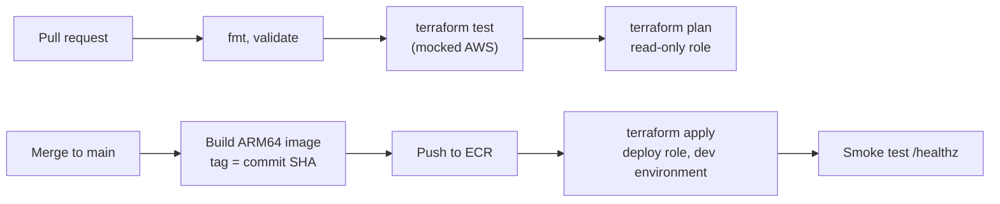

# Step 7: CI/CD With GitHub Actions

## What You'll Learn

- How GitHub Actions assumes an AWS role with OIDC, without any stored access keys
- How to give pull requests read-only access and only deploys write access
- How `terraform test` with a mocked provider checks the stack offline in seconds
- How one workflow builds the image, applies Terraform, and checks the result

## The Pipeline



## Step 1: Create the CI Roles

Re-apply the bootstrap stack with your repository name:

```bash
cd webapp/bootstrap
terraform apply -var "github_repository=your-github-user/webapp"
```

```text
Plan: 6 to add, 0 to change, 0 to destroy.
```

That adds the GitHub OIDC provider and two roles. Look at their trust policies in `bootstrap/main.tf` from step 1. Each role trusts exactly one **subject** claim from GitHub's token:

| Role | Subject it trusts | Can do |
|---|---|---|
| `webapp-github-plan` | `repo:your-github-user/webapp:pull_request` | Read everything, write the state lock file |
| `webapp-github-deploy` | `repo:your-github-user/webapp:environment:dev` | Anything: it runs `terraform apply` |

A workflow in another repository, a push to a random branch, or a fork can't assume either role, because its token carries a different subject.

!!! warning "Narrowing the deploy role"
    `AdministratorAccess` is acceptable only in an account that holds nothing but this project. To narrow it, attach a policy that allows only the services this stack uses (EC2/VPC, ELB, ECS, RDS, ECR, Logs, Secrets Manager read, Application Auto Scaling, ACM, Route 53), and add a **permissions boundary** to any IAM role Terraform creates, so the pipeline can't create a role more powerful than itself.

## Step 2: Configure GitHub

Store the role ARNs as repository **variables**. They aren't secrets: a role ARN is useless without a token that matches its trust policy.

```bash
gh variable set AWS_PLAN_ROLE_ARN   --body "$(terraform output -raw github_plan_role_arn)"
gh variable set AWS_DEPLOY_ROLE_ARN --body "$(terraform output -raw github_deploy_role_arn)"
```

Create the `dev` environment that the deploy role trusts, and restrict it to `main`:

```bash
gh api -X PUT "repos/{owner}/{repo}/environments/dev" \
  -F "deployment_branch_policy[protected_branches]=false" \
  -F "deployment_branch_policy[custom_branch_policies]=true"
gh api -X POST "repos/{owner}/{repo}/environments/dev/deployment-branch-policies" -f name=main
```

To require a human approval before each deploy, add required reviewers to the environment in **Settings**, **Environments**, **dev**.

## Step 3: The Tests

`terraform test` runs the whole stack against a **mocked** AWS provider: no credentials, no cost, a few seconds. Save this as `infra/tests/stack.tftest.hcl`:

```hcl title="infra/tests/stack.tftest.hcl"
# Runs offline with a mocked AWS provider: no credentials, no cost, a few seconds.
#   terraform test

mock_provider "aws" {
  mock_data "aws_availability_zones" {
    defaults = {
      names = ["us-east-1a", "us-east-1b", "us-east-1c"]
    }
  }

  mock_data "aws_ecr_repository" {
    defaults = {
      repository_url = "123456789012.dkr.ecr.us-east-1.amazonaws.com/webapp"
    }
  }

  mock_data "aws_iam_policy_document" {
    defaults = {
      json = "{\"Version\":\"2012-10-17\",\"Statement\":[]}"
    }
  }

  # Mocked values are random strings by default. The provider still checks ARN formats,
  # so give every resource whose ARN is passed to another resource a realistic one.
  mock_resource "aws_iam_role" {
    defaults = { arn = "arn:aws:iam::123456789012:role/mock" }
  }

  mock_resource "aws_lb" {
    defaults = { arn = "arn:aws:elasticloadbalancing:us-east-1:123456789012:loadbalancer/app/mock/0123456789abcdef" }
  }

  mock_resource "aws_lb_target_group" {
    defaults = { arn = "arn:aws:elasticloadbalancing:us-east-1:123456789012:targetgroup/mock/0123456789abcdef" }
  }

  mock_resource "aws_ecs_task_definition" {
    defaults = { arn = "arn:aws:ecs:us-east-1:123456789012:task-definition/mock:1" }
  }

  mock_resource "aws_acm_certificate" {
    defaults = {
      arn = "arn:aws:acm:us-east-1:123456789012:certificate/00000000-0000-0000-0000-000000000000"
      domain_validation_options = [{
        domain_name           = "app.example.com"
        resource_record_name  = "_x.app.example.com."
        resource_record_type  = "CNAME"
        resource_record_value = "_y.acm-validations.aws."
      }]
    }
  }

  mock_resource "aws_acm_certificate_validation" {
    defaults = { certificate_arn = "arn:aws:acm:us-east-1:123456789012:certificate/00000000-0000-0000-0000-000000000000" }
  }

  mock_resource "aws_db_instance" {
    defaults = {
      master_user_secret = [{
        secret_arn    = "arn:aws:secretsmanager:us-east-1:123456789012:secret:rds!db-test"
        kms_key_id    = "alias/aws/secretsmanager"
        secret_status = "active"
      }]
    }
  }
}

variables {
  environment = "dev"
  image_tag   = "test"
}

run "dev_is_private_and_cheap" {
  assert {
    condition     = length(aws_subnet.private) == 2 && length(aws_nat_gateway.main) == 1
    error_message = "dev should use 2 AZs and a single NAT gateway"
  }

  assert {
    condition     = aws_db_instance.main.publicly_accessible == false && aws_db_instance.main.storage_encrypted
    error_message = "the database must be private and encrypted"
  }

  assert {
    condition     = aws_ecs_service.app.network_configuration[0].assign_public_ip == false
    error_message = "app tasks must not get public IP addresses"
  }

  assert {
    condition     = aws_vpc_security_group_ingress_rule.db_from_app.referenced_security_group_id == aws_security_group.app.id
    error_message = "only the app security group may reach the database"
  }

  assert {
    condition     = aws_vpc_security_group_ingress_rule.app_from_alb.referenced_security_group_id == aws_security_group.alb.id
    error_message = "only the load balancer may reach the app"
  }

  assert {
    condition     = strcontains(aws_ecs_task_definition.app.container_definitions, "webapp:test")
    error_message = "the task must run the requested image tag"
  }

  assert {
    condition = (
      !contains([for e in jsondecode(aws_ecs_task_definition.app.container_definitions)[0].environment : e.name], "DB_PASSWORD")
      && contains([for s in jsondecode(aws_ecs_task_definition.app.container_definitions)[0].secrets : s.name], "DB_PASSWORD")
    )
    error_message = "the database password must come from secrets, never from plain environment variables"
  }

  assert {
    condition     = aws_db_instance.main.deletion_protection == false
    error_message = "dev databases should be easy to tear down"
  }

  assert {
    condition     = startswith(output.app_url, "http://")
    error_message = "without a domain name the app is served over plain HTTP on the ALB"
  }
}

run "prod_protects_data" {
  variables {
    environment        = "prod"
    single_nat_gateway = false
    db_multi_az        = true
  }

  assert {
    condition     = aws_db_instance.main.deletion_protection && !aws_db_instance.main.skip_final_snapshot
    error_message = "production databases need deletion protection and a final snapshot"
  }

  assert {
    condition     = length(aws_nat_gateway.main) == 2
    error_message = "production should have one NAT gateway per AZ"
  }
}

run "https_when_domain_is_set" {
  variables {
    domain_name      = "app.example.com"
    hosted_zone_name = "example.com"
  }

  override_data {
    target = data.aws_route53_zone.main[0]
    values = { zone_id = "Z0123456789ABCDEFGHIJ" }
  }

  assert {
    condition     = aws_lb_listener.http.default_action[0].type == "redirect"
    error_message = "HTTP should redirect to HTTPS when a domain is set"
  }

  assert {
    condition     = length(aws_lb_listener.https) == 1 && output.app_url == "https://app.example.com"
    error_message = "an HTTPS listener should serve the custom domain"
  }
}

run "rejects_unknown_environment" {
  command = plan

  variables {
    environment = "qa"
  }

  expect_failures = [var.environment]
}
```

```bash
cd ../infra
terraform test
```

```text
tests/stack.tftest.hcl... in progress
  run "dev_is_private_and_cheap"... pass
  run "prod_protects_data"... pass
  run "https_when_domain_is_set"... pass
  run "rejects_unknown_environment"... pass
tests/stack.tftest.hcl... tearing down
tests/stack.tftest.hcl... pass

Success! 4 passed, 0 failed.
```

The tests check the properties that matter, not the syntax: tasks have no public IPs, the database is private and encrypted, each security group only accepts the group in front of it, the password comes from secrets, production keeps its data, HTTPS turns on with a domain, and an invalid environment is rejected.

Two things to know about mocks:

- **Mocked values are random strings.** The AWS provider still checks that ARNs look like ARNs, so the `mock_resource` blocks give realistic ARNs to resources whose ARN is passed to another resource.
- **Mocks prove your logic, not AWS's behaviour.** They can't tell you that an instance class doesn't exist or that a quota is exceeded. That's what the plan job and the dev environment are for.

## Step 4: The Workflow

Save this as `.github/workflows/deploy.yml` at the repository root:

```yaml title=".github/workflows/deploy.yml"
name: Deploy web app

on:
  pull_request:
    paths: ["app/**", "infra/**", ".github/workflows/deploy.yml"]
  push:
    branches: [main]
    paths: ["app/**", "infra/**", ".github/workflows/deploy.yml"]

permissions:
  contents: read

# Never run two applies against the same state at once, and never cancel one half-way.
concurrency:
  group: deploy-dev
  cancel-in-progress: false

env:
  AWS_REGION: us-east-1
  TF_IN_AUTOMATION: "true"
  TF_VERSION: "1.13.3"

jobs:
  plan:
    if: github.event_name == 'pull_request'
    runs-on: ubuntu-24.04
    permissions:
      contents: read
      id-token: write # lets the job request an OIDC token for AWS
    defaults:
      run:
        working-directory: infra
    steps:
      - uses: actions/checkout@v7

      - uses: aws-actions/configure-aws-credentials@v6
        with:
          role-to-assume: ${{ vars.AWS_PLAN_ROLE_ARN }}
          aws-region: ${{ env.AWS_REGION }}

      - uses: hashicorp/setup-terraform@v4
        with:
          terraform_version: ${{ env.TF_VERSION }}
          terraform_wrapper: false # plain stdout, so $(terraform output -raw ...) works

      - run: terraform fmt -check -recursive
      - run: terraform init -input=false -backend-config=backend.hcl
      - run: terraform validate
      - run: terraform test
      - run: terraform plan -input=false -var-file=dev.tfvars -var "image_tag=${{ github.sha }}"

  deploy:
    if: github.event_name == 'push'
    runs-on: ubuntu-24.04-arm # builds the ARM64 image natively, no emulation
    environment: dev          # must match the deploy role's trust policy
    permissions:
      contents: read
      id-token: write
    steps:
      - uses: actions/checkout@v7

      - uses: aws-actions/configure-aws-credentials@v6
        with:
          role-to-assume: ${{ vars.AWS_DEPLOY_ROLE_ARN }}
          aws-region: ${{ env.AWS_REGION }}

      - id: ecr
        uses: aws-actions/amazon-ecr-login@v2

      - uses: docker/setup-buildx-action@v4

      - uses: docker/build-push-action@v7
        with:
          context: app
          platforms: linux/arm64
          push: true
          tags: ${{ steps.ecr.outputs.registry }}/webapp:${{ github.sha }}

      - uses: hashicorp/setup-terraform@v4
        with:
          terraform_version: ${{ env.TF_VERSION }}
          terraform_wrapper: false # plain stdout, so $(terraform output -raw ...) works

      - name: Terraform apply
        working-directory: infra
        run: |
          terraform init -input=false -backend-config=backend.hcl
          terraform apply -input=false -auto-approve -var-file=dev.tfvars -var "image_tag=${{ github.sha }}"

      - name: Smoke test
        working-directory: infra
        run: |
          url=$(terraform output -raw app_url)
          curl --fail --silent --show-error --retry 5 --retry-delay 5 "$url/healthz"
```

How it fits together:

- **`id-token: write`** lets a job request an OIDC token. `configure-aws-credentials` exchanges it for temporary credentials for the role. Nothing long-lived is stored anywhere.
- **The plan job** runs on pull requests with the read-only role. Run `terraform test` before `plan`: it's cheaper, and it catches broken rules without calling AWS.
- **The deploy job** runs only on pushes to `main`, in the `dev` environment, which is what the deploy role's trust policy requires.
- **The image tag is the commit SHA**, the same for the image in ECR and the `image_tag` passed to Terraform. Every deploy is traceable to a commit.
- **`concurrency` with `cancel-in-progress: false`** queues deploys instead of cancelling one mid-apply. A half-finished apply is much worse than a slow queue.
- **`terraform_wrapper: false`** stops `setup-terraform` from wrapping the binary, so `$(terraform output -raw app_url)` returns just the value.
- **The smoke test** calls `/healthz` through the load balancer after the apply. `wait_for_steady_state` already waited for healthy targets, so this checks the public path end to end.

!!! note "ARM64 runners"
    `ubuntu-24.04-arm` builds the ARM64 image natively. If ARM runners aren't available for your repository, use `ubuntu-24.04`, add `docker/setup-qemu-action@v4` before Buildx, and keep `platforms: linux/arm64`. The build is slower under emulation. Alternatively set `cpu_architecture = "X86_64"` and build `linux/amd64`.

## Step 5: Ship a Change

Commit everything and push to `main`. Then make a visible change on a branch:

```bash
git switch -c bigger-heading
sed -i.bak 's/<h1>Hello from Terraform on AWS<\/h1>/<h1>Hello from Terraform on AWS, via CI<\/h1>/' app/app.py && rm app/app.py.bak
git commit -am "Change the heading" && git push -u origin bigger-heading
gh pr create --fill
```

The pull request runs the plan job. The plan should show one task definition replaced and the service updated in place, because only `image_tag` changed. Merge it, and watch the deploy job build, push, apply, and smoke-test. Then:

```bash
curl -s "$(cd infra && terraform output -raw app_url)/"
```

The page shows the new heading and the new commit SHA as the version.

## What Most Engineers Miss

- **The plan you review isn't the plan you apply.** This workflow plans on the pull request and plans again at deploy time. If `main` changed in between, the deploy applies something nobody reviewed. Teams that need stronger guarantees save the plan as an artifact and apply that exact file, or require branches to be up to date before merging.
- **OIDC trust conditions are the security boundary.** A trust policy with `StringLike` and `repo:your-org/*` lets every repository in the organization deploy. Be as specific as you can.
- **Read-only isn't harmless.** `ReadOnlyAccess` can read S3 objects, including state. State can contain sensitive values, so treat the plan role as sensitive too.
- **Lock files belong in Git.** Commit `infra/.terraform.lock.hcl`, so CI uses exactly the provider versions you tested.

!!! quiz "OIDC subjects"
    The deploy role trusts `repo:acme/webapp:environment:dev`. A contributor opens a pull request that edits the workflow to use the deploy role in the plan job. What happens?

    - [ ] The plan job gets admin access
    - [x] Role assumption fails: a pull request job's token has the subject `repo:acme/webapp:pull_request`
    - [ ] GitHub blocks the workflow edit

    The trust policy checks the token's subject claim, which GitHub sets from the event and environment, not from the workflow file.

!!! quiz "Concurrency"
    Why set `cancel-in-progress: false` on the deploy concurrency group?

    - [ ] To save runner minutes
    - [x] Cancelling a running `terraform apply` can leave resources half-created and the state lock held
    - [ ] GitHub requires it for environments

    Let applies finish. Queue the next one.

## Common Mistakes

- Storing AWS access keys as GitHub secrets instead of using OIDC.
- One role for both plan and apply, so every pull request runs with admin credentials.
- Trust policies that match any branch, any repository, or any environment.
- Skipping `terraform test` because "the plan will catch it".
- Tagging CI images `latest`, so the deployed version can't be traced to a commit.

## Interview Questions

- How does GitHub Actions authenticate to AWS without stored credentials?
- How would you design IAM roles for Terraform plan and apply in CI?
- What does `terraform test` with `mock_provider` test, and what can't it test?
- How do you make sure the plan that was reviewed is the plan that gets applied?

## Next

Continue to [Step 8: Operate, Troubleshoot, and Destroy](08-operate-and-destroy.md).
