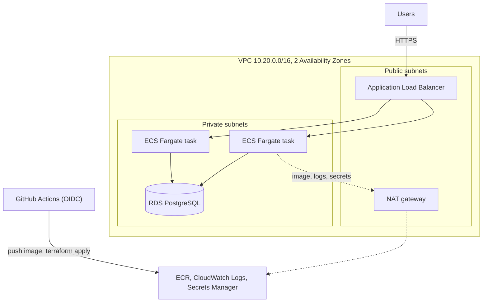

# Project: Deploy a Web App on AWS With Terraform

The rest of the Terraform section teaches concepts one at a time. This project puts them together: you deploy a real web application to AWS, from an empty account to a load-balanced, autoscaling service with a database, HTTPS, and a deployment pipeline. Every line of Terraform is on these pages, and you apply it in stages so you can see each layer work before adding the next.

## What You'll Build



| Layer | AWS service | Page |
|---|---|---|
| State, image registry, CI roles | S3, ECR, IAM OIDC | [1. Bootstrap](01-bootstrap.md) |
| The application | A Python web app in a container | [2. App and image](02-app-and-image.md) |
| Network and firewall | VPC, subnets, NAT, security groups | [3. Network](03-network-and-security.md) |
| Data | RDS PostgreSQL, Secrets Manager | [4. Database](04-database.md) |
| Compute and traffic | ECS Fargate, ALB, autoscaling, CloudWatch | [5. Load balancer and ECS](05-load-balancer-and-ecs.md) |
| Custom domain | ACM, Route 53 | [6. HTTPS](06-https-and-custom-domain.md) |
| Delivery | GitHub Actions, `terraform test` | [7. CI/CD](07-ci-cd-with-github-actions.md) |
| Day 2 | Deploys, scaling, drift, teardown | [8. Operate and destroy](08-operate-and-destroy.md) |

The application is deliberately small: a page counter that writes to PostgreSQL and shows which task served the request. Small enough to read in a minute, real enough to need a network, a database, secrets, health checks, and rolling deploys.

## Design Decisions

| Decision | Why |
|---|---|
| **ECS Fargate**, not EC2 or Kubernetes | No servers to patch. The [Kubernetes](../../kubernetes/index.md) section covers EKS when you need it. |
| **Private subnets** for tasks and the database | Nothing but the load balancer is reachable from the internet. |
| **Security groups that reference each other** | The database accepts traffic from the app's security group, not from an IP range. |
| **RDS-managed master password** | The password lives in Secrets Manager and never appears in code, state, or the task definition. |
| **ARM64 (Graviton)** | Cheaper per vCPU on Fargate, and Apple silicon laptops build ARM64 images natively. |
| **Plain resources, no community modules** | You see every resource. The last page shows how to split them into [modules](../modules.md). |
| **S3 state with native locking** | Terraform 1.10 and later lock state with a lock file in the bucket, so no DynamoDB table is needed. |

## Cost

This deploys billable resources. Approximate `us-east-1` on-demand prices for the dev configuration:

| Resource | Approx. per hour |
|---|---|
| NAT gateway | $0.045, plus $0.045 per GB processed |
| Application Load Balancer | $0.0225, plus capacity units |
| 2 Fargate tasks, 0.25 vCPU and 0.5 GB, ARM64 | $0.02 |
| RDS `db.t4g.micro`, 20 GB gp3 | $0.02 |
| 3 public IPv4 addresses (ALB and NAT) | $0.015 |
| **Total** | **About $0.12 per hour, roughly $3 a day** |

Run it for an afternoon, then destroy it ([page 8](08-operate-and-destroy.md)). Leaving it up for a month costs around $90. Check current prices in the [AWS Pricing Calculator](https://calculator.aws/), and set a budget alert before you start.

## Prerequisites

- An AWS account you can experiment in. A separate sandbox account in an AWS Organization is ideal. Don't use an account that runs production.
- AWS CLI v2, signed in: `aws sts get-caller-identity` should print your account and role.
- Terraform 1.10 or later. These pages were tested with Terraform 1.13 and AWS provider 6.71.
- Docker, to build the image.
- Comfort with the [Terraform fundamentals](../overview.md), [state and backends](../state-and-backends.md), and the [AWS networking basics](../../cloud/aws/03-vpc-networking.md).

## Repository Layout

By the end, your repository looks like this:

```text
webapp/
├── app/                      # the web application
│   ├── app.py
│   ├── requirements.txt
│   ├── Dockerfile
│   └── compose.yaml          # run it locally with PostgreSQL
├── bootstrap/                # one-time: state bucket, ECR, CI roles (local state)
│   └── main.tf
├── infra/                    # the application stack (remote state)
│   ├── versions.tf
│   ├── variables.tf
│   ├── main.tf
│   ├── network.tf
│   ├── security.tf
│   ├── database.tf
│   ├── alb.tf
│   ├── ecs.tf
│   ├── outputs.tf
│   ├── backend.hcl
│   ├── dev.tfvars
│   └── tests/stack.tftest.hcl
├── .github/workflows/deploy.yml
└── .gitignore
```

## Next

Start with [Step 1: Bootstrap State, Registry, and CI Access](01-bootstrap.md).
